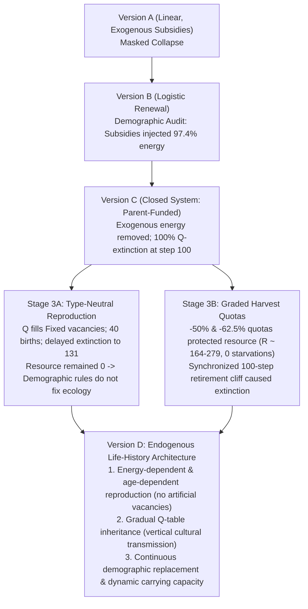

# Project Master Research Lineage & Model Progression

This document provides a single, authoritative reference for the experimental and architectural evolution of the study:
**Adaptive Agents in a Shared Resource Ecosystem: Endogenous Turnover and Ecological Resilience.**

---

## 1. Master Model Lineage Table

| Version / Stage | Architecture & Primary Mechanism | Key Empirical Finding & Scientific Interpretation | Status | Key Reports & Manifests |
| :--- | :--- | :--- | :---: | :--- |
| **Version A** (`sim-1.0.0`) | Baseline linear renewal, unconstrained harvesting, exogenous newborn energy ($E_0=10.0$ injected). | Fixed agents sustained apparent stability, masking tragedy of the commons in Q-agents ($R \to 0$). Demographic subsidy concealed ecological collapse. | **Frozen** | [Release Lock](file:///Users/nish/home/Research%20Project/simulator/release_lock.json)<br>[README](file:///Users/nish/home/Research%20Project/simulator/README.md) |
| **Version B** (`sim-2.0.0`) | Logistic renewal ($G(R) = gR(1 - R/K)$). Explored state perception (`B2-A`), reward penalties (`B2-B`), and demographic subsidies (`B2-C`). | Demographic audit proved exogenous newborn subsidies injected $97.4\%$ of total energy ($16,110$ units), masking collapse. Removing subsidy caused $10/10$ extinctions. Formally rejected baseline. | **Frozen** | [Stage 1 Failure Report](file:///Users/nish/home/Research%20Project/calibration_logs/stage1_baseline_failure_report.md)<br>[B2-C Demographic Report](file:///Users/nish/home/Research%20Project/calibration_logs/b2c_demographic_rules_report.md)<br>[Stage 2 Audit](file:///Users/nish/home/Research%20Project/calibration_logs/stage2_synthesis_audit_report.md) |
| **Version C** (`sim-3.0.0`) | Closed thermodynamic system: parent-funded reproduction ($E_{\text{cost}}=10.0$ deducted from parent, strictly $E>10.0$ required, $\Delta E=0.0$). Strict vacancy quota. | Confirmed $100\%$ Q-agent extinction at step 100 without subsidies. Mechanism experiments (`C2-A` rewards, `C2-B` learning, `C2-C` mixtures) proved tragedy of the commons is robust to minor reward shaping. | **Frozen** | [Stage 1 Calibration Report](file:///Users/nish/home/Research%20Project/calibration_logs/version_c/stage1_calibration_report.md)<br>[Stage 1 Audit](file:///Users/nish/home/Research%20Project/calibration_logs/version_c/stage1_audit_report.md)<br>[Stage 2 Synthesis](file:///Users/nish/home/Research%20Project/calibration_logs/version_c/stage2_audit_correction_report.md) |
| **Stage 3A** | **Mechanism Isolation: Type-Neutral Reproduction** (Living Q-parents with $E > 10.0$ permitted to fill Fixed-quota vacancies). | Enabled 40 births across 5 runs; extended survival from 100 to 115.5 steps (starvation cliff at 131). Resource remained at $R=0$. Proved demographic rules contribute to extinction timing, but do not cause ecological collapse. | **Complete / Frozen** | [Stage 3A Execution Report](file:///Users/nish/home/Research%20Project/calibration_logs/version_c/stage3/exp3a_execution_report.md)<br>[Control Summary](file:///Users/nish/home/Research%20Project/results_v3/stage3_mechanism_isolation/exp3a/control_summary.csv)<br>[Treatment Summary](file:///Users/nish/home/Research%20Project/results_v3/stage3_mechanism_isolation/exp3a/treatment_summary.csv) |
| **Stage 3B** | **Mechanism Isolation: Graded Harvest Quotas** (Universal action scaling: Control, $-25\%$, $-50\%$, $-62.5\%$). | Quotas of $-50\%$ (B) and $-62.5\%$ (C) completely eliminated resource depletion ($0/10$ runs $R<1$) and eliminated starvation ($0$ deaths). All populations still extinct at step 100 due to synchronized founder retirement. | **Complete / Frozen** | [Stage 3B Plan](file:///Users/nish/home/Research%20Project/calibration_logs/version_c/stage3/stage3b_experimental_plan.md)<br>[Stage 3B Execution Report](file:///Users/nish/home/Research%20Project/calibration_logs/version_c/stage3/exp3b_execution_report.md)<br>[Execution Manifest](file:///Users/nish/home/Research%20Project/results_v3/stage3_mechanism_isolation/exp3b/exp3b_execution_manifest.csv) |
| **Stage 3C** | **Mechanism Isolation: Age-Structure Investigation** (Distributed founder cohorts). | Conceptual bridge: investigates whether initial age dispersion enables continuous generational replacement under sustainable harvest quotas. | **Proposed, Not Executed** | Documented conceptually in Stage 3B report |
| **Version D** (`sim-4.0.0`) | **Unified Endogenous Architecture:** Energy-dependent, age-dependent reproduction with gradual Q-table inheritance. No artificial population cap ($N_{t+1}=N_t+B_t-D_t$). | Calibration completed across 10 seeds (1001–1010). Broke through the step-100 demographic cliff (mean survival: 141.7 steps); 199 Q-births; population peaked at 69.9 agents (+40% bloom); Malthusian commons overshoot emerged organically. Post-audit reconciled with raw CSV data. Research readiness audit, required design decisions, comprehensive design review, and final design blockers completed. | **Audited (Design Review Complete)** | [Model Specification](file:///Users/nish/home/Research%20Project/calibration_logs/version_d/version_d_model_specification.md)<br>[Stage 1 Calibration Report](file:///Users/nish/home/Research%20Project/calibration_logs/version_d/stage1_calibration_report.md)<br>[Audit Corrections Report](file:///Users/nish/home/Research%20Project/calibration_logs/version_d/version_d_stage1_audit_corrections.md)<br>[Research Readiness Audit](file:///Users/nish/home/Research%20Project/calibration_logs/version_d/version_d_research_readiness_audit.md)<br>[Design Decisions Required](file:///Users/nish/home/Research%20Project/calibration_logs/version_d/version_d_design_decisions_required.md)<br>[Final Design Review](file:///Users/nish/home/Research%20Project/calibration_logs/version_d/version_d_research_design_review.md)<br>[Final Design Blockers](file:///Users/nish/home/Research%20Project/calibration_logs/version_d/version_d_final_design_blockers.md) |

---

## 2. Core Scientific Trajectory & Cumulative Lessons



### Cumulative Key Discoveries:
1. **The Demographic Subsidy Artifact (Version B Audit):** In standard ecological simulators, fixed newcomer endowments ($E_0 = 10$) often act as massive exogenous energy injections that keep artificial agent populations alive even when the environment has collapsed to total ruin.
2. **The Decoupling of Demographic Persistence and Ecological Sustainability (Stage 3A):** Allowing unconstrained demographic turnover enables populations to burn accumulated generational energy slightly longer (extending survival from step 100 to 131), but cannot compensate for an exhausted resource stock.
3. **The Commons Collapse Threshold (Stage 3B):** When per-capita extraction capacity is constrained such that aggregate demand remains below ecological replenishment rates ($G_{\max} = 12.5$), resource collapse is 100% prevented and starvation drops to zero.
4. **The Synchronized Age Artifact (Stage 3B Audit):** In cohort models where all founders start at age 0 and reproduction only triggers upon vacancy, preventing starvation creates an artificial "demographic cliff" where zero reproduction occurs before step 100, causing total extinction when founders retire simultaneously.

---

## 3. Directory Layout & Repository Organization

The repository is structured to maintain strict separation between frozen historical baselines, mechanism isolation experiments, and future model versions:

```text
Research Project/
├── README.md                                          <- Project Overview & Navigation Index
├── MASTER_RESEARCH_LINEAGE.md                         <- This document (Core Roadmap)
├── docs/                                              <- Research Documentation & Protocols
│   ├── README.md
│   └── research_protocol/                             <- Foundational Protocols (01 through 06)
│
├── simulator/                                         <- [FROZEN] Version A (sim-1.0.0)
│   ├── simulator.py
│   └── results/
│
├── simulator_v2/                                      <- [FROZEN] Version B (sim-2.0.0)
│   ├── simulator.py
│   └── experiments/ (b2a, b2b, b2c)
├── results_v2/                                        <- [FROZEN] Version B output CSVs
│
├── simulator_v3/                                      <- [FROZEN] Version C (sim-3.0.0)
│   ├── simulator.py, agents.py, reproduction.py
│   ├── experiments/ (c2a, c2b, c2c)
│   └── experiments/stage3/                           <- Stage 3 Mechanism Experiments
│       ├── exp3a_type_neutral_reproduction.py
│       ├── exp3b_harvest_quotas.py
│       └── tests/
├── results_v3/                                        <- [FROZEN] Version C output CSVs
│   ├── calibration/
│   ├── stage2_mechanism/
│   └── stage3_mechanism_isolation/ (exp3a, exp3b)
│
├── calibration_logs/                                  <- Master Audit & Experimental Reports
│   ├── version_b/                                    <- Version B failure analysis & synthesis audits
│   ├── version_c/                                    <- Version C calibration & Stage 2
│   │   └── stage3/                                   <- Stage 3A & 3B reports & plans
│   └── version_d/                                    <- Version D specification & audits
│
└── simulator_v4/                                      <- [NEXT] Version D Implementation
    └── (To be built under Version D Specification)
```

