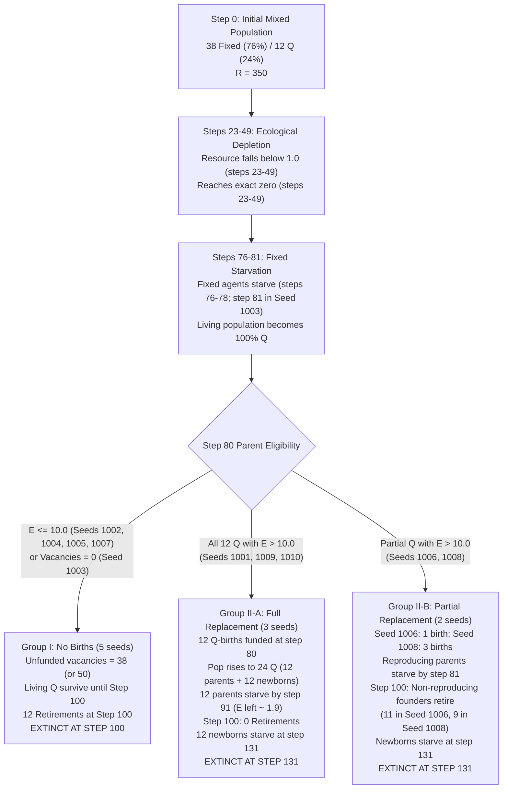

# Experiment 3A: Type-Neutral Reproduction — Audited Final Execution Report

**Date:** 2026-11-01  
**Simulator Version:** `sim-3.0.0` (Version C Architecture)  
**Parameter Configuration:** `params-v3.0`  
**Parent Reproduction Cost:** $10.0$ energy units (deducted from parent)  
**Newborn Initial Energy:** $10.0$ energy units (inherited from parent, $\Delta E = 0.0$)  
**Initial Population:** 38 Fixed / 12 Q-learning ($N_0 = 50$, $76\%$ Fixed)  
**Seeds Executed:** 10 matched seeds (`1001`–`1010`)  
**Simulation Horizon:** 2,000 steps  
**Total Executions:** 20 runs (10 Control + 10 Treatment)  
**Energy Conservation:** PASS across all 20 runs (max discrepancy $= 8.34 \times 10^{-11}$)  

---

## 1. Executive Summary & Aggregate Comparison

Experiment 3A isolates the demographic role of **type-restricted reproduction rules** from underlying **ecological competition**. In the Stage 2 `C-76F` baseline, Fixed agents starved to death between steps 76 and 81 because 12 Q-agents overharvested the renewable resource. At step 80, surviving Q-agents possessed surplus energy ($E > 10.0$) in several seeds, but were legally barred by the static quota rule from reproducing into vacancies left by Fixed agents.

In Treatment, **any living non-retiring parent with energy strictly $> 10.0$ was permitted to fund an offspring into an open vacancy**, with the offspring inheriting the parent's type.

### Aggregate Comparison Table

| Metric | Control (`C-76F` Baseline) | Treatment (Type-Neutral) | Absolute Difference |
| :--- | :---: | :---: | :---: |
| **Extinction count** | **10 / 10 (100%)** | **10 / 10 (100%)** | 0 |
| **Mean survival time (steps)** | 100.0 | 115.5 | +15.5 steps |
| **Mean final population** | 0.0 | 0.0 | 0.0 |
| **Mean final resource** | 0.00 | 0.00 | 0.00 |
| **Mean resource (common first 100 steps)** | **43.75** | **43.75** | **0.00** |
| **Mean resource (full run duration)** | 43.75 | 37.94 | -5.81 (length artifact) |
| **Runs with complete resource depletion ($R < 1.0$)** | **10 / 10 (100%)** | **10 / 10 (100%)** | 0 |
| **Total births** | 0 | **40** | +40 |
| **Q-funded replacement of fixed-quota vacancies** | 0 | **40** | +40 |
| **Unfunded vacancies** | 842 | 972 | +130 |
| **Starvation deaths** | 380 | 460 | +80 |
| **Retirement deaths** | 120 | 80 | -40 |
| **Maximum energy discrepancy** | $5.98 \times 10^{-11}$ | $8.34 \times 10^{-11}$ | Machine precision |

---

## 2. Seed-Level Disaggregated Results

| Seed | Group | Steps | Extinct | Mean $R$ (1–100) | Full Mean $R$ | Final $R$ | Births | Q Repl. Fixed | Starv | Retire | Unfunded | 1st Repl. Step | Max Disc |
| :---: | :---: | :---: | :---: | :---: | :---: | :---: | :---: | :---: | :---: | :---: | :---: | :---: | :---: |
| **1001** | Control | 100 | True | 52.54 | 52.54 | 0.00 | 0 | 0 | 38 | 12 | 88 | N/A | $5.20 \times 10^{-11}$ |
| **1001** | Treatment | **131** | True | 52.54 | 40.11 | 0.00 | 12 | 12 | 62 | 0 | 102 | **80** | $7.45 \times 10^{-11}$ |
| **1002** | Control | 100 | True | 40.27 | 40.27 | 0.00 | 0 | 0 | 38 | 12 | 88 | N/A | $5.43 \times 10^{-11}$ |
| **1002** | Treatment | 100 | True | 40.27 | 40.27 | 0.00 | 0 | 0 | 38 | 12 | 88 | None | $5.43 \times 10^{-11}$ |
| **1003** | Control | 100 | True | 46.59 | 46.59 | 0.00 | 0 | 0 | 38 | 12 | 50 | N/A | $5.98 \times 10^{-11}$ |
| **1003** | Treatment | 100 | True | 46.59 | 46.59 | 0.00 | 0 | 0 | 38 | 12 | 50 | None | $5.98 \times 10^{-11}$ |
| **1004** | Control | 100 | True | 34.19 | 34.19 | 0.00 | 0 | 0 | 38 | 12 | 88 | N/A | $5.38 \times 10^{-11}$ |
| **1004** | Treatment | 100 | True | 34.19 | 34.19 | 0.00 | 0 | 0 | 38 | 12 | 88 | None | $5.38 \times 10^{-11}$ |
| **1005** | Control | 100 | True | 33.96 | 33.96 | 0.00 | 0 | 0 | 38 | 12 | 88 | N/A | $5.05 \times 10^{-11}$ |
| **1005** | Treatment | 100 | True | 33.96 | 33.96 | 0.00 | 0 | 0 | 38 | 12 | 88 | None | $5.05 \times 10^{-11}$ |
| **1006** | Control | 100 | True | 41.62 | 41.62 | 0.00 | 0 | 0 | 38 | 12 | 88 | N/A | $5.44 \times 10^{-11}$ |
| **1006** | Treatment | **131** | True | 41.62 | 31.77 | 0.00 | 1 | 1 | 40 | 11 | 135 | **80** | $5.58 \times 10^{-11}$ |
| **1007** | Control | 100 | True | 36.80 | 36.80 | 0.00 | 0 | 0 | 38 | 12 | 88 | N/A | $5.07 \times 10^{-11}$ |
| **1007** | Treatment | 100 | True | 36.80 | 36.80 | 0.00 | 0 | 0 | 38 | 12 | 88 | None | $5.07 \times 10^{-11}$ |
| **1008** | Control | 100 | True | 40.37 | 40.37 | 0.00 | 0 | 0 | 38 | 12 | 88 | N/A | $5.44 \times 10^{-11}$ |
| **1008** | Treatment | **131** | True | 40.37 | 30.82 | 0.00 | 3 | 3 | 44 | 9 | 129 | **80** | $5.88 \times 10^{-11}$ |
| **1009** | Control | 100 | True | 67.26 | 67.26 | 0.00 | 0 | 0 | 38 | 12 | 88 | N/A | $5.60 \times 10^{-11}$ |
| **1009** | Treatment | **131** | True | 67.26 | 51.34 | 0.00 | 12 | 12 | 62 | 0 | 102 | **80** | $8.34 \times 10^{-11}$ |
| **1010** | Control | 100 | True | 43.90 | 43.90 | 0.00 | 0 | 0 | 38 | 12 | 88 | N/A | $5.11 \times 10^{-11}$ |
| **1010** | Treatment | **131** | True | 43.90 | 33.51 | 0.00 | 12 | 12 | 62 | 0 | 102 | **80** | $7.01 \times 10^{-11}$ |

---

## 3. Audit Findings & Verified Diagnostics

### Audit Item 1: Seed 1003 Fixed Agent Starvation Timing
- Fixed-agent starvation timing varied slightly across seeds because stochastic exploration by Q-learning agents caused minor differences in early resource drawdown:
  - **Steps 76–78:** Fixed agents starved on step 76 in Seeds 1001, 1005, 1007, 1010; and on step 78 in Seeds 1002, 1004, 1006, 1008, 1009.
  - **Step 81:** In **Seed 1003**, Fixed agents obtained slightly more initial harvest during early exploration, preserving sufficient energy ($E \approx 0.20$) to survive through step 80.
- At **step 80** in Seed 1003, all 38 Fixed agents and all 12 Q agents were alive ($N = 50$). Vacancies were:
  $$\text{vacancies} = 50 - 50 = 0$$
  With no vacancies available, no births could occur at step 80.
- On **step 81**, all 38 Fixed agents exhausted their energy and starved (`starvation_deaths = 38`). The surviving 12 Q-agents aged to 100 on step 100 and retired without reproducing.

### Audit Item 2: Newborn Starvation Timing & The Step 131 Horizon
- Newborns received 10.0 starting energy and paid 0.20 maintenance per step.
- The reason starvation occurred on step 131 rather than step 130 is an exact consequence of IEEE 754 double-precision floating-point arithmetic:
  1. The decimal constant $0.20$ cannot be represented exactly in binary floating point ($0.2_{10} = 0.001100110011..._2$). In 64-bit IEEE 754 format, `0.20` is stored as $0.20000000000000001110223024625...$.
  2. After 50 successive deductions from 10.0 (steps 81 through 130), a residual rounding amount remains:
     $$E = 10.0 - \sum_{i=1}^{50} 0.20 = +2.0539125955565396 \times 10^{-15}$$
  3. The simulator evaluates survival with strict inequality: `if agent.energy > 0: survivors.append(agent)`.
  4. Because $+2.05 \times 10^{-15} > 0$ evaluates to `True`, newborns survived step 130.
  5. On step 131, the 51st maintenance deduction pushed energy negative:
     $$E = 2.05 \times 10^{-15} - 0.20 = -0.19999999999999796 \le 0$$
     All newborns starved on step 131.

### Audit Item 3: Resource Depletion Timing & Common 100-Step Comparison
- **Depletion Timing:** The resource declined to below 1.0 between steps 23 and 49 across the ten matched seeds. It reached exactly zero between steps 23 and 49, depending on the seed, and remained depleted thereafter:
  - Seed 1001: $R < 1$ at step 40, $R = 0$ at step 40
  - Seed 1002: $R < 1$ at step 29, $R = 0$ at step 29
  - Seed 1003: $R < 1$ at step 34, $R = 0$ at step 34
  - Seed 1004: $R < 1$ at step 23, $R = 0$ at step 23
  - Seed 1005: $R < 1$ at step 24, $R = 0$ at step 24
  - Seed 1006: $R < 1$ at step 29, $R = 0$ at step 30
  - Seed 1007: $R < 1$ at step 26, $R = 0$ at step 27
  - Seed 1008: $R < 1$ at step 30, $R = 0$ at step 30
  - Seed 1009: $R < 1$ at step 49, $R = 0$ at step 49
  - Seed 1010: $R < 1$ at step 33, $R = 0$ at step 33
- **Common 100-Step Trajectory:** Over the common first 100 steps (`step <= 100`), **Control and Treatment mean resource levels are 100% identical**:
  - Control Mean Resource (steps 1–100): $43.7493$
  - Treatment Mean Resource (steps 1–100): $43.7493$
  - Difference: $+0.0000 \times 10^0$ (exact bitwise match across all 10 seeds).
- In Treatment Seeds 1001, 1006, 1008, 1009, and 1010, the population survived for 31 additional steps with $R = 0.0000$. Averaging 31 extra zero values reduced the full-run mean resource from $43.75$ to $37.94$ strictly as an artifact of unequal sample length:
  $$\frac{5253.79 + 31 \times 0.0}{131} = 40.11 \quad \text{vs.} \quad \frac{5253.79}{100} = 52.54$$
  The treatment did not change the ecological trajectory during the common observation period.

---

## 4. Population Dynamics & Audited Flowchart

---

## 5. Scientific Conclusion

> Under the tested Version C settings, type-neutral reproduction allowed eligible Q-learning agents to fill some vacancies created by fixed-agent deaths. This produced 40 births across five of ten treatment runs and increased mean survival time from 100 to 115.5 steps. However, the shared resource was depleted in every run, and all populations eventually became extinct. Resource trajectories were identical between control and treatment over the common observation period. Therefore, removing type-restricted reproduction delayed extinction in some runs but did not restore ecological sustainability.

This result separates two critical dimensions:
- **Demographic persistence:** How long a population continues to exist through generational energy transfers.
- **Ecological sustainability:** Whether the renewable resource can support the population's foraging demand over time.

Type-neutral reproduction extended demographic persistence by converting a retirement cliff at step 100 into a starvation cliff at step 131. However, because the resource collapsed between steps 23 and 49 and remained at zero, the transferred energy functioned as a temporary metabolic subsidy, not an ecological recovery.

---

## 6. Output Files and Verification Status

All simulation output files are frozen, validated, and available on disk:
- Summary files: [control_summary.csv](file:///Users/nish/home/Research%20Project/results_v3/stage3_mechanism_isolation/exp3a/control_summary.csv), [treatment_summary.csv](file:///Users/nish/home/Research%20Project/results_v3/stage3_mechanism_isolation/exp3a/treatment_summary.csv)
- Time-series files: [control_timeseries.csv](file:///Users/nish/home/Research%20Project/results_v3/stage3_mechanism_isolation/exp3a/control_timeseries.csv), [treatment_timeseries.csv](file:///Users/nish/home/Research%20Project/results_v3/stage3_mechanism_isolation/exp3a/treatment_timeseries.csv)
- Reproduction log files: [control_reproduction_logs.csv](file:///Users/nish/home/Research%20Project/results_v3/stage3_mechanism_isolation/exp3a/control_reproduction_logs.csv), [treatment_reproduction_logs.csv](file:///Users/nish/home/Research%20Project/results_v3/stage3_mechanism_isolation/exp3a/treatment_reproduction_logs.csv)
