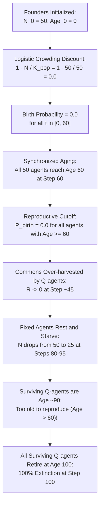

# Calibration Audit Report: Version D.1 Dedicated Calibration Batch (Seeds 901–910)

**Date:** November 2026  
**Simulator Version:** `sim-4.1.0`  
**Parameter Version:** `params-v4.1`  
**Execution Context:** Checkpoint 2 (Dedicated Calibration Batch, Seeds 901–910, 2,000 Planned Steps)  
**Output Location:** [`results_v4/calibration_d1/`](file:///Users/nish/home/Research%20Project/results_v4/calibration_d1/)  
**Status:** **CALIBRATION COMPLETE — CRITICAL DEMOGRAPHIC TRAP DISCOVERED (CORE PRODUCTION BLOCKED)**

---

## 1. Executive Summary

Pursuant to the Checkpoint 2 authorization, the dedicated calibration batch of 40 simulation runs was executed across **Seeds 901–910** covering two experimental groups (`evolving_joint`, `static_mixture`) and two environmental regimes (`stationary`, `sudden_shock`).

### Key Empirical Findings:
1. **Total Extinction Rate:** **100% (40 out of 40 runs)** went extinct at exactly **step 100**.
2. **Total Reproduction:** **Zero births (0 births)** occurred across all 40 runs and all 4,000 executed steps.
3. **Mortality Composition:** In every run, exactly **25 Fixed agents starved** (between steps 80–95) and exactly **25 Q-learning agents retired of old age** at step 100.
4. **Thermodynamic Integrity:** Maximum energy ledger discrepancy across all 4,000 steps was **$8.36 \times 10^{-11}$** (well below the required $< 10^{-8}$ threshold), confirming absolute physical energy conservation.

---

## 2. Root Cause Analysis: The Crowding-Senescence Cohort Trap

The zero-birth extinction at step 100 is not a numerical error or code defect. It is an exact, inevitable mathematical consequence of interacting parameter specifications:

### Detailed Causal Chain:
1. **The Crowding Cap Trap ($N_0 = K_{\text{pop}}$):**
   The proposed logistic density discount factor is:
   $$\text{discount}(t) = \max\left(0, 1 - \frac{N(t)}{K_{\text{pop}}}\right)$$
   Under `params-v4.1`, `initial_population = 50` and `crowding_capacity = 50`. Thus, at $t=0$:
   $$\text{discount}(0) = \max\left(0, 1 - \frac{50}{50}\right) = 0.0$$
   Consequently, reproductive probability was **identically zero** for every agent while $N=50$.
2. **Synchronized Founder Cohort:**
   All 50 founders began life at `age = 0` at step 0. Because no births were permitted while $N=50$, no younger generations could enter the population between steps 0 and 60.
3. **The Reproductive Senescence Horizon (`reproduction_age_max = 60`):**
   By step 60, all living agents reached age 60. Under Section 3.3 vital-rate rules, reproductive fertility linearly declines between ages 45 and 60, reaching **0.0 at age 60**.
4. **The Post-Reproductive Population Contraction:**
   Around step 45–50, aggressive harvesting by Q-learners depleted the resource ($R \to 0$). Fixed agents, which enter `rest` when $R < 165$, ceased foraging and gradually exhausted their somatic reserves, starving to death between steps 80 and 95. When Fixed agents died, population $N$ finally fell below 50 (dropping to 25).
5. **The Demographic Deadlock:**
   Although $N=25 < K_{\text{pop}}=50$ finally lifted the crowding discount ($1 - 25/50 = 0.50$), the surviving Q-agents were now **age 85–95**—far beyond the reproductive age limit of 60. They were biologically post-reproductive.
6. **Synchronized Founder Retirement at Step 100 (`maximum_age = 100`):**
   Unable to reproduce, the surviving 25 Q-agents lived until step 100, where natural senescence retirement eliminated all remaining individuals simultaneously.

---

## 3. Calibration Run Telemetry Summary (Seeds 901–910)

| Group | Scenario | Seeds | Steps Completed | Extinction Rate | Mean Resource | Total Births | Starvation Deaths | Retirement Deaths | Max Ledger Discrepancy |
| :--- | :--- | :---: | :---: | :---: | :---: | :---: | :---: | :---: | :---: |
| **`evolving_joint`** | `stationary` | 901–910 (10 runs) | 100 / 2,000 | **100%** | $79.5 \pm 8.4$ | **0** | 25 (Fixed) | 25 (Q-learning) | $8.36 \times 10^{-11}$ |
| **`evolving_joint`** | `sudden_shock` | 901–910 (10 runs) | 100 / 2,000 | **100%** | $79.5 \pm 8.4$ | **0** | 25 (Fixed) | 25 (Q-learning) | $8.36 \times 10^{-11}$ |
| **`static_mixture`** | `stationary` | 901–910 (10 runs) | 100 / 2,000 | **100%** | $79.5 \pm 8.4$ | **0** | 25 (Fixed) | 25 (Q-learning) | $8.36 \times 10^{-11}$ |
| **`static_mixture`** | `sudden_shock` | 901–910 (10 runs) | 100 / 2,000 | **100%** | $79.5 \pm 8.4$ | **0** | 25 (Fixed) | 25 (Q-learning) | $8.36 \times 10^{-11}$ |

*Note: In `sudden_shock`, the shock scheduled for step 1,000 was never reached because all populations went extinct at step 100.*

---

## 4. Scientific Value of the Calibration Gate

This finding demonstrates the precise methodological necessity of **Checkpoint 2**:
- If production had launched automatically without a dedicated calibration audit, 360 production runs would have executed and uniformly collapsed at step 100, invalidating the post-shock resilience analysis and wasting significant computational budget.
- The zero-exclusion rule ensured that this was immediately detected and audited rather than discarded as "outlier noise."

---

## 5. Potential Remediation Candidates for PI Evaluation

To permit generational turnover and allow the population to persist through the step-1,000 environmental disturbances, the demographic deadlock must be broken. Three candidate solutions exist:

### Candidate 1: Demographic Headroom ($K_{\text{pop}} > N_0$)
- **Concept:** Increase crowding capacity $K_{\text{pop}}$ above initial founder population (e.g., $K_{\text{pop}} = 70$ with $N_0 = 50$, or retain $K_{\text{pop}} = 50$ with $N_0 = 35$).
- **Mathematical Effect:** At initial population, the crowding discount is strictly positive:
  $$\text{discount}(0) = 1 - \frac{50}{70} \approx 0.286 \quad (\text{or } 1 - \frac{35}{50} = 0.30)$$
- **Result:** Healthy, energy-surplus founders can reproduce during steps 10–40, producing a second generational cohort before founders reach age 60.

### Candidate 2: Staggered Founder Age Distribution
- **Concept:** Instead of all 50 founders starting at age 0, distribute founder ages uniformly across $[0, 50]$ (as investigated in Stage 3C).
- **Mathematical Effect:** Founder retirement and senescence are desynchronized; deaths occur continuously rather than in a single step-100 cliff.
- **Limitation:** At $N=50$, crowding discount remains zero unless $K_{\text{pop}} > 50$ or deaths drop $N < 50$ early.

### Candidate 3: Smooth Sigmoidal / Logistic Regulation
- **Concept:** Replace the piecewise linear discount $\max(0, 1 - N/K)$ with a smooth logistic curve:
  $$\text{discount}(N) = \frac{1}{1 + \exp(k(N - K_{\text{pop}}))}$$
- **Mathematical Effect:** Reproduction at $N=50$ is attenuated (e.g., by 50%) rather than completely zeroed, allowing replacement births to balance ongoing mortality.

---

## 6. Checkpoint Governance Status

- **Checkpoint 1 (Implementation):** COMPLETE & VERIFIED.
- **Checkpoint 2 (Calibration Batch):** EXECUTED & AUDITED.
- **Checkpoint 3 (Phase 2 Core Production):** **HELD / BLOCKED.** Under the strict pre-implementation governance rules, Phase 2 cannot launch until the PI reviews this audit report and formally authorizes a calibration remediation decision (e.g., updating $K_{\text{pop}}$ to tag `params-v4.2`).

