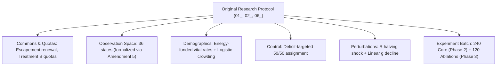
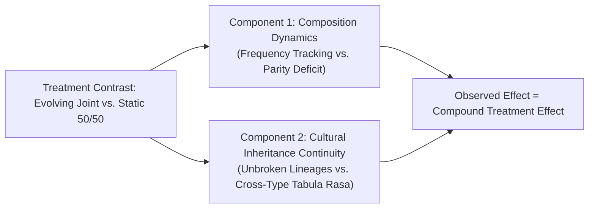
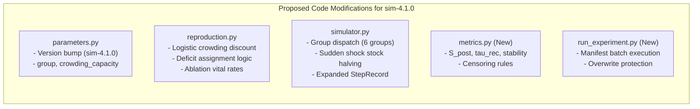
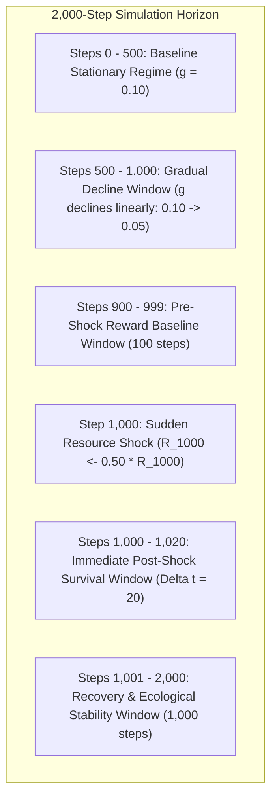
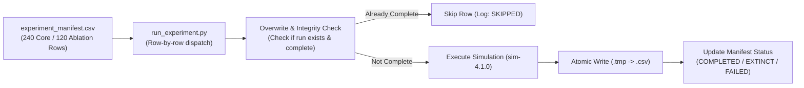
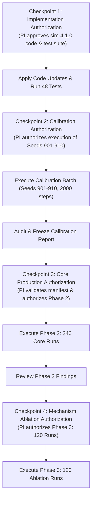

# Version D.1 (`sim-4.1.0`): Pre-Implementation Plan & Research Readiness Audit

**Document:** `calibration_logs/version_d/version_d1_implementation_plan.md`  
**Date:** 2026-11-02  
**Target:** Implementation Plan & Readiness Audit for Version D.1 (`sim-4.1.0`, `params-v4.1`)  
**Status:** PROPOSED IMPLEMENTATION PLAN (Awaiting PI Approval)  
**Execution Guard:** Strictly planning and audit only. No simulator code or parameters modified; no experiments run; no frozen data altered; no implementation authorized.

---

## 1. Executive Summary & Objective

This document provides a comprehensive, methodologically rigorous implementation and execution plan to transition the project from the research-design review phase to the main experiment phase under **Version D.1 (`sim-4.1.0`)**.

### Proposed PI Architectural Baseline (Under Evaluation):
- **Demographic Model:** Decentralized, energy-funded vital rates ($E \ge 15.0$, parent transfers 10.0 energy, $\Delta E_{\text{birth}} = 0.000$).
- **Perceptual State Space:** 36-state model (3 resource $\times$ 4 energy $\times$ 3 trend bands) incorporating the `critical` starvation-warning band ($E < 3.0$).
- **Population Regulation:** Logistic density-dependent reproduction discount ($K_{\text{pop}} = 50$) as the leading candidate.
- **Cultural Transmission:** Gradual Q-table inheritance over 12 steps ($\lambda_t = 1 - t/12$).
- **Control Group:** Deficit-targeted static 50/50 composition control.
- **Harvest Quotas:** Treatment B (Rest=0.0, Cons=0.25, Mod=0.50, Aggr=1.0) as leading candidate.
- **Environmental Perturbations:** Corrected sudden shock ($R_{1000} \leftarrow 0.50 \cdot R_{1000}$ at step 1,000 with baseline $g=0.10$) and gradual decline ($g = 0.10 \to 0.05$ from step 500 to 1,000).
- **Scale:** 2,000-step horizon, 30 matched seeds (1001–1030).

---

## 2. Item-by-Item Requirement Traceability Audit

We map every requirement from [`docs/research_protocol/01_research_protocol.md`](file:///Users/nish/home/Research%20Project/docs/research_protocol/01_research_protocol.md), [`docs/research_protocol/02_parameter_spec_sheet.md`](file:///Users/nish/home/Research%20Project/docs/research_protocol/02_parameter_spec_sheet.md), and [`docs/research_protocol/06_submission_roadmap.md`](file:///Users/nish/home/Research%20Project/docs/research_protocol/06_submission_roadmap.md) to the proposed Version D.1 architecture:



| Protocol Requirement | Original Protocol Specification | Version D.1 Proposed Design | Conformance & Justification |
| :--- | :--- | :--- | :--- |
| **Renewable Commons** | Escapement logistic renewal ($K=500, R_0=350, g=0.10$). | Identical escapement model in [`simulator.py:430`](file:///Users/nish/home/Research%20Project/simulator_v4/simulator.py#L430). | **Full Match.** Completely preserved. |
| **Harvest Action Set** | 4 discrete actions: Rest, Conservative, Moderate, Aggressive. | Treatment B: 0.0, 0.25, 0.50, 1.0. | **Full Match.** Retained from Stage 1 calibration. |
| **Observation Space** | 27 states ($3 \times 3 \times 3$, 108 Q-values). | 36 states ($3 \times 4 \times 3$, 144 Q-values). | **Formal Amendment Required (Amendment 5).** Incorporates `critical` energy band ($E < 3.0$). |
| **Agent Metabolism** | Maintenance $c = 0.20$ energy/step; $A_{\max} = 100$. | Maintenance $c = 0.20$; retirement at $a = 100$. | **Full Match.** Fully consistent. |
| **Demographic Model** | Vacancy-driven softmax tournament on survival and reward. | Decentralized, energy-funded vital rates ($E \ge 15.0$) with logistic crowding ($K_{\text{pop}}=50$). | **Formal Amendment Required (Amendment 1).** Replaces tournament with bioenergetic demography. |
| **Cultural Transmission** | Zero inheritance (offspring start tabula rasa). | Gradual Q-table inheritance over 12 steps. | **Formal Amendment Required (Amendment 2).** Replaces tabula rasa with parental transmission. |
| **Static Control** | Deficit-targeted replenishment preserving 50/50 mix. | Deficit-targeted offspring assignment upon energy-funded birth. | **Formal Amendment Required (Amendment 3).** Operationalizes control in vital-rates framework. |
| **Sudden Shock** | At step 1,000, $R_{1000} \leftarrow 0.50 \cdot R_{1000}$; baseline $g=0.10$. | At step 1,000, $R_{1000} \leftarrow 0.50 \cdot R_{1000}$; baseline $g=0.10$. | **Full Match (Bug Fix).** Rectifies `sim-4.0.0`'s inadvertent $g$-drop. |
| **Gradual Decline** | Steps 500–1000: linear decline in $g$ from $0.10$ to $0.05$. | Steps 500–1000: linear decline in $g$ from $0.10$ to $0.05$. | **Full Match.** Retained from Stage 1 calibration. |
| **Replication & Scale** | 30 matched seeds; 2,000 steps per run. | Seeds 1001–1030; $T = 2,000$ steps. | **Full Match.** Exact roadmap alignment. |
| **Core Experiment (Phase 2)**| 4 groups $\times$ 2 scenarios $\times$ 30 seeds = 240 runs. | 4 groups $\times$ 2 scenarios $\times$ 30 seeds = 240 runs. | **Full Match.** Exact roadmap alignment. |
| **Mechanism Ablations (Phase 3)**| 2 ablations $\times$ 2 scenarios $\times$ 30 seeds = 120 runs. | `survival_only` and `reward_only` vital-rate groups. | **Formal Amendment Required (Amendment 4).** Operationalizes ablations in vital-rates model. |

---

## 3. Formal Analysis of Mechanism Ablations: Vital Rates vs. Tournament Selection

To ensure absolute methodological integrity, we explicitly analyze the divergence between the proposed vital-rate ablations and the original protocol's tournament fitness formulations. **These mechanisms are NOT mathematically or conceptually equivalent.**

### 1. Survival-Only Ablation: Age-Based Vital Rate vs. Survival-Only Tournament Fitness
- **Original Protocol Rule ([`01_research_protocol.md:84-88, 103`](file:///Users/nish/home/Research%20Project/docs/research_protocol/01_research_protocol.md#L84)):**
  $$F_{\text{surv}}(i) = 1.0 \cdot \left(\frac{\text{age}_i}{A_{\max}}\right) + 0.0 \cdot \text{reward}$$
  $$P(i) = \frac{\exp(\beta \cdot F_{\text{surv}}(i))}{\sum_j \exp(\beta \cdot F_{\text{surv}}(j))}$$
  *Mechanics:* Whenever a death creates a vacancy, a global softmax tournament is conducted over all living candidates. The probability of winning the single open slot depends strictly on the agent's relative chronological rank among living contemporaries.
- **Proposed Version D.1 Vital-Rate Rule:**
  $$P_i' = P_{\max} \cdot \left(\frac{a_i}{A_{\max}}\right) \cdot \max\left(0, 1 - \frac{N(t)}{K_{\text{pop}}}\right) \quad \text{subject to } E_i \ge 15.0$$
  *Mechanics:* Reproduction is decentralized. Each agent independently evaluates a Bernoulli trial with probability proportional to normalized age, provided it has accumulated $E_i \ge 15.0$. The parent pays 10.0 energy.
- **Fundamental Non-Equivalence:**
  1. *Relative Rank vs. Absolute Probability:* The protocol rule is a zero-sum relative ranking across contemporaries; the vital-rate rule is an absolute individual fertility rate.
  2. *Thermodynamic Energy Gating:* The vital-rate rule retains $E \ge 15.0$ as an energetic feasibility gate to prevent the thermodynamic creation of energy ex nihilo. Thus, an agent must still successfully harvest resources to survive and accumulate surplus before age-driven reproduction can occur.

---

### 2. Reward-Only Ablation: Energy-Surplus Vital Rate vs. Lifetime-Reward Tournament Fitness
- **Original Protocol Rule ([`01_research_protocol.md:84-88, 104`](file:///Users/nish/home/Research%20Project/docs/research_protocol/01_research_protocol.md#L84)):**
  $$F_{\text{rew}}(i) = 0.0 \cdot \text{survival} + 1.0 \cdot \operatorname{norm}(\text{lifetime\_reward}_i)$$
  $$P(i) = \frac{\exp(\beta \cdot F_{\text{rew}}(i))}{\sum_j \exp(\beta \cdot F_{\text{rew}}(j))}$$
  *Mechanics:* Vacancies are filled by a global softmax tournament evaluating min-max normalized cumulative net reward accrued across an agent's entire lifetime relative to contemporaries.
- **Proposed Version D.1 Vital-Rate Rule:**
  $$P_i' = P_{\max} \cdot \operatorname{clip}\left(\frac{E_i - 15.0}{5.0}, 0, 1\right) \cdot \max\left(0, 1 - \frac{N(t)}{K_{\text{pop}}}\right)$$
  *Mechanics:* Birth probability is driven strictly by instantaneous somatic energy surplus ($E_i \in [15, 20]$) at step $t$. Age-fertility decline is disabled ($A(a_i) = 1.0$ for all ages until retirement at $a=100$).
- **Fundamental Non-Equivalence:**
  1. *Cumulative Lifetime Reward vs. Instantaneous Somatic Energy:* The protocol evaluates historical lifetime extraction efficiency; the vital-rate rule evaluates current stored energy reserves.
  2. *Decentralized vs. Tournament Allocation:* In the vital-rate model, multiple agents with high energy can give birth simultaneously, whereas the protocol tournament selects exactly one parent per vacancy.

*Conclusion:* Both ablations represent **formal protocol amendments** (Amendment 4). In all scientific reporting, they must be described as *vital-rate survival and surplus-energy ablations*, not as identical replications of the original tournament fitness functions.

---

## 4. Methodological Scope of the Static vs. Evolving Comparison

The core headline comparison of the study is between the **Evolving Joint Mixture (`evolving_joint`)** and the **Static 50/50 Mixture (`static_mixture`)**.



### 1. Dual-Factor Treatment Contrast (Composition AND Inheritance)
The static 50/50 control operates via Deficit-Targeted Offspring Assignment. When a birth occurs:
- In `evolving_joint`, offspring inherit parent type and Q-learners inherit parental Q-tables along unbroken lineages.
- In `static_mixture`, newborn type is assigned to whichever subpopulation is below $N/2$. When a Q-parent funds a Fixed newborn, the child receives a Fixed table. When a Fixed parent funds a Q newborn, the child receives a **clean zero-initialized Q-table ($Q=0$)** because Fixed agents possess no Q-tables.
- **Scientific Implication:** The contrast between `evolving_joint` and `static_mixture` alters **BOTH** type frequency dynamics AND the continuity of cultural Q-table lineages across generations.

### 2. Boundary of Causal Attribution
- **What CAN be claimed:** The experiment rigorously measures the **complete treatment contrast**: whether an evolving population with frequency-dependent selection and unbroken cultural transmission differs in ecological resilience from a compositionally stabilized mixture with broken cross-type inheritance.
- **What CANNOT be claimed:** We cannot causally attribute observed differences *exclusively* to population composition changes alone, because cross-type births in the static control introduce a temporary experience deficit by injecting tabula rasa learners.

### 3. Additional Experimental Controls Required to Disentangle Factors
If the PI requires isolating composition shifts from inheritance continuity in future follow-up studies, the following controls would be needed:
- *Control C1 (Evolving Tabula Rasa):* An evolving population where Q-offspring never inherit parental Q-tables ($Q=0$ at birth). Comparing `evolving_joint` to `evolving_tabula_rasa` isolates the pure value of cultural transmission.
- *Control C2 (Static Clonal with Rejection Sampling):* A static control where only Q parents fund Q children and Fixed fund Fixed, but births are gated so that neither type exceeds 25.

---

## 5. Required Code Modifications (File-by-File Specification)



### 1. `simulator_v4/parameters.py`
- Bump version strings:
  ```python
  SIMULATOR_VERSION = "sim-4.1.0"
  PARAMETER_VERSION = "params-v4.1"
  ```
- Add population regulation and group configuration fields:
  ```python
  group: str = "evolving_joint"          # fixed_only, q_only, static_mixture, evolving_joint, survival_only, reward_only
  crowding_capacity: int = 50           # K_pop for logistic density discounting
  regulation_model: str = "logistic"     # logistic, none
  ```
- Update `__post_init__` to validate group settings and initial population balances:
  - If `group == "fixed_only"`: require `initial_fixed_count = 50, initial_q_count = 0`.
  - If `group == "q_only"`: require `initial_fixed_count = 0, initial_q_count = 50`.
  - If `group in ("static_mixture", "evolving_joint", "survival_only", "reward_only")`: require `initial_fixed_count = 25, initial_q_count = 25`.

### 2. `simulator_v4/reproduction.py`
- Modify `calculate_reproduction_probability`:
  - Apply logistic density discount factor:
    $$\text{density\_discount} = \max\left(0.0, 1.0 - \frac{\text{living\_population}}{\text{parameters.crowding\_capacity}}\right)$$
  - Handle group-specific vital-rate rules:
    - `evolving_joint`, `fixed_only`, `q_only`, `static_mixture`: standard joint probability $\times$ density discount.
    - `survival_only`: probability driven by $a_i / A_{\max}$ (with $E \ge 15.0$ as eligibility gate) $\times$ density discount.
    - `reward_only`: age decline disabled ($A(a_i) = 1.0$) $\times$ density discount.
- Implement Deficit-Targeted Offspring Assignment in `perform_endogenous_reproduction`:
  - When `group == "static_mixture"`, determine newborn type via relative deficit to 25 ($\Delta_F$ vs. $\Delta_Q$).
  - Extinct type reintroduction: if $N_F = 0$, mandatory assignment to Fixed; if $N_Q = 0$, mandatory assignment to Q.
  - Zero-parent rule: if no living agent has $E \ge 15.0$, births cease entirely (no external subsidies).
  - Cross-type table assignment: Fixed parent funding Q newborn $\implies$ clean zero-initialized Q-table; Q parent funding Fixed newborn $\implies$ standard Fixed rule table.

### 3. `simulator_v4/simulator.py`
- **Group Dispatch in Population Initialization:** Instantiate agents based on `self.parameters.group` and initial counts.
- **Sudden Shock Bug Fix (Stage 9 Environmental Renewal):**  
  Correct lines 214–219 so that sudden shock **halves standing stock at step 1,000**, retaining baseline regeneration $g = 0.10$:
  ```python
  if self.scenario == "sudden_shock" and step_number == self.parameters.shock_step:
      self.resource = max(0.0, self.resource * 0.50)
  ```
- **Telemetry Expansion in `StepRecord`:** Add subpopulation energy, eligibility, mortality, and descriptive harvest metrics.

### 4. `simulator_v4/metrics.py` (New Module)
- Implement rigorous primary outcome functions: $S_{\text{post}}$ ($\Delta t = 20$), $\tau_{\text{rec}}$ (with pre-shock baseline steps 900–999; explicit `unrecovered` censoring), resource stability ($\sigma_R^2, \text{CV}_R$), and paired seed differences ($\Delta t_{\text{deplete}}, \Delta S_{\text{post}}, \Delta \tau_{\text{rec}}$).

### 5. `simulator_v4/run_experiment.py` (New Module)
- Manifest-driven batch runner for Phase 2 (240 runs) and Phase 3 (120 runs) with atomic writes and overwrite protection.

---

## 6. Complete Configuration Matrix for All Six Groups

| Group Identifier | Group Role / Type | Initial Mix ($N_0=50$) | Birth Eligibility | Reproductive Probability Formula ($P_i'$) | Offspring Type Rule | Inheritance Rule | Thermodynamic Energy Transfer |
| :--- | :--- | :--- | :--- | :--- | :--- | :--- | :--- |
| **`fixed_only`** | Homogeneous Baseline | 50 Fixed, 0 Q | $E \ge 15.0$, cooldown $\le 0$, age $< 60$ | $P_{\max} \cdot \operatorname{clip}\left(\frac{E-15}{5}, 0, 1\right) \cdot A(a) \cdot \max\left(0, 1 - \frac{N}{50}\right)$ | Fixed | Fixed heuristic table | Parent $-10.0$, Child $+10.0$ ($\Delta E = 0$) |
| **`q_only`** | Homogeneous Baseline | 0 Fixed, 50 Q | $E \ge 15.0$, cooldown $\le 0$, age $< 60$ | $P_{\max} \cdot \operatorname{clip}\left(\frac{E-15}{5}, 0, 1\right) \cdot A(a) \cdot \max\left(0, 1 - \frac{N}{50}\right)$ | Q-learning | Frozen parental snapshot with 12-step decay | Parent $-10.0$, Child $+10.0$ ($\Delta E = 0$) |
| **`static_mixture`** | **Essential Null Control** | 25 Fixed, 25 Q | $E \ge 15.0$, cooldown $\le 0$, age $< 60$ | $P_{\max} \cdot \operatorname{clip}\left(\frac{E-15}{5}, 0, 1\right) \cdot A(a) \cdot \max\left(0, 1 - \frac{N}{50}\right)$ | **Deficit-Targeted Assignment** ($\Delta_F$ vs $\Delta_Q$) | If Fixed child: Fixed table.<br>If Q child: parent Q (if Q parent) or $Q=0$ (if Fixed parent). | Parent $-10.0$, Child $+10.0$ ($\Delta E = 0$) |
| **`evolving_joint`** | **Primary Experimental** | 25 Fixed, 25 Q | $E \ge 15.0$, cooldown $\le 0$, age $< 60$ | $P_{\max} \cdot \operatorname{clip}\left(\frac{E-15}{5}, 0, 1\right) \cdot A(a) \cdot \max\left(0, 1 - \frac{N}{50}\right)$ | Clonal Lineage ($T_{\text{child}} = T_{\text{parent}}$) | Fixed table or gradual Q-table inheritance | Parent $-10.0$, Child $+10.0$ ($\Delta E = 0$) |
| **`survival_only`** | Mechanism Ablation 1 | 25 Fixed, 25 Q | $E \ge 15.0$ (gate), cooldown $\le 0$, age $< 60$ | $P_{\max} \cdot \left(\frac{a}{A_{\max}}\right) \cdot \max\left(0, 1 - \frac{N}{50}\right)$ | Clonal Lineage ($T_{\text{child}} = T_{\text{parent}}$) | Fixed table or gradual Q-table inheritance | Parent $-10.0$, Child $+10.0$ ($\Delta E = 0$) |
| **`reward_only`** | Mechanism Ablation 2 | 25 Fixed, 25 Q | $E \ge 15.0$, cooldown $\le 0$, all living ages | $P_{\max} \cdot \operatorname{clip}\left(\frac{E-15}{5}, 0, 1\right) \cdot \max\left(0, 1 - \frac{N}{50}\right)$ | Clonal Lineage ($T_{\text{child}} = T_{\text{parent}}$) | Fixed table or gradual Q-table inheritance | Parent $-10.0$, Child $+10.0$ ($\Delta E = 0$) |

---

## 7. Stress Schedules & Analytical Measurement Windows



### Exact Parameter Values & Schedules
1. **Stationary Baseline (Control Scenarios):** $g(t) = 0.10$ constant for all $t \in [0, 2000]$.
2. **Gradual Decline Scenario (Family A):** $g(t) = 0.10$ for $t \in [0, 500]$; linear decline to $g = 0.05$ over $t \in [500, 1000]$; $g(t) = 0.05$ for $t \in [1000, 2000]$.
3. **Sudden Resource Shock Scenario (Family B):** $g(t) = 0.10$ constant for all $t \in [0, 2000]$; at step $t = 1000$, $R(1000) \leftarrow \max(0.0, 0.50 \cdot R(1000))$.
4. **Pre-Shock Baseline Window ($t \in [900, 999]$):**
   $$\bar{r}_{\text{pre}} = \frac{1}{100} \sum_{t=900}^{999} \bar{r}(t)$$
5. **Immediate Post-Shock Survival Fraction ($S_{\text{post}}$):**
   $$S_{\text{post}} = \frac{N(1020)}{N(1000)}$$
   *(Note: If population went extinct before step 1000, $S_{\text{post}}$ is undefined; recorded as `pre_shock_extinction` and analyzed in extinction frequency).*
6. **Recovery Time ($\tau_{\text{rec}}$):**
   $$\tau_{\text{rec}} = \min \left\{ \Delta t \ge 1 \;\middle|\; \bar{r}(1000 + \Delta t) \ge 0.90 \cdot \bar{r}_{\text{pre}} \right\}$$
   *(Censoring Rule: If threshold is not reached prior to step 2000, or post-shock extinction occurs, recorded explicitly as `unrecovered`).*
7. **Resource Stability ($\sigma_R^2, \text{CV}_R$ over $t \in [1001, 2000]$):**
   $$\bar{R}_{\text{post}} = \frac{1}{1000} \sum_{t=1001}^{2000} R(t), \quad \sigma_R^2 = \frac{1}{1000} \sum_{t=1001}^{2000} (R(t) - \bar{R}_{\text{post}})^2, \quad \text{CV}_R = \frac{\sigma_R}{\bar{R}_{\text{post}}}$$

---

## 8. Complete Telemetry Schema

The simulation engine outputs three structured CSV streams per run:

1. **Per-Step Time-Series CSV (`timeseries.csv` — 44 Columns):**
   `seed,step,scenario,group,resource,total_harvest,requested_harvest,fixed_requested_harvest,q_requested_harvest,fixed_allocated_harvest,q_allocated_harvest,reference_harvest,regeneration,living_population,fixed_population,q_population,q_share,mean_reward,mean_energy,fixed_mean_energy,fixed_max_energy,q_mean_energy,q_max_energy,births,fixed_births,q_births,reproduction_attempts,fixed_eligible_count,q_eligible_count,successful_births,starvation_deaths,fixed_starvation_deaths,q_starvation_deaths,retirement_deaths,fixed_retirement_deaths,q_retirement_deaths,q_act_rest,q_act_conservative,q_act_moderate,q_act_aggressive,fixed_act_rest,fixed_act_conservative,fixed_act_moderate,fixed_act_aggressive,energy_ledger_discrepancy`
2. **Reproduction Event Log CSV (`reproduction_logs.csv` — 14 Columns):**
   `run_id,seed,step,group,parent_id,parent_type,parent_age,parent_energy_before,energy_transferred,parent_energy_after,newborn_id,newborn_type,reproduction_probability,success,failure_reason`
3. **Experiment Summary CSV (`experiment_summary.csv` — 28 Columns):**
   `run_id,group,scenario,seed,completed_steps,extinct,extinction_step,depletion_step,peak_population,peak_step,total_births,fixed_births,q_births,total_starvations,fixed_starvations,q_starvations,total_retirements,mean_resource,post_shock_survival,recovery_time,recovery_status,resource_post_mean,resource_post_variance,resource_post_cv,final_q_share,max_energy_discrepancy,parameter_version,simulator_version`

---

## 9. Rigorous Calibration Protocol & Parameter Versioning Invariants

To avoid survivorship bias and methodological circularity:

1. **Dedicated Calibration Seeds (Separation from Production):**
   - Calibration runs use a dedicated, distinct seed set: **Seeds 901–910 (10 seeds)**.
   - Production runs strictly preserve the pre-registered **Seeds 1001–1030 (30 matched seeds)**.
   - This prevents out-of-sample contamination and eliminates any possibility of cherry-picking production seeds based on calibration behavior.
2. **Zero-Exclusion Retention Policy:**
   - Every single calibration run is retained in summary outputs. Pre-shock extinction is treated as a **primary ecological outcome**, not an experimental failure.
3. **Prohibition of Survival-Based Parameter Tuning:**
   - Parameters must **never be iteratively adjusted** merely to force survival through step 1,000.
4. **Parameter Versioning Invariant:**
   - Any parameter modification (e.g., altering quotas from Treatment B to Treatment C, or adjusting $K_{\text{pop}}$) mandates tagging a **new parameter version** (e.g., `params-v4.2`) and executing a **fresh, independent calibration batch**.
5. **Mandatory Post-Calibration Audit & Freeze:**
   - After executing the 10 calibration seeds, a formal calibration report and code audit must be generated and frozen under `calibration_logs/version_d/` before production authorization can be considered.

---

## 10. Manifest-Driven Batch Runner & No-Overwrite Protocol



- **Manifest Pre-Validation:** `experiment_manifest.csv` must be fully generated and audited before execution begins.
- **Deterministic Seeding:** Each simulation is initialized strictly with `seed = int(row['seed'])`.
- **Atomic File Writes:** Output files are written to `.tmp` files first, then renamed atomically upon successful step completion.
- **No-Overwrite Protection:** If output CSVs exist and contain exactly 2,000 steps (or a valid recorded extinction), `run_experiment.py` logs `SKIPPED_EXISTING` and does not overwrite existing data.

---

## 11. Multi-Stage Approval Checkpoints

Production experiments must **never launch automatically** following calibration. Execution is gated across four sequential approval checkpoints:



1. **Checkpoint 1 (Implementation Authorization):** Authorizes modifying `simulator_v4/` to create `sim-4.1.0` and expanding the test suite to 48 tests.
2. **Checkpoint 2 (Calibration Authorization):** Authorizes executing the dedicated 10-seed calibration batch (Seeds 901–910, 2,000 steps).
3. **Checkpoint 3 (Phase 2 Core Production Authorization):** Authorizes generating `experiment_manifest.csv` and executing the 240-run core experiment batch (Seeds 1001–1030). **Requires prior review, audit, and freeze of the calibration report.**
4. **Checkpoint 4 (Phase 3 Mechanism Ablation Authorization):** Authorizes executing the 120-run ablation batch (Seeds 1001–1030) following successful review of Phase 2 core outcomes.

---

## 12. Final Principal Investigator Decision Checklist

Before implementation can be authorized, the Principal Investigator must formally review and record decisions on the following items:

### A. Substantive Scientific Decisions

| Decision ID | Item Requiring Decision | Competing Options | Recommended Option |
| :---: | :--- | :--- | :--- |
| **DEC-07** | **Population Regulation Model** | **Option A (Crowding Only)** vs. **Option B (Scarcity Gating)** vs. **Option C (Combined)** vs. **Option D (Unrestricted)** | **Option A (Logistic Crowding alone, $K_{\text{pop}}=50$)** as leading candidate. |
| **DEC-08** | **Observation State Space** | **36 States (Implementation Baseline)** vs. **27 States (Protocol Specification)** | **36 States** via formal protocol amendment, retaining `critical` starvation band ($E < 3.0$). |
| **DEC-09** | **Action Quota Sizing** | **Treatment B Quotas (1.0 max)** vs. **Treatment C Quotas (0.75 max)** | **Treatment B Quotas** as leading candidate, pending calibration review. |
| **DEC-10** | **Turnover Paradigm Formalization** | **Decentralized Vital Rates** vs. **Softmax Tournament Selection** | **Decentralized Vital Rates** via formal protocol amendment. |

### B. Formal Protocol Amendments Required (for Protocol v2.0)
- **Amendment 1:** Replace Section 3.3 with Decentralized Energy-Funded Vital Rates ($E \ge 15.0$, parent $-10.0$, child $+10.0$, logistic crowding discount).
- **Amendment 2:** Formalize Section 3.4 with Gradual Q-Table Inheritance over 12 steps.
- **Amendment 3:** Formalize Section 4.1 with Deficit-Targeted Offspring Assignment in static mixture (acknowledging cross-type tabula rasa Q initialization).
- **Amendment 4:** Formalize Section 4.2 with Vital-Rate Survival ($a_i / A_{\max}$) and Surplus-Energy ($E_i - 15$) Ablations (acknowledging non-equivalence to tournament fitness).
- **Amendment 5:** Formalize Section 2.4 with 36-State Discretization (incorporating `critical` energy band $<3.0$).

### C. Files Scheduled for Modification (Post-Approval)
- `simulator_v4/parameters.py`: Bump to `sim-4.1.0` / `params-v4.1`; add `group`, `crowding_capacity`.
- `simulator_v4/reproduction.py`: Add logistic discount, deficit assignment, and ablation formulas.
- `simulator_v4/simulator.py`: Add group dispatch, sudden shock stock halving, and expanded `StepRecord`.
- `simulator_v4/metrics.py`: New module for primary outcome analytics.
- `simulator_v4/run_experiment.py`: New manifest-driven batch runner.
- `simulator_v4/tests/test_version_d1.py`: Expanded test suite (48 tests).
- `docs/research_protocol/01_research_protocol.md`: Tag Protocol v2.0 with approved amendments.

### D. Validation & Acceptance Criteria
- Unit test suite: **48 out of 48 tests passing**.
- Thermodynamic energy ledger: maximum discrepancy **$< 10^{-8}$** across all steps.
- Dedicated calibration (Seeds 901–910): zero-exclusion report audited and frozen.
- Validated `experiment_manifest.csv` with checksums and no-overwrite verification.

### E. Data Preservation Invariants
- `results_v4/calibration/` (Stage 1 calibration) remains **permanently frozen**.
- Versions A, B, and C remain **permanently frozen**.
- Dedicated calibration outputs saved to `results_v4/calibration_d1/`.
- Production outputs saved to `results_v4/phase2_core/` and `results_v4/phase3_mechanism/`.

---

### Strict Implementation Guard Confirmation

**IMPLEMENTATION AND SIMULATION RUNS REMAIN COMPLETELY UNAUTHORIZED.**

- All code in `simulator_v4/` remains completely untouched.
- No parameters have been altered.
- No simulation scripts have been executed.
- All historical calibration data remains pristine and frozen.
- Step 1 implementation will commence only upon explicit, written authorization of Checkpoint 1 by the Principal Investigator.
