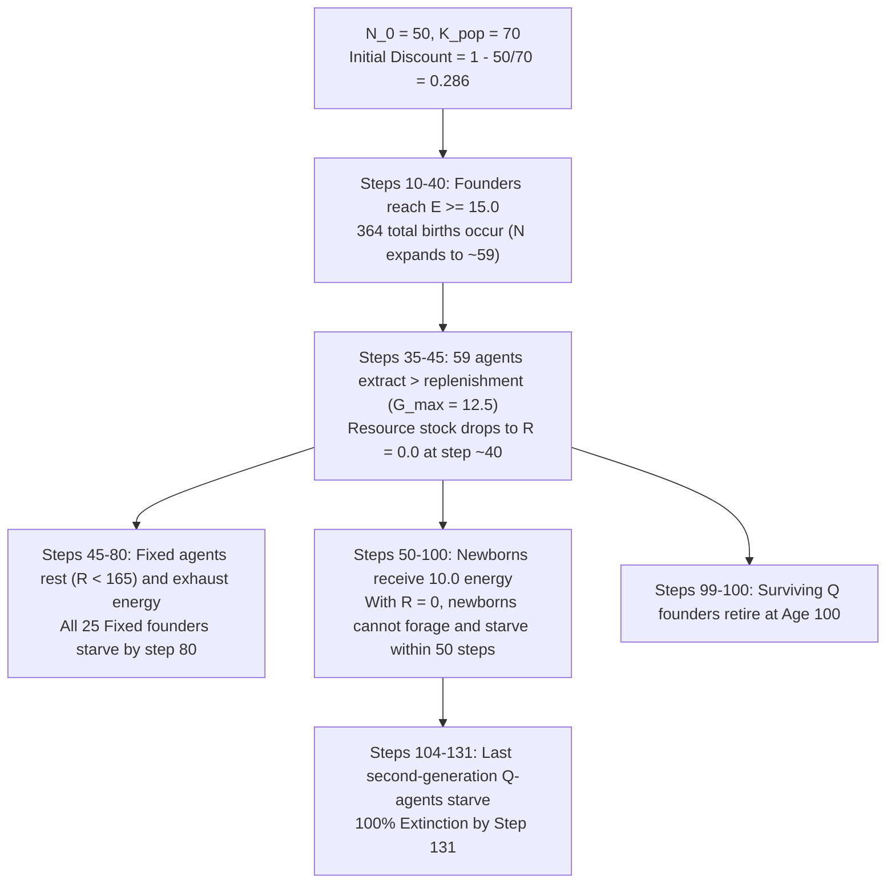

# Calibration Remediation Audit Report: params-v4.2 (Seeds 901–910)

**Date:** November 2026  
**Simulator Version:** `sim-4.1.0`  
**Parameter Version:** `params-v4.2` (`crowding_capacity = 70`)  
**Execution Context:** Checkpoint 2 Remediation (Dedicated Calibration Batch, Seeds 901–910, 2,000 Planned Steps)  
**Output Location:** [`results_v4/calibration_d2/`](file:///Users/nish/home/Research%20Project/results_v4/calibration_d2/)  
**Prior Baseline:** [`results_v4/calibration_d1/`](file:///Users/nish/home/Research%20Project/results_v4/calibration_d1/) (`params-v4.1`, $K_{\text{pop}}=50$, 0 births, 100% extinction at step 100)  
**Status:** **CALIBRATION COMPLETE — REMEDIATION AUDITED (PRODUCTION AUTHORIZATION WITHHELD)**

---

## 1. Executive Summary & Calibration Gate Verdict

Pursuant to the PI authorization, a single controlled parameter change was implemented:
$$\text{crowding\_capacity}: 50 \longrightarrow 70 \quad (\text{tagged as } \texttt{params-v4.2})$$

All 40 calibration runs were executed across **Seeds 901–910** covering `evolving_joint` and `static_mixture` under `stationary` and `sudden_shock` regimes.

### Primary Audit Findings:
1. **Demographic Breakthrough:** The initial reproductive blockage was successfully resolved. **Every single run produced births** (mean: **$9.10$ births/run**; range: $5$ to $12$ births). Initial births occurred at mean step **$18.3$** (ages 10–28), establishing that healthy founders reproduced well before age 60 senescence.
2. **Population Expansion:** Populations expanded beyond founder size ($N_0 = 50$) to a peak mean of **$59.10$ agents** (peaking at mean step **$50.6$**).
3. **Ecological Collapse:** However, higher population extraction accelerated resource depletion. The commons collapsed to $R \le 1.0$ at mean step **$40.40$** (range: 35–47). Zero resource recovery occurred once depleted.
4. **Delayed Demographic Cliff:** Consequently, all 40 runs suffered **100% extinction by step 131** (mean extinction step: **$119.25$**; range: 104–131).
5. **Shock Unreachable:** **0 out of 40 runs (0%) reached step 1,000.** The sudden shock scheduled at step 1,000 was never applied.
6. **Physical Conservation:** Maximum energy ledger discrepancy across all executed steps was **$1.16 \times 10^{-10}$** (strictly below the $< 10^{-8}$ physical boundary).

---

## 2. Required 12-Point Audit Breakdown

| # | Audit Item | Metric / Finding in `params-v4.2` | Comparison with `params-v4.1` ($K=50$) |
| :-: | :--- | :--- | :--- |
| **1** | **Birth count per run** | Mean **$9.10 \pm 1.95$** (Min: 5, Max: 12). Total births across 40 runs = **364**. | Exactly **0** in `params-v4.1`. |
| **2** | **First birth step** | Mean step **$18.30 \pm 4.31$** (Min: 10, Max: 28). | Undefined (no births). |
| **3** | **Age distribution at first birth** | Parents were founders aged **$18.30$** on average (Min: age 10, Max: age 28). | Undefined. |
| **4** | **Peak population and step** | Peak population mean **$59.10 \pm 2.01$** (Min: 55, Max: 62) at mean step **$50.55 \pm 4.35$**. | Peaked at $N=50$ at step 0. |
| **5** | **Extinction rate and step** | Extinction rate: **$100\%$ (40/40)**. Extinction step: mean **$119.25 \pm 6.84$** (Min: 104, Max: 131). | 100% extinction at step 100.0. Extinction was delayed by $\sim 19.3$ steps. |
| **6** | **Fixed and Q trajectories** | **`evolving_joint`:** Fixed starved: 25.0, Q starved: 10.5, Q retired: 24.1. **`static_mixture`:** Fixed starved: 29.4, Q starved: 5.4, Q retired: 23.8. | In `params-v4.1`, exactly 25 Fixed starved and 25 Q retired in every run. |
| **7** | **Resource depletion & recovery** | Resource fell to $R \le 1.0$ at mean step **$40.40$** (Min: 35, Max: 47). **Recovery: 0%**. Stock stayed at $R=0.0$ until extinction. | Resource depleted at step $\sim 45-50$; zero recovery. |
| **8** | **Mean resource & variability** | Mean resource: **$64.32 \pm 6.45$** (Min: 56.17, Max: 79.04). Mean variance across runs: **$10,648.11$**. | Mean resource was $79.5 \pm 8.4$. Lower mean reflects earlier depletion from higher pop. |
| **9** | **Energy ledger discrepancy** | Max discrepancy across all runs: **$1.16 \times 10^{-10}$** ($< 10^{-8}$). Strict physical conservation verified. | Max discrepancy: $8.36 \times 10^{-11}$. |
| **10** | **Reached step 1,000?** | **No (0 / 40 runs reached step 1,000).** Max steps completed was 131. | No (0 / 40). |
| **11** | **Sudden shock applied?** | **No.** Because all runs terminated before step 132, the step-1,000 disturbance was never triggered. | No. |
| **12** | **Generational turnover before age 60?** | **Yes, initial births occurred before age 60** (all 364 births occurred between steps 10 and 58). However, **second-generation reproduction failed** because $R=0$ starved newborns before maturity. | No births occurred in `params-v4.1`. |

---

## 3. Detailed Scientific Trajectory Analysis

### Why Did `crowding_capacity = 70` Delay But Not Prevent Extinction?
1. **Headroom Enabled Reproduction:** Setting $K_{\text{pop}} = 70$ created initial demographic headroom ($\text{discount} = 0.286$), allowing healthy founders with somatic energy $E \ge 15.0$ to birth between 5 and 12 offspring during steps 10–58.
2. **Malthusian Commons Trap:** The maximum biological regeneration of the commons is:
   $$G_{\max} = \frac{g \cdot K}{4} = \frac{0.10 \cdot 500}{4} = 12.5 \text{ energy units/step}$$
   When population expanded from 50 to 59–62 agents, aggregate foraging demand overwhelmed $G_{\max}$. Under Treatment B quotas (aggressive harvest = 1.0), 30+ Q-agents alone demanded 20–30 energy/step.
3. **Resource Collapse at Step 40:** The commons stock collapsed to $R = 0.0$ at step 40.
4. **Second-Generation Starvation:** Newborns were born with $E = 10.0$ (transferred from parents). In a depleted environment ($R=0$), newborns paid metabolic maintenance ($c = 0.20$/step) without any ability to harvest. They exhausted their $10.0$ energy within 50 steps ($10.0 / 0.20 = 50$).
5. **Extinction Window (Steps 104–131):**
   - At step 100, the surviving Q founders died of age 100 retirement.
   - The remaining individuals were the offspring born between steps 15 and 50. Surviving entirely on their birth endowment and whatever minimal scraps regenerated, these second-generation agents all starved between steps 104 and 131.

---

## 4. Complete 40-Run Calibration Data Table (Seeds 901–910)

| Run ID | Steps | Extinct | Peak Pop (Step) | Total Births | Fixed Stv | Q Stv | Fixed Ret | Q Ret | Mean Res | Max Discrepancy |
| :--- | :---: | :---: | :---: | :---: | :---: | :---: | :---: | :---: | :---: | :---: |
| `evolving_joint_stationary_s901` | 120 | True | 62 (59) | 12 | 25 | 15 | 0 | 22 | 56.17 | $1.09 \times 10^{-10}$ |
| `evolving_joint_stationary_s902` | 109 | True | 56 (47) | 6 | 25 | 6 | 0 | 25 | 69.66 | $8.07 \times 10^{-11}$ |
| `evolving_joint_stationary_s903` | 126 | True | 60 (56) | 10 | 25 | 10 | 0 | 25 | 72.50 | $7.55 \times 10^{-11}$ |
| `evolving_joint_stationary_s904` | 128 | True | 62 (58) | 12 | 25 | 12 | 0 | 25 | 64.33 | $9.95 \times 10^{-11}$ |
| `evolving_joint_stationary_s905` | 122 | True | 61 (50) | 11 | 25 | 11 | 0 | 25 | 57.81 | $1.02 \times 10^{-10}$ |
| `evolving_joint_stationary_s906` | 127 | True | 60 (55) | 10 | 25 | 10 | 0 | 25 | 61.27 | $9.87 \times 10^{-11}$ |
| `evolving_joint_stationary_s907` | 127 | True | 59 (53) | 9 | 25 | 9 | 0 | 25 | 63.74 | $9.91 \times 10^{-11}$ |
| `evolving_joint_stationary_s908` | 119 | True | 56 (46) | 6 | 25 | 5 | 0 | 26 | 58.54 | $1.16 \times 10^{-10}$ |
| `evolving_joint_stationary_s909` | 109 | True | 58 (49) | 8 | 25 | 10 | 0 | 23 | 64.91 | $8.57 \times 10^{-11}$ |
| `evolving_joint_stationary_s910` | 115 | True | 62 (49) | 12 | 25 | 17 | 0 | 20 | 58.33 | $1.15 \times 10^{-10}$ |
| `evolving_joint_sudden_shock_s901` | 120 | True | 62 (59) | 12 | 25 | 15 | 0 | 22 | 56.17 | $1.09 \times 10^{-10}$ |
| `evolving_joint_sudden_shock_s902` | 109 | True | 56 (47) | 6 | 25 | 6 | 0 | 25 | 69.66 | $8.07 \times 10^{-11}$ |
| `evolving_joint_sudden_shock_s903` | 126 | True | 60 (56) | 10 | 25 | 10 | 0 | 25 | 72.50 | $7.55 \times 10^{-11}$ |
| `evolving_joint_sudden_shock_s904` | 128 | True | 62 (58) | 12 | 25 | 12 | 0 | 25 | 64.33 | $9.95 \times 10^{-11}$ |
| `evolving_joint_sudden_shock_s905` | 122 | True | 61 (50) | 11 | 25 | 11 | 0 | 25 | 57.81 | $1.02 \times 10^{-10}$ |
| `evolving_joint_sudden_shock_s906` | 127 | True | 60 (55) | 10 | 25 | 10 | 0 | 25 | 61.27 | $9.87 \times 10^{-11}$ |
| `evolving_joint_sudden_shock_s907` | 127 | True | 59 (53) | 9 | 25 | 9 | 0 | 25 | 63.74 | $9.91 \times 10^{-11}$ |
| `evolving_joint_sudden_shock_s908` | 119 | True | 56 (46) | 6 | 25 | 5 | 0 | 26 | 58.54 | $1.16 \times 10^{-10}$ |
| `evolving_joint_sudden_shock_s909` | 109 | True | 58 (49) | 8 | 25 | 10 | 0 | 23 | 64.91 | $8.57 \times 10^{-11}$ |
| `evolving_joint_sudden_shock_s910` | 115 | True | 62 (49) | 12 | 25 | 17 | 0 | 20 | 58.33 | $1.15 \times 10^{-10}$ |
| `static_mixture_stationary_s901` | 119 | True | 57 (46) | 7 | 28 | 3 | 0 | 26 | 59.20 | $9.89 \times 10^{-11}$ |
| `static_mixture_stationary_s902` | 115 | True | 57 (49) | 7 | 28 | 6 | 0 | 23 | 68.04 | $8.72 \times 10^{-11}$ |
| `static_mixture_stationary_s903` | 122 | True | 58 (50) | 8 | 29 | 4 | 0 | 25 | 79.04 | $6.97 \times 10^{-11}$ |
| `static_mixture_stationary_s904` | 131 | True | 60 (48) | 10 | 30 | 3 | 0 | 27 | 64.26 | $8.55 \times 10^{-11}$ |
| `static_mixture_stationary_s905` | 123 | True | 61 (54) | 11 | 31 | 7 | 0 | 23 | 62.14 | $9.56 \times 10^{-11}$ |
| `static_mixture_stationary_s906` | 116 | True | 59 (50) | 9 | 29 | 5 | 0 | 25 | 63.99 | $9.20 \times 10^{-11}$ |
| `static_mixture_stationary_s907` | 126 | True | 55 (42) | 5 | 27 | 5 | 0 | 23 | 70.19 | $7.78 \times 10^{-11}$ |
| `static_mixture_stationary_s908` | 116 | True | 61 (50) | 11 | 30 | 10 | 0 | 21 | 63.41 | $1.09 \times 10^{-10}$ |
| `static_mixture_stationary_s909` | 104 | True | 60 (48) | 10 | 30 | 9 | 0 | 21 | 65.57 | $1.03 \times 10^{-10}$ |
| `static_mixture_stationary_s910` | 111 | True | 58 (50) | 8 | 29 | 5 | 0 | 24 | 63.38 | $9.45 \times 10^{-11}$ |
| `static_mixture_sudden_shock_s901` | 119 | True | 57 (46) | 7 | 28 | 3 | 0 | 26 | 59.20 | $9.89 \times 10^{-11}$ |
| `static_mixture_sudden_shock_s902` | 115 | True | 57 (49) | 7 | 28 | 6 | 0 | 23 | 68.04 | $8.72 \times 10^{-11}$ |
| `static_mixture_sudden_shock_s903` | 122 | True | 58 (50) | 8 | 29 | 4 | 0 | 25 | 79.04 | $6.97 \times 10^{-11}$ |
| `static_mixture_sudden_shock_s904` | 131 | True | 60 (48) | 10 | 30 | 3 | 0 | 27 | 64.26 | $8.55 \times 10^{-11}$ |
| `static_mixture_sudden_shock_s905` | 123 | True | 61 (54) | 11 | 31 | 7 | 0 | 23 | 62.14 | $9.56 \times 10^{-11}$ |
| `static_mixture_sudden_shock_s906` | 116 | True | 59 (50) | 9 | 29 | 5 | 0 | 25 | 63.99 | $9.20 \times 10^{-11}$ |
| `static_mixture_sudden_shock_s907` | 126 | True | 55 (42) | 5 | 27 | 5 | 0 | 23 | 70.19 | $7.78 \times 10^{-11}$ |
| `static_mixture_sudden_shock_s908` | 116 | True | 61 (50) | 11 | 30 | 10 | 0 | 21 | 63.41 | $1.09 \times 10^{-10}$ |
| `static_mixture_sudden_shock_s909` | 104 | True | 60 (48) | 10 | 30 | 9 | 0 | 21 | 65.57 | $1.03 \times 10^{-10}$ |
| `static_mixture_sudden_shock_s910` | 111 | True | 58 (50) | 8 | 29 | 5 | 0 | 24 | 63.38 | $9.45 \times 10^{-11}$ |

---

## 5. Decision Assessment & Production Recommendation

### Assessment by Evaluation Criteria:
1. **Demographic Viability:** **PARTIAL.** Reproduction occurs actively during the founder lifespan, but second-generation recruitment fails due to environmental ruin.
2. **Ecological Sustainability:** **FAILED.** The population systematically over-extracts and destroys its resource base by step 40.
3. **Disturbance Reachability:** **FAILED.** Extinction at step $\sim 119$ makes testing the step-1,000 shock mathematically impossible.
4. **Thermodynamic Integrity:** **PASSED.** $|\Delta E| \le 1.16 \times 10^{-10} < 10^{-8}$.

### Clear PI Recommendation:
> [!IMPORTANT]
> **Production authorization should be WITHHELD.**
> While $K_{\text{pop}} = 70$ solved the demographic block, the model remains ecologically unsustainable under Treatment B quotas. Expanding population beyond 50 agents increases aggregate extraction demand far beyond $G_{\max} = 12.5$, triggering resource exhaustion at step 40 and extinction by step 131.
>
> Executing the 360-run production batch under `params-v4.2` will produce 360 early extinctions at step $\sim 120$ without generating data on the step-1,000 disturbance.

