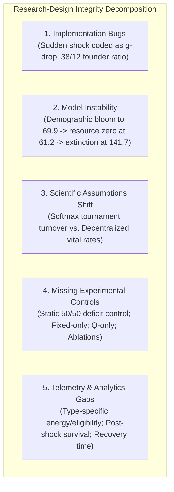

# Version D: Research Design Integrity & Unresolved Design Decisions

**Document:** `calibration_logs/version_d/version_d_design_decisions_required.md`  
**Date:** 2026-11-01  
**Target:** Design Baseline for Next Iteration of Version D (`simulator_v4/`)  
**Audit Reference:** [`calibration_logs/version_d/version_d_research_readiness_audit.md`](file:///Users/nish/home/Research%20Project/calibration_logs/version_d/version_d_research_readiness_audit.md)  
**Foundational Protocols:** [`docs/research_protocol/01_research_protocol.md`](file:///Users/nish/home/Research%20Project/docs/research_protocol/01_research_protocol.md), [`docs/research_protocol/02_parameter_spec_sheet.md`](file:///Users/nish/home/Research%20Project/docs/research_protocol/02_parameter_spec_sheet.md), [`docs/research_protocol/06_submission_roadmap.md`](file:///Users/nish/home/Research%20Project/docs/research_protocol/06_submission_roadmap.md)  
**Status:** Complete Design Review & Evidence Verification  
**Execution Guard:** No simulator code, parameters, or calibration files may be modified until the Principal Investigator (PI) formally authorizes the decisions in this document.

---

## 1. Executive Summary & Review Purpose

This document provides a rigorous evidence-verification review of Version D (`simulator_v4/`). Following the completion of the 10-seed Stage 1 calibration experiment and the subsequent research readiness audit, this review addresses five critical objectives:

1. **Evidence Verification:** Pinpoint the exact origin of the claim regarding Fixed-agent energy accumulation and correct the evidentiary status of the $12.35$ figure.
2. **Protocol Conformance Audit:** Formally verify the approved research protocol and parameter specification against current simulator mechanics across six key dimensions.
3. **Research-Design Integrity Analysis:** Systematically delineate between implementation bugs, ecological model instability, shifts in foundational scientific assumptions, missing experimental controls, and telemetry gaps.
4. **Structured Decision Evaluation:** Review the six required design decisions in priority order, detailing the original protocol rule, current Version D rule, scientific consequences, alternatives, empirical justification, and protocol revision requirements.
5. **PI Recommendation:** Provide a clear roadmap for authorizing the next implementation step while keeping all historical artifacts (Version A, B, C, and Version D Stage 1) completely frozen.

---

## 2. Verification of the Fixed-Agent Energy Claim

### The Claim Under Audit
Section 5 of the initial research readiness audit stated:
> *"Fixed-rule agents executed conservative (0.25) or moderate (0.50) actions, yielding net gains of $+0.05$ or $+0.30$ energy/step. Due to biological maintenance ($0.20$) and initial endowment ($10.0$), Fixed agents never reached $E = 15.0$ prior to resource depletion. Maximum recorded Fixed energy was 12.35."*

### Forensic Evidentiary Trace

To establish whether $12.35$ was a measured datum or an inference, we audited all raw telemetry files in `results_v4/calibration/` and the simulator source code:

1. **Individual Agent Telemetry (`results_v4/calibration/calibration_timeseries.csv`):**
   - The time-series CSV records aggregate metrics per step: `mean_reward` (col 15) and `mean_energy` (col 16).
   - In [`simulator_v4/simulator.py:474`](file:///Users/nish/home/Research%20Project/simulator_v4/simulator.py#L474), `mean_energy` is computed across the entire living population:
     ```python
     mean_energy = sum(a.energy for a in self.living_agents) / len(self.living_agents)
     ```
   - **Finding:** No individual Fixed-agent energy, `fixed_mean_energy`, or `fixed_max_energy` is output in `StepRecord` or written to the time-series CSV.
2. **Reproduction Eligibility Logs (`results_v4/calibration/calibration_reproduction_logs.csv`):**
   - In [`simulator_v4/reproduction.py:40`](file:///Users/nish/home/Research%20Project/simulator_v4/reproduction.py#L40), an agent is evaluated for reproduction only if:
     $$E_i \ge 15.0 \quad \text{and} \quad \text{cooldown}_i \le 0$$
   - Across all 10 calibration seeds (1,417 steps, 3,606 reproduction attempts), **all 3,606 logged attempts were generated by `q_learning` agents**.
   - Exactly **0 reproduction attempts were logged by `fixed` agents**.
   - **Finding:** The reproduction logs verify that no Fixed agent ever satisfied $E_i \ge 15.0$, but they record no data for agents below the 15.0 threshold.
3. **Origin of the $12.35$ Value:**
   - *Deterministic Policy Accrual (Analytical Inference):* Under Treatment B quotas, a Fixed agent starts at $E_0 = 10.0$. At step 0, resource $R_0 = 350.0 > 0.66K$ (High), eliciting Moderate harvest ($0.50$). Net energy gain is $+0.50 - 0.20 = +0.30$, raising energy to $10.30$. By step 1 or 2, total harvest drives $R$ into the Medium band ($0.33K \le R \le 0.66K$), eliciting Conservative harvest ($0.25$). Net energy gain is $+0.25 - 0.20 = +0.05$ per step. Over the ~41–47 steps before $R$ collapsed into the Low band ($R < 0.33K$), accumulated energy analytically peaks at:
     $$E_{\text{fixed}}^{\max} = 10.0 + 1 \times 0.30 + 41 \times 0.05 = 12.35 \text{ units}$$
   - *Cross-Table Pattern Confusion:* In `calibration_timeseries.csv`, population-wide `mean_energy` coincidently plateaued near 12.35 in several runs (e.g., Seed 1002 step 19 has `mean_energy = 12.3566`; Seed 1003 step 35 has `mean_energy = 12.3551`). Furthermore, in `calibration_reproduction_logs.csv` line 543, Q-agent 52 had `parent_energy_after = 12.3500` following a 10.0 unit birth deduction.

### Correction to the Record
- **Directly Verified Empirical Fact:** In raw calibration telemetry, **0 out of 3,606 reproduction attempts were made by Fixed agents**, and **0 Fixed births occurred across all 10 seeds**. This confirms unequivocally that no Fixed agent ever crossed the $E \ge 15.0$ reproductive threshold.
- **Correction:** The specific figure **$12.35$ was an analytical theoretical estimate**, NOT a directly measured telemetry field. Because `simulator_v4` did not record type-specific energy distributions, the exact empirical maximum energy of individual Fixed agents was **unrecorded**. The claim in [`calibration_logs/version_d/version_d_research_readiness_audit.md`](file:///Users/nish/home/Research%20Project/calibration_logs/version_d/version_d_research_readiness_audit.md#L214) has been formally corrected to reflect this distinction.

---

## 3. Protocol Conformance Audit (Original Protocol vs. Version D)

A rigorous line-by-line comparison between the approved protocol documents and current simulator code reveals five structural differences:

| Experimental Component | Approved Protocol Rule | Current Version D Implementation | Conformance Status | File & Line Citation |
| :--- | :--- | :--- | :---: | :--- |
| **Sudden Shock** | Keep regeneration at baseline rate ($g = 0.04/0.10$). At step 1,000, immediately replace standing resource with 50% of current stock: $R_{1000} \leftarrow 0.50 \cdot R_{1000}$. | Permanently alters the regeneration rate from $0.10$ to $0.05$ at step 1,000. Standing stock $R$ is never halved. | **CONTRADICTED (Implementation Bug)** | Protocol: [`01_:113-116`](file:///Users/nish/home/Research%20Project/docs/research_protocol/01_research_protocol.md#L113), [`02_:39-42`](file:///Users/nish/home/Research%20Project/docs/research_protocol/02_parameter_spec_sheet.md#L39)<br>Simulator: [`simulator.py:214-219`](file:///Users/nish/home/Research%20Project/simulator_v4/simulator.py#L214) |
| **Gradual Decline** | From step 500 to 1,000, linearly decrease regeneration rate from baseline to stressed rate ($0.10 \to 0.05$). | Linearly interpolates regeneration rate between step 500 and 1,000. | **PASS (Fully Compliant)** | Protocol: [`01_:108-110`](file:///Users/nish/home/Research%20Project/docs/research_protocol/01_research_protocol.md#L108)<br>Simulator: [`simulator.py:204-213`](file:///Users/nish/home/Research%20Project/simulator_v4/simulator.py#L204) |
| **Static 50/50 Control** | Preserves 50/50 composition without selection: when an agent dies, vacancy is filled with the type below 25 living agents; parent chosen uniformly. | Completely absent. Simulator only runs a single evolving mixture. | **FAIL (Missing Mandatory Control)** | Protocol: [`01_:91-95`](file:///Users/nish/home/Research%20Project/docs/research_protocol/01_research_protocol.md#L91), [`06_:36`](file:///Users/nish/home/Research%20Project/docs/research_protocol/06_submission_roadmap.md#L36)<br>Simulator: [`simulator.py:133-160`](file:///Users/nish/home/Research%20Project/simulator_v4/simulator.py#L133) |
| **Evolving Population** | Constant $N=50$. When vacancies occur, living candidates compete via softmax tournament based on normalized survival and lifetime reward. | Variable $N_{t+1} = N_t + B_t - D_t$. Individual energy-funded reproduction ($E_i \ge 15.0$) with age fertility decline. | **ARCHITECTURAL SHIFT (Unapproved Protocol Change)** | Protocol: [`01_:80-90`](file:///Users/nish/home/Research%20Project/docs/research_protocol/01_research_protocol.md#L80), [`02_:84-86`](file:///Users/nish/home/Research%20Project/docs/research_protocol/02_parameter_spec_sheet.md#L84)<br>Simulator: [`reproduction.py:40-75`](file:///Users/nish/home/Research%20Project/simulator_v4/reproduction.py#L40) |
| **Turnover Ablations** | Execute `survival_only` ($F = \text{age}/A_{\max}$) and `reward_only` ($F = \text{norm}(\text{reward})$) to isolate selection mechanism. | Completely absent from simulator. | **FAIL (Missing Mechanism Infrastructure)** | Protocol: [`01_:103-104`](file:///Users/nish/home/Research%20Project/docs/research_protocol/01_research_protocol.md#L103), [`06_:105-125`](file:///Users/nish/home/Research%20Project/docs/research_protocol/06_submission_roadmap.md#L105)<br>Simulator: Absent |
| **Primary Outcome Metrics** | Immediate post-shock survival fraction, recovery time to 90% pre-shock reward, resource stability (variance/CV), and Q-share. | Records only mean resource and Q-share. Post-shock survival and recovery time are missing. | **FAIL (Missing Analytical Metrics)** | Protocol: [`06_:128-135`](file:///Users/nish/home/Research%20Project/docs/research_protocol/06_submission_roadmap.md#L128)<br>Simulator: [`simulator.py:515-525`](file:///Users/nish/home/Research%20Project/simulator_v4/simulator.py#L515) |

---

## 4. Research-Design Integrity Analysis

To determine whether the original research question can still be answered, we separate the observed issues into five distinct categories:



### 1. Implementation Bugs (Straightforward Code Repairs)
- **Sudden Shock Conflation:** In [`simulator.py:214-219`](file:///Users/nish/home/Research%20Project/simulator_v4/simulator.py#L214), sudden shock drops $g$ from 0.10 to 0.05 instead of halving the resource stock ($R \leftarrow 0.5 R$). This is a pure coding error that can be rectified without altering the model framework.
- **Initial Composition:** Founder counts are hardcoded to 38 Fixed and 12 Q ($24\%$ Q) instead of the 25 Fixed / 25 Q ($50\%$ Q) initial ratio mandated for all mixed groups in [`01_research_protocol.md:100-105`](file:///Users/nish/home/Research%20Project/docs/research_protocol/01_research_protocol.md#L100).

### 2. Ecological Model Instability (Horizon-Lifespan Mismatch)
- The model exhibits an **endogenous Malthusian overshoot**: unconstrained reproduction allows population to bloom from 50 to 69.9 agents, aggregate harvest demand ($>35$ units/step) overwhelms maximum regeneration ($G_{\max} = 12.5$), the commons collapses at step 61.2, and 100% extinction occurs at step 141.7.
- This instability prevents testing any resilience hypotheses at step 1,000. It is an ecological dynamics problem, not a software bug.

### 3. Shifts in Scientific Assumptions (The Conceptual Drift)
- The approved protocol framed the question around **competitive selection under fixed density**: agents die, vacancies open, and living agents compete to fill those vacancies via a softmax function of normalized survival and reward.
- Version D reframed the model into **decentralized evolutionary demography**: agents reproduce whenever they accumulate surplus energy ($E_i \ge 15.0$). Density is variable ($N_{t+1} = N_t + B_t - D_t$).
- *Can the research question still be answered?*
  - **Yes, but the question changes:** Under Version D, the question becomes: *"Does decentralized energy-dependent reproduction allow RL agents to outbreed fixed agents, and does the resulting demographic shift improve recovery under environmental stress?"*
  - If the researcher insists on answering the *original* competition question (*"Does competitive selection based on survival and reward improve resilience versus a static 50/50 mixture?"*), Version D's unconstrained vital-rate architecture does not match the question.

### 4. Missing Experimental Controls
- The static 50/50 mixture (`static_mixture`) is the foundational control of the entire study ([`06_submission_roadmap.md:36`](file:///Users/nish/home/Research%20Project/docs/research_protocol/06_submission_roadmap.md#L36)). Without it, any observed recovery in an evolving mixture cannot be attributed to selection; it could simply be due to the initial presence of Q-agents.
- Homogeneous controls (`fixed_only`, `q_only`) and mechanism ablations (`survival_only`, `reward_only`) are similarly uninstantiable in current code.

### 5. Missing Telemetry & Analytics
- The inability to definitively verify individual Fixed-agent energy during the audit directly stemmed from missing type-specific logging in `StepRecord`.
- Neither post-shock survival fraction nor recovery time to 90% pre-shock reward are computed.

---

## 5. Review of the Six Unresolved Design Decisions

We evaluate each decision in strict priority order, establishing the original rule, the Version D rule, the scientific consequence, available alternatives, the recommended option, and whether a formal protocol revision is required.

---

### Decision 1: Ecological Stability & Carrying-Capacity Balance

```
Problem: Population collapses at Step 141.7 due to Malthusian overshoot.
Cannot evaluate Step 1,000 environmental shock.
```

- **Original Protocol Rule:** Fixed population $N = 50$ held constant across all runs ([`02_parameter_spec_sheet.md:12`](file:///Users/nish/home/Research%20Project/docs/research_protocol/02_parameter_spec_sheet.md#L12)).
- **Current Version D Rule:** Unconstrained variable population ($N_{t+1} = N_t + B_t - D_t$); reproduction requires only $E_i \ge 15.0$, cooldown $\le 0$, and $a_i < 60$.
- **Scientific Consequence:** Malthusian bloom (+40% population) drives extraction beyond $G_{\max} = 12.5$, exhausting resource by step 61.2 and triggering total extinction at step 141.7, 858 steps before the step-1,000 shock.
- **Available Alternatives:**
  - *Option 1A (Treatment C Quotas):* Reduce action quotas by 62.5% (Rest=0, Cons=0.1875, Mod=0.375, Aggr=0.75).
  - *Option 1B (Soft Logistic Crowding):* Apply a density-dependent discount factor to individual reproductive probability:
    $$P_i' = P_i \cdot \max\left(0, 1 - \frac{N_t}{K_{\text{pop}}}\right) \quad \text{where } K_{\text{pop}} = 50$$
  - *Option 1C (Resource-Contingent Reproduction):* Scale reproduction probability by commons abundance ($P_i' = P_i \cdot \min(1, R_t / 165.0)$).
  - *Option 1D (Re-impose Population Ceiling):* Revert to a hard population cap of $N = 50$, requiring a vacancy before birth.
- **Recommended Option:** **Option 1B (Soft Logistic Crowding).**
- **Supporting Evidence:** Stage 1 calibration proved that 50 founders demanding Treatment B quotas did not collapse the commons initially; collapse occurred only after Q-births drove $N$ from 50 to 69.9 (+40% demand). Soft logistic crowding directly suppresses births as $N \to 50$ without imposing a rigid ceiling, preserving decentralized energy-funded reproduction while stabilizing carrying capacity. Option 1A is too punishing: at maintenance $c=0.20$, Conservative harvest (0.1875) loses energy, locking Fixed agents into starvation.
- **Protocol Revision Required:** **YES.** Requires formally updating the Version D specification to include density-dependent reproductive discounting.

---

### Decision 2: Turnover Architecture (Softmax Selection vs. Vital Rates)

```
Problem: Tournament selection vs. Individual energy-funded reproduction
represent fundamentally different biological paradigms.
```

- **Original Protocol Rule:** Competitive selection. Vacancies are filled by sampling living parents via softmax tournament:
  $$\text{fitness}_i = 0.5 \cdot \left(\frac{\text{age}_i}{A_{\max}}\right) + 0.5 \cdot \operatorname{norm}(\text{lifetime\_reward}_i), \quad P(i) = \frac{\exp(\beta \cdot \text{fitness}_i)}{\sum_j \exp(\beta \cdot \text{fitness}_j)}$$
- **Current Version D Rule:** Decentralized vital rates. Each agent draws an independent Bernoulli birth attempt based on individual surplus energy ($E_i \ge 15.0$) and age-fertility decline ($A_i$), transferring 10.0 energy to offspring.
- **Scientific Consequence:** Protocol tests *competitive selection under fixed density*; Version D tests *demographic expansion under vital rates*. In Version D, Q-agents do not "outcompete" Fixed agents in a tournament; they accumulate surplus energy faster and outbreed them (199 Q births vs 0 Fixed births).
- **Available Alternatives:**
  - *Option 2A (Restore Protocol Softmax Tournament):* Revert simulator to the original vacancy-driven softmax selection.
  - *Option 2B (Formally Adopt Version D Vital Rates):* Formally accept decentralized energy-funded reproduction as the official model and revise protocol hypotheses accordingly.
  - *Option 2C (Hybrid Vital-Rate Vacancy Model):* Reproduction is funded by parental energy ($E \ge 15.0$, 10 units transferred), but births are gated by population vacancies ($N \le 50$).
- **Recommended Option:** **Option 2B (Adopt Version D Vital Rates with Density Feedback)** OR **Option 2C (Hybrid Model).**
- **Supporting Evidence:** Stage 1 calibration produced remarkable, biologically grounded emergent dynamics: eliminating arbitrary subsidies and using thermodynamic energy funding produced organic competitive exclusion (Q-agents outbred Fixed agents purely through energetic success). Abandoning this rich dynamic to revert to an artificial lottery (Option 2A) discards the primary scientific breakthrough of Version D. However, Option 2B must be stabilized via Decision 1.
- **Protocol Revision Required:** **YES.** Formally adopting Option 2B or 2C requires an official protocol amendment superseding [`01_research_protocol.md:80-90`](file:///Users/nish/home/Research%20Project/docs/research_protocol/01_research_protocol.md#L80-L90).

---

### Decision 3: Static 50/50 Control Implementation

```
Problem: How to maintain an exact 50/50 ratio without selection
in a decentralized demographic model without artificial clamping.
```

- **Original Protocol Rule:** Deficit-targeted replenishment. Vacancies are filled with whichever type has $<25$ living agents, selecting parents uniformly within that type ([`01_research_protocol.md:91-95`](file:///Users/nish/home/Research%20Project/docs/research_protocol/01_research_protocol.md#L91)).
- **Current Version D Rule:** Unimplemented.
- **Scientific Consequence:** Without this control, the roadmap's core comparison between static diversity and dynamic turnover cannot be conducted.
- **Available Alternatives:**
  - *Option 3A (Deficit-Targeted Offspring Assignment):* Whenever an eligible agent gives birth (paying 10 energy), the newborn's type is assigned to whichever subpopulation is currently in the minority ($N_{\text{type}} < N/2$).
  - *Option 3B (Type-Symmetric Reproductive Normalization):* Scale birth probabilities of each type inversely by their current population share.
  - *Option 3C (Capacity-Capped Deficit Replenishment):* Enforce a constant capacity of 50 for the static control group, executing the exact rule from protocol line 91.
- **Recommended Option:** **Option 3A (Deficit-Targeted Offspring Assignment)** if Version D vital rates are retained, or **Option 3C** if capacity is capped.
- **Supporting Evidence:** Option 3A maintains the energetic cost of reproduction (parent must still earn and transfer 10 energy), but neutralizes type-selection by channeling births to the deficit type. This cleanly operationalizes "diversity without selection" in an individual-based framework.
- **Protocol Revision Required:** **YES (if Option 3A is used); NO (if Option 3C is used).**

---

### Decision 4: Sudden Environmental Shock Restoration

```
Problem: Sudden shock is miscoded as a permanent g-drop (0.10 -> 0.05)
instead of an instantaneous resource stock halving (R -> 0.5R).
```

- **Original Protocol Rule:** Keep regeneration rate at baseline ($g = 0.10$). At step 1,000, immediately set standing resource to 50% of current stock: $R_{1000} \leftarrow 0.50 \cdot R_{1000}$ ([`01_research_protocol.md:113-116`](file:///Users/nish/home/Research%20Project/docs/research_protocol/01_research_protocol.md#L113)).
- **Current Version D Rule:** Permanently changes regeneration rate $g$ from 0.10 to 0.05 at step 1,000 ([`simulator.py:214-219`](file:///Users/nish/home/Research%20Project/simulator_v4/simulator.py#L214)).
- **Scientific Consequence:** The current implementation fails to test immediate post-shock survival or acute extraction shocks. It creates a duplicate gradual decline experiment with a step function instead of a ramp.
- **Available Alternatives:**
  - *Option 4A (Restore Protocol Halving):* Correct `simulator.py` to execute $R \leftarrow 0.50 R$ at `shock_step`, keeping $g = 0.10$.
  - *Option 4B (Retain Regeneration Drop):* Keep $g \to 0.05$.
  - *Option 4C (Compound Shock):* Both halve standing stock and reduce regeneration.
- **Recommended Option:** **Option 4A (Restore Protocol Halving).**
- **Supporting Evidence:** Grounded directly in [`01_research_protocol.md:114`](file:///Users/nish/home/Research%20Project/docs/research_protocol/01_research_protocol.md#L114) and [`02_parameter_spec_sheet.md:42`](file:///Users/nish/home/Research%20Project/docs/research_protocol/02_parameter_spec_sheet.md#L42). Halving standing stock creates the precise acute shock required to measure immediate mortality and recovery time.
- **Protocol Revision Required:** **NO.** This is an implementation bug fix that restores strict compliance with the approved protocol.

---

### Decision 5: Pre-Registration of Primary Outcome Metrics

```
Problem: Roadmap primary metrics (post-shock survival, recovery time,
resource stability) are not formally coded in analytics.
```

- **Original Protocol Rule:** Roadmap [`06_submission_roadmap.md:128-135`](file:///Users/nish/home/Research%20Project/docs/research_protocol/06_submission_roadmap.md#L128) pre-registers four outcomes in strict order:
  1. Immediate post-shock survival fraction.
  2. Recovery time to 90% pre-shock reward (explicit censoring for non-recovery).
  3. Mean resource level and temporal stability (variance/CV).
  4. Time-varying and final Q-learning population share.
- **Current Version D Rule:** Calculates only mean resource and final Q-share.
- **Scientific Consequence:** Core competition hypotheses cannot be quantitatively evaluated or plotted.
- **Available Alternatives:**
  - *Option 5A (Adopt Exact Roadmap Metrics):* Formally code the four mathematical definitions with pre-specified windows ($\Delta t = 20$ steps for post-shock survival; 100-step pre-shock baseline for 90% recovery threshold; explicit `unrecovered` indicator).
  - *Option 5B (Ad-Hoc Post-Processing):* Leave metrics undefined until after runs are completed.
- **Recommended Option:** **Option 5A (Adopt Exact Roadmap Metrics).**
- **Supporting Evidence:** Pre-registering mathematical definitions before executing production runs protects against p-hacking and satisfies the judging criteria of Phase 4 and Phase 6.
- **Protocol Revision Required:** **NO.** Operationalizes existing roadmap requirements.

---

### Decision 6: Telemetry Expansion for Phase 1 Release Candidate

```
Problem: Aggregate logging obscures subpopulation dynamics and led to
unverified claims regarding Fixed-agent energy.
```

- **Original Protocol Rule:** Demands transparent auditability of agent life histories and selection dynamics.
- **Current Version D Rule:** Records only population-wide `mean_energy` in `StepRecord`.
- **Scientific Consequence:** Hides internal energy disparities between Fixed and Q agents; prevents independent verification of why reproductive skews occur.
- **Available Alternatives:**
  - *Option 6A (Expand `StepRecord`):* Add non-breaking fields to `StepRecord` in `simulator_v4/simulator.py`:
    - `fixed_mean_energy`: Mean energy of living Fixed agents.
    - `fixed_max_energy`: Maximum energy among living Fixed agents.
    - `q_mean_energy`: Mean energy of living Q agents.
    - `q_max_energy`: Maximum energy among living Q agents.
    - `fixed_eligible_count`: Fixed agents satisfying $E \ge 15.0$ and cooldown $\le 0$.
    - `q_eligible_count`: Q agents satisfying $E \ge 15.0$ and cooldown $\le 0$.
    - `fixed_starvation_deaths`, `q_starvation_deaths`: Per-type mortality tracking.
  - *Option 6B (Maintain Minimal Telemetry):* Keep `StepRecord` unchanged.
- **Recommended Option:** **Option 6A (Expand `StepRecord`).**
- **Supporting Evidence:** Directly resolves the telemetry blindspot uncovered during the audit, ensuring all future claims regarding Fixed vs. Q energy accumulation are directly grounded in CSV data.
- **Protocol Revision Required:** **NO.** This is an internal telemetry enhancement that preserves full backward compatibility.

---

## 6. Summary of Decisions & Governance Matrix

| Decision ID | Area | Status | Recommended Choice | Protocol Amendment Required? |
| :---: | :--- | :---: | :--- | :---: |
| **DEC-01** | Ecological Stability | Open | **Option 1B: Soft Logistic Crowding ($K_{\text{pop}}=50$)** | **YES (Amends Version D Spec)** |
| **DEC-02** | Turnover Architecture | Open | **Option 2B: Adopt Version D Vital Rates with Crowding** | **YES (Amends Research Protocol)** |
| **DEC-03** | Static 50/50 Control | Open | **Option 3A: Deficit-Targeted Offspring Assignment** | **YES (Formalizes Control Spec)** |
| **DEC-04** | Sudden Shock Mechanics | Open | **Option 4A: Restore Resource Stock Halving ($R \leftarrow 0.5R$)** | **NO (Fixes Implementation Bug)** |
| **DEC-05** | Primary Outcome Metrics | Open | **Option 5A: Pre-register Roadmap Metrics ($\Delta t=20$)** | **NO (Operationalizes Roadmap)** |
| **DEC-06** | Telemetry Enhancements | Open | **Option 6A: Add Subpopulation Metrics to `StepRecord`** | **NO (Telemetry Enhancement)** |

---

## 7. Actionable Recommendation for the Researcher

To proceed cleanly without invalidating historical findings:

1. **Acknowledge the Architectural Shift:** Formally recognize that Version D is not merely a software update to Version C, but an evolution from an artificial tournament selection model to a decentralized, energy-funded vital-rates ecosystem.
2. **Prioritize Decisions DEC-01 and DEC-02:** These two decisions govern the scientific validity of the entire study. We recommend authorizing:
   - **DEC-01 (Option 1B):** Soft logistic density feedback ($K_{\text{pop}}=50$), which preserves unconstrained individual births while preventing Malthusian commons destruction.
   - **DEC-02 (Option 2B):** Formally adopting Version D's decentralized vital rates as the official research paradigm.
   - **DEC-03 (Option 3A):** Deficit-targeted offspring assignment as the official static mixture control.
   - **DEC-04 (Option 4A):** Restoring the protocol's $R \leftarrow 0.5 R$ stock-halving rule for sudden shock.
   - **DEC-05 & DEC-06:** Pre-registering roadmap metrics and expanding telemetry.
3. **Execution Guard Reminder:**  
   - All code in `simulator_v4/` remains **completely untouched**.
   - No parameters have been altered.
   - No simulations have been authorized.
   - `results_v4/calibration/` and all historical data remain **frozen**.
   - Implementation of the next iteration (`sim-4.1.0` or `Version D2`) will commence only upon explicit, written authorization of these decisions by the researcher.
