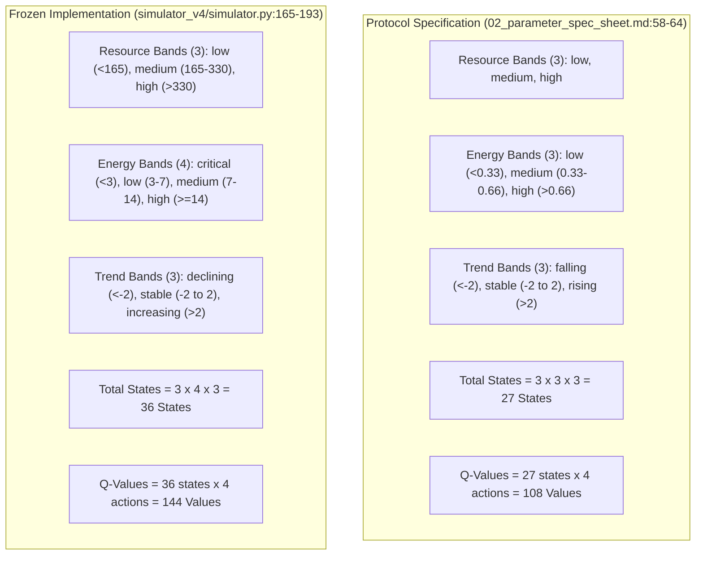

# Version D: Final Methodological Evaluation, State Space Audit & Decision Framework

**Document:** `calibration_logs/version_d/version_d_final_design_blockers.md`  
**Date:** 2026-11-02  
**Target:** Explicit Scientific Decisions, State-Space Audit, Static Control Mechanics, and Causal Telemetry prior to Implementation Authorization  
**Companion File:** [`calibration_logs/version_d/version_d_research_design_review.md`](file:///Users/nish/home/Research%20Project/calibration_logs/version_d/version_d_research_design_review.md)  
**Foundational References:** [`docs/research_protocol/01_research_protocol.md`](file:///Users/nish/home/Research%20Project/docs/research_protocol/01_research_protocol.md), [`docs/research_protocol/02_parameter_spec_sheet.md`](file:///Users/nish/home/Research%20Project/docs/research_protocol/02_parameter_spec_sheet.md), [`docs/research_protocol/06_submission_roadmap.md`](file:///Users/nish/home/Research%20Project/docs/research_protocol/06_submission_roadmap.md), [`calibration_logs/version_d/stage1_calibration_report.md`](file:///Users/nish/home/Research%20Project/calibration_logs/version_d/stage1_calibration_report.md)  
**Status:** Methodologically Finalized (Awaiting PI Signature)  
**Execution Guard:** Strictly documentation-only. No simulator code or parameters modified; no experiments run; no frozen data altered; no implementation authorized.

---

## 1. Task 1: Verification of the 27-State vs. 36-State Discrepancy

A forensic inspection of the approved protocol documents and the frozen `simulator_v4` implementation was conducted to establish the exact architecture of the agent observation state space.

### Forensic Evidentiary Findings

1. **Exact Number of Resource Bands: 3**
   - Both specification and code implement 3 identical resource bands: `low` ($R < 165.0$), `medium` ($165.0 \le R \le 330.0$), `high` ($R > 330.0$).
2. **Exact Number of Energy Bands: 4 in Code vs. 3 in Protocol**
   - In [`docs/research_protocol/02_parameter_spec_sheet.md:61`](file:///Users/nish/home/Research%20Project/docs/research_protocol/02_parameter_spec_sheet.md#L61), energy is partitioned into 3 tertiles: `low` ($< 0.33 E_{\max} = 6.6$), `medium` ($6.6$–$13.2$), `high` ($> 13.2$).
   - In [`simulator_v4/simulator.py:171-177`](file:///Users/nish/home/Research%20Project/simulator_v4/simulator.py#L171-L177), `_get_energy_band()` defines 4 bins:
     - `critical`: $E < 3.0$
     - `low`: $3.0 \le E < 7.0$
     - `medium`: $7.0 \le E < 14.0$
     - `high`: $E \ge 14.0$
3. **Exact Number of Trend Bands: 3**
   - Both implement 3 bands based on $\Delta R = R(t) - R(t-1)$ with identical threshold $\pm 2.0$ units.
4. **Exact Number of Possible States:**
   - **Protocol Specification:** $3 \times 3 \times 3 = \mathbf{27\text{ states}}$.
   - **Current Implementation:** $3 \times 4 \times 3 = \mathbf{36\text{ states}}$.
5. **Exact Number of Q-Values per Learner:**
   - **Protocol Specification:** $27 \times 4 = \mathbf{108\text{ Q-values}}$.
   - **Current Implementation:** $36 \times 4 = \mathbf{144\text{ Q-values}}$.
6. **Q-Table Initialization & Runtime Verification:**
   - In [`simulator_v4/agents.py:30`](file:///Users/nish/home/Research%20Project/simulator_v4/agents.py#L30), Q-tables are initialized as lazy dictionaries (`default_factory=dict`). State entries are populated dynamically via `.setdefault(state, [0.0] * 4)`.
   - Runtime inspection of simulated runs under Seed 1001 verifies that all four energy bands (`critical`, `low`, `medium`, `high`) are actively instantiated in agent Q-tables. The `critical` band is actively populated when agent energy falls below 3.0 prior to starvation.
7. **Documentation Discrepancy & Test Coverage:**
   - [`02_parameter_spec_sheet.md:64`](file:///Users/nish/home/Research%20Project/docs/research_protocol/02_parameter_spec_sheet.md#L64) explicitly claims 27 states and 108 values.
   - Unit tests in `simulator_v4/tests/test_version_d.py` test specific arbitrary tuples (e.g., `("medium", "medium", "stable")`), never asserting total state space cardinality or testing the `critical` band directly.
   - Claims that 27 states offer faster convergence are theoretically plausible (smaller state space), but remain an unverified hypothesis in this specific environment.

### Recommendation for PI Decision (DEC-08)
- **PI Recommendation:** **Retain 36 states as the current implementation baseline.** Do not modify the frozen codebase to force alignment with the old spec. Approve the 36-state model through a formal protocol amendment explaining that the `critical` energy band ($E < 3.0$) provides an essential starvation-warning perceptual signal.

---

## 2. Task 2: Static Mixture Edge Cases & Operational Rules

In the static 50/50 control group (`static_mixture`), **Deficit-Targeted Offspring Assignment** is an engineered composition-maintenance control designed to separate behavioral diversity from frequency-dependent selection.

To eliminate any ambiguity or potential overlap between count comparison and capacity thresholds, offspring assignment follows a **strict 3-tier priority hierarchy**:
1. **Priority 1 (Extinction Recovery):** If one subpopulation has count zero ($N_F = 0$ or $N_Q = 0$), the newborn is mandatorily assigned to the extinct type, funded by the surviving type.
2. **Priority 2 (Deficit Elimination):** If type counts are unequal ($N_F \ne N_Q$), the newborn is assigned to whichever type currently has the lower count (larger deficit relative to parity). This mathematical rule holds uniformly across all population states ($N < 50$, $N = 50$, and $N > 50$), because $(25 - N_F > 25 - N_Q) \iff N_F < N_Q$.
3. **Priority 3 (Parity Tie-Breaking):** If type counts are exactly equal ($N_F = N_Q$), the newborn type is assigned via fair Bernoulli trial ($p = 0.50$).

| Population State | Operational Assignment Rule | Offspring Behavioral Policy & Inheritance | Methodological Status |
| :--- | :--- | :--- | :--- |
| **Subpopulation Extinction ($N_F = 0$ or $N_Q = 0$)** | **Priority 1:** Mandatory reintroduction: next birth funded by surviving type is assigned to extinct type. | If Fixed extinct: Q-parent pays 10 energy; newborn is Fixed with Fixed table. If Q extinct: Fixed-parent pays 10 energy; newborn is Q with **clean zero Q-table**. | **Fully Defined, with Acknowledged Limitation:** Reintroduced Q-agents enter tabula rasa, lacking historical Q-lineage. |
| **Unequal Subpopulations ($N_F \ne N_Q$)** | **Priority 2:** Assigned to whichever type has lower count ($N_F < N_Q \implies$ Fixed; $N_Q < N_F \implies$ Q). Holds uniformly for $N < 50$, $N = 50$, and $N > 50$. | If Fixed: receives Fixed rule table. If Q: receives clean zero Q-table (if Fixed parent) or parent Q snapshot (if Q parent). | **Fully Defined.** Negative feedback monotonically pulls subpopulation counts towards parity. |
| **Equal Subpopulations ($N_F = N_Q$)** | **Priority 3:** Fair coin flip ($p=0.50$). | Standard policy assignment per newborn type. | **Fully Defined.** Unbiased stochastic allocation at balance. |
| **No Eligible Parent ($E < 15.0$ for all living agents)** | **Reproduction halts entirely.** No births occur until an agent accumulates $E \ge 15.0$. | N/A | **Fully Defined (No-Subsidy Invariant):** Adheres strictly to thermodynamic closure. No emergency births or external subsidies are permitted. |
| **Cross-Type Birth ($T_{\text{child}} \ne T_{\text{parent}}$)** | Parent pays 10 energy ($E \leftarrow E - 10$); newborn receives 10 energy. | Fixed parent births Q $\implies$ **clean zero Q-table**. Q parent births Fixed $\implies$ **Fixed heuristic table**. | **Fully Defined.** Cross-type cultural Q-table inheritance is strictly prohibited. |

### Documented Limitations of the Static Control
1. **Controls Composition, Not Experience:** The static control isolates population composition, but does **not** control for accumulated learning experience. When a Fixed parent funds a Q-newborn, that learner enters tabula rasa ($Q=0$), creating an experience disparity relative to the evolving group where all Q-newborns inherit parental tables.
2. **Somatic Lineage Subsidy:** When Q-agents forage aggressively and fund Fixed newborns, the Q-subpopulation pays the thermodynamic cost of recruiting individuals for the competing heuristic type.

---

## 3. Task 3: Harvest Telemetry & Descriptive Reference Accounting

### 1. Verification of Allocated vs. Requested Harvest Tracking
In [`simulator_v4/simulator.py:305-335`](file:///Users/nish/home/Research%20Project/simulator_v4/simulator.py#L305-L335), the engine explicitly distinguishes requested harvest from allocated harvest:
- **Requested Harvest (`requested_harvest`):** Total extraction demanded by agents during Stage 2 action selection ($\sum req_i$).
- **Allocated Harvest (`total_harvest`):** Actual resource extracted from the commons during Stage 3 after environmental rationing. When total requested exceeds available resource ($R < \sum req_i$), harvest is scaled pro-rata ($req_i \cdot R / \sum req$).
- **Telemetry Confirmation:**
  - `total_harvest` records **actual allocated harvest** extracted from the commons.
  - `fixed_allocated_harvest` and `q_allocated_harvest` record **actual allocated harvest** received by each subpopulation after rationing.

Dividing allocated harvest by living agents yields actual per-capita extraction:
$$\bar{h}_F(t) = \frac{\text{fixed\_allocated\_harvest}(t)}{N_{\text{fixed}}(t)}, \quad \bar{h}_Q(t) = \frac{\text{q\_allocated\_harvest}(t)}{N_Q(t)}$$
The total allocated harvest identity strictly holds:
$$H_{\text{actual}}(t) = N_F(t) \cdot \bar{h}_F(t) + N_Q(t) \cdot \bar{h}_Q(t)$$

### 2. Fixed-Composition Reference Harvest
$$H_{\text{ref}}(t) = \frac{N(t)}{2} \cdot \bar{h}_F(t) + \frac{N(t)}{2} \cdot \bar{h}_Q(t)$$

### 3. Methodological Guard Against Causal Claims
$H_{\text{ref}}(t)$ is a **descriptive accounting calculation**, NOT causal evidence. It quantifies what harvest would be at step $t$ if the observed per-capita extraction rates were weighted equally across a 50/50 mix. It cannot predict counterfactual history because in an actual 50/50 population, resource dynamics and individual harvest decisions would have diverged. Causal attribution requires matched-seed comparisons ($\Delta t_{\text{deplete}}$) and exogenous ratio sweeps.

---

## 4. Master Decision Matrix & Protocol Governance

### Category 1: Decisions Ready for PI Approval

| Decision ID | Item | Recommended Decision | Evidentiary Justification |
| :---: | :--- | :--- | :--- |
| **DEC-01** | **Thermodynamic Energy Accounting** | **Approve Exact Dyadic Conservation:** Parent $-10.0$, Child $+10.0$, $\Delta E_{\text{birth}} = 0.000$; parent threshold $E \ge 15.0$. | Mathematically verified in `simulator_v4` to $1.63 \times 10^{-10}$. |
| **DEC-02** | **Sudden Shock Bug Fix** | **Approve Stock Halving:** Correct `simulator.py:214` to execute $R_{1000} \leftarrow 0.50 \cdot R_{1000}$, holding baseline $g = 0.10$ constant. | Restores compliance with [`01_research_protocol.md:114`](file:///Users/nish/home/Research%20Project/docs/research_protocol/01_research_protocol.md#L114). |
| **DEC-03** | **Static 50/50 Control Mechanics** | **Approve Deficit-Targeted Offspring Assignment:** Newborn assigned to minority type upon energy-funded birth, with documented limitations. | Isolates diversity from selection; strictly enforces no-subsidy rule when no parent has $E \ge 15.0$. |
| **DEC-04** | **Subpopulation Telemetry Additions** | **Approve Telemetry Expansion:** Add `fixed_mean_energy`, `q_mean_energy`, `fixed_eligible_count`, `q_eligible_count`, and per-type mortality to `StepRecord`. | Resolves telemetry blindspots identified in Stage 1 audit. |
| **DEC-05** | **Primary Outcome Analytics & Censoring** | **Approve Pre-Registered Metrics:** $S_{\text{post}}$ ($\Delta t = 20$), $\tau_{\text{rec}}$ (censored as `unrecovered`), and reject correlation indices. | Pre-shock baseline defined as mean reward over steps 900–999. |
| **DEC-06** | **Zero-Exclusion Calibration Architecture** | **Approve Two-Tiered Calibration:** Retain all seeds in manifest; evaluate pre-shock collapse as an ecological outcome; shock recovery on survivors. | Replaces arbitrary 8/10 hard gate with sound statistical practice. |

---

### Category 2: Decisions Requiring PI Discussion & Direction

| Decision ID | Discussion Topic | Competing Options | Core Trade-Off to Resolve |
| :---: | :--- | :--- | :--- |
| **DEC-07** | **Population Regulation Architecture** | **Option A (Crowding Only)** vs. **Option B (Scarcity Gating)** vs. **Option C (Combined)** vs. **Option D (Unrestricted)** | Option A bounds density at 50 but risks depletion if agents harvest aggressively. Option B halts breeding during scarcity but permits initial bloom. Option C combines both but adds behavioral assumptions. Option D is the unconstrained reference. |
| **DEC-08** | **Observation State Space** | **36 States (Implementation Default)** vs. **27 States (Protocol Specification)** | **PI Preference: Prefer 36 states through formal protocol amendment**, retaining the functional `critical` energy band ($E < 3.0$). |
| **DEC-09** | **Action Quota Sizing** | **Treatment B Quotas (1.0 max)** vs. **Treatment C Quotas (0.75 max)** | Keep unresolved pending regulation decision. Treatment B preserves historical continuity; Treatment C brings demand closer to $G_{\max} = 12.5$ but increases Fixed starvation risk. |
| **DEC-10** | **Turnover Paradigm Formalization** | **Option 2B (Adopt Decentralized Vital Rates)** vs. **Option 2A (Revert to Softmax Tournament)** | **PI Preference: Prefer decentralized vital rates**, subject to formal protocol amendment replacing tournament selection. |

---

### Category 3: Exact Protocol Amendments Required (for Protocol v2.0)
1. **Amendment 1 (Demographic Replacement):** Replace Section 3.3 (Softmax Tournament) with Section 3.3-D (Decentralized Energy-Funded Vital Rates with Regulation).
2. **Amendment 2 (Cultural Transmission):** Formalize Section 3.4-D (Gradual Q-Table Inheritance over 12 steps).
3. **Amendment 3 (Static Mixture Control):** Formalize Section 4.1-D (Deficit-Targeted Offspring Assignment with a strict 3-tier priority hierarchy and documented limitations).
4. **Amendment 4 (Ablation Formulations):** Formalize Section 4.2-D (Vital-rate mechanism ablations: survival-only group using an **age-based survival proxy** that rewards chronological age, not direct survival fitness; reward-only group using somatic energy surplus).
5. **Amendment 5 (Observation Space):** Formalize 36-state discretization in Section 2.4, incorporating the `critical` energy band ($E < 3.0$).

---

### Category 4: Conditions That Must Remain Unchanged (Scope Lock)
- Single well-mixed renewable commons ($K = 500.0, R_0 = 350.0$).
- Baseline regeneration rate $g = 0.10$; stressed regeneration rate $g = 0.05$.
- Biological maintenance cost $c = 0.20$ energy/step.
- Senescence retirement age $A_{\max} = 100$ steps.
- Q-learning hyperparameters ($\alpha = 0.10, \gamma = 0.95, \epsilon_0 = 0.20 \to 0.02$).
- **Strict Seed Disjointness:**
  - Dedicated calibration seeds: **Seeds 901–910** (10 independent seeds, 2,000 steps).
  - Common matched production seeds: **Seeds 1001–1030** (30 pre-registered seeds, 2,000 steps).
  - Zero overlap between calibration and production data ($[901, 910] \cap [1001, 1030] = \emptyset$).
- Production run horizon $T = 2,000$ steps.
- Complete historical preservation of Version A, B, C, and Version D Stage 1 calibration artifacts.

---

### Category 5: Remaining Scientific & Technical Limitations
1. **Discretization Bias:** Tabular RL requires coarse discretization of continuous resource and energy dynamics.
2. **Spatial Well-Mixed Commons:** The model abstracts away spatial patches, local depletion, and migration.
3. **Matched Seed Divergence:** Matched PRNG seeds synchronize initial conditions, but trajectories fall out of step once demographic events diverge.
4. **Static Control Asymmetry:** Cross-type births in `static_mixture` force Q-agents to subsidize Fixed recruitment and instantiate new Q-learners tabula rasa.

---

### Strict Implementation Guard Statement

**IMPLEMENTATION AND SIMULATION RUNS REMAIN COMPLETELY UNAUTHORIZED.**

- All code in `simulator_v4/` remains completely untouched.
- No parameters have been altered.
- No simulation scripts have been executed.
- All historical calibration files (`results_v4/calibration/`) remain pristine and frozen.
- Coding of the next release candidate (`sim-4.1.0`) will begin only upon explicit, written authorization of decisions DEC-01 through DEC-10 by the Principal Investigator.
