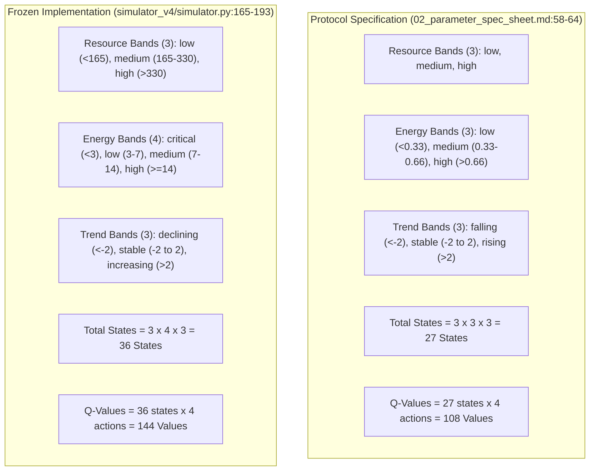
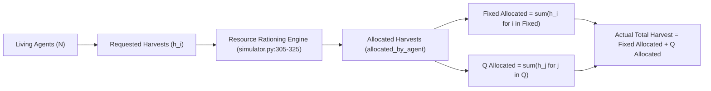

# Version D: Final Methodological Evaluation, State Space Audit & Decision Framework

**Document:** `calibration_logs/version_d/version_d_final_design_blockers.md`  
**Date:** 2026-11-02  
**Target:** Explicit Scientific Decisions, State-Space Audit, Static Control Mechanics, and Causal Telemetry prior to Implementation Authorization  
**Companion File:** [`calibration_logs/version_d/version_d_research_design_review.md`](file:///Users/nish/home/Research%20Project/calibration_logs/version_d/version_d_research_design_review.md)  
**Foundational References:** [`docs/research_protocol/01_research_protocol.md`](file:///Users/nish/home/Research%20Project/docs/research_protocol/01_research_protocol.md), [`docs/research_protocol/02_parameter_spec_sheet.md`](file:///Users/nish/home/Research%20Project/docs/research_protocol/02_parameter_spec_sheet.md), [`docs/research_protocol/06_submission_roadmap.md`](file:///Users/nish/home/Research%20Project/docs/research_protocol/06_submission_roadmap.md), [`calibration_logs/version_d/stage1_calibration_report.md`](file:///Users/nish/home/Research%20Project/calibration_logs/version_d/stage1_calibration_report.md)  
**Status:** Complete Methodological Audit (Awaiting PI Signature)  
**Execution Guard:** Strictly documentation-only. No simulator code or parameters modified; no experiments run; no frozen data altered; no implementation authorized.

---

## 1. Task 1: Resolution of the 27-State vs. 36-State Discrepancy

A forensic inspection of the approved protocol documents and the frozen `simulator_v4` implementation was conducted to establish the exact architecture of the agent observation state space.

### Forensic Evidentiary Findings

1. **Exact Number of Resource Bands: 3**
   - Both specification and code implement 3 identical resource bands: `low` ($R < 165.0$), `medium` ($165.0 \le R \le 330.0$), `high` ($R > 330.0$).
2. **Exact Number of Energy Bands: 4 in Code vs. 3 in Protocol**
   - In [`docs/research_protocol/02_parameter_spec_sheet.md:61`](file:///Users/nish/home/Research%20Project/docs/research_protocol/02_parameter_spec_sheet.md#L61), energy is partitioned into 3 tertiles: `low` ($< 0.33 E_{\max} = 6.6$), `medium` ($6.6$–$13.2$), `high` ($> 13.2$).
   - In [`simulator_v4/simulator.py:171-177`](file:///Users/nish/home/Research%20Project/simulator_v4/simulator.py#L171-L177), `_get_energy_band()` defines 4 bins:
     - `critical`: $E < 3.0$
     - `low`: $3.0 \le E < 7.0$
     - `medium`: $7.0 \le E < 14.0$
     - `high`: $E \ge 14.0$
3. **Exact Number of Trend Bands: 3**
   - Both implement 3 bands based on $\Delta R = R(t) - R(t-1)$ with identical threshold $\pm 2.0$ units.
4. **Exact Number of Possible States:**
   - **Protocol Specification:** $3 \times 3 \times 3 = \mathbf{27\text{ states}}$.
   - **Current Implementation:** $3 \times 4 \times 3 = \mathbf{36\text{ states}}$.
5. **Exact Number of Q-Values per Learner:**
   - **Protocol Specification:** $27 \times 4 = \mathbf{108\text{ Q-values}}$.
   - **Current Implementation:** $36 \times 4 = \mathbf{144\text{ Q-values}}$.
6. **Consistency of the Fourth Energy Band in Code:**
   - The dictionary `agent.q_own` is indexed dynamically as tuples `(resource_band, energy_band, trend_band)`. The 4 energy bands are generated consistently across all steps in [`simulator.py:190-192`](file:///Users/nish/home/Research%20Project/simulator_v4/simulator.py#L190-L192) and learned via [`agent.update_q_value()`](file:///Users/nish/home/Research%20Project/simulator_v4/agents.py#L91-L114).
7. **Documentation Discrepancy:**
   - Both [`02_parameter_spec_sheet.md:64`](file:///Users/nish/home/Research%20Project/docs/research_protocol/02_parameter_spec_sheet.md#L64) and earlier audit drafts incorrectly asserted that the model uses 27 states and 108 values, failing to detect that `simulator_v4` implemented the 4-band energy partition. Unit tests in `simulator_v4/tests/test_version_d.py` test specific arbitrary tuples (e.g., `("medium", "medium", "stable")`), never asserting total state space cardinality.

### Design Trade-Offs & Recommendation for PI Decision
- **27-State Model (Protocol Default):**
  - *Pros:* Fully compliant with pre-registered protocol sheet; faster tabular convergence (108 values); fewer exploration steps required.
  - *Cons:* Lacks a dedicated warning state for imminent starvation ($E < 3.0$), grouping near-death agents with agents having up to $6.6$ energy.
- **36-State Model (Implementation Default):**
  - *Pros:* Biologically functional; the `critical` band ($E < 3.0$) gives Q-learning an explicit perceptual signal to harvest before starving; already verified in `sim-4.0.0` calibration.
  - *Cons:* Protocol sheet must be formally amended to 36 states; requires 33% more state-action pairs to converge.
- **Recommendation:** Formally amend the protocol to adopt the **36-state model** (DEC-08), acknowledging that the `critical` starvation band is necessary for viable tabular learning under biological maintenance costs.

---

## 2. Task 2: Static Mixture Edge Cases & Unresolved Rules

In the static 50/50 control group (`static_mixture`), **Deficit-Targeted Offspring Assignment** is an engineered composition-maintenance control. We audit all edge cases:

| Population & Demographic State | Procedural Assignment Rule | Offspring Behavioral Policy & Table Initialization | Methodological Integrity / Unresolved Issues |
| :--- | :--- | :--- | :--- |
| **$N < 50$ (Population Contraction)** | Assigned to type with larger absolute deficit: $\Delta_F = 25 - N_F$ vs $\Delta_Q = 25 - N_Q$. If $\Delta_F = \Delta_Q$, fair coin flip ($p=0.5$). | If Fixed: receives Fixed rule table. If Q: receives clean zero Q-table (if Fixed parent) or parent Q-table (if Q parent). | **Fully Defined.** Negative feedback pulls subpopulation counts towards 25. |
| **$N = 50$ (Nominal Capacity)** | If $N_F < 25 \implies$ Fixed. If $N_Q < 25 \implies$ Q-learning. If $N_F = N_Q = 25 \implies$ coin flip ($p=0.5$). | Standard policy assignment per newborn type. | **Fully Defined.** Maintains exact parity. |
| **$N > 50$ (Simultaneous Birth Overshoot)** | Assigned to minority proportion: if $N_F < N/2 \implies$ Fixed; if $N_Q < N/2 \implies$ Q; if $N_F = N_Q \implies$ coin flip. | Standard policy assignment per newborn type. | **Fully Defined.** Directs births to minority type during demographic blooms. |
| **Subpopulation Extinction ($N_F = 0$ or $N_Q = 0$)** | Mandatory reintroduction: next birth funded by surviving type is assigned to extinct type. | If Fixed extinct: Q-parent pays 10 energy; newborn is Fixed with Fixed table. If Q extinct: Fixed-parent pays 10 energy; newborn is Q with **clean zero Q-table**. | **Defined, with Confound:** Re-injected Q-agent starts tabula rasa, lacking cultural Q-table lineage. |
| **Total Extinction ($N = 0$)** | Simulation terminates. No reproduction can occur. | N/A | **Fully Defined.** Recorded as total population extinction. |
| **Cross-Type Birth ($T_{\text{child}} \ne T_{\text{parent}}$)** | Parent pays 10 energy ($E \leftarrow E - 10$); newborn receives 10 energy. | Fixed parent births Q $\implies$ **clean zero Q-table**. Q parent births Fixed $\implies$ **Fixed heuristic table**. | **Fully Defined.** Cross-type cultural Q-table inheritance is strictly prohibited. |

### Remaining Undefined Rules Requiring Formal Protocol Direction
1. **Zero-Parent Extinction Edge Case:** If *no living agent of either type* satisfies the $E \ge 15.0$ threshold, but agents remain alive ($0 < N < 50$), reproduction halts entirely. Does the protocol permit exogenous founder re-injection, or does the cohort proceed to starvation? *(Current spec requires zero exogenous injection; population must self-fund or perish).*
2. **Q-Lineage Disruption in Re-injected Learners:** When Q-agents are re-injected after local extinction, should they receive a frozen snapshot of the *historical founder Q-table*, or must they start completely tabula rasa ($Q=0$)? *(Recommended: Tabula rasa, consistent with zero-subsidy thermodynamics).*

---

## 3. Task 3: Harvest Telemetry & Descriptive Reference Accounting

We audited the harvest calculation and tracking pipeline in `simulator_v4`:

### 1. Verification of Type-Specific Harvest Calculation
In [`simulator_v4/simulator.py:320-335`](file:///Users/nish/home/Research%20Project/simulator_v4/simulator.py#L320-L335), the simulator explicitly tracks allocated harvest per agent:
- `fixed_allocated_harvest`: $\sum_{i \in \text{Fixed}} H_i(t)$
- `q_allocated_harvest`: $\sum_{j \in Q} H_j(t)$
- `total_harvest`: $\sum_{a \in \text{All}} H_a(t) = \text{fixed\_allocated} + \text{q\_allocated}$

Dividing by living subpopulation counts yields the exact per-capita extraction rates:
$$\bar{h}_F(t) = \frac{\text{fixed\_allocated\_harvest}(t)}{N_{\text{fixed}}(t)}, \quad \bar{h}_Q(t) = \frac{\text{q\_allocated\_harvest}(t)}{N_Q(t)}$$
The codebase strictly satisfies the identity:
$$H_{\text{actual}}(t) = N_F(t) \cdot \bar{h}_F(t) + N_Q(t) \cdot \bar{h}_Q(t)$$

### 2. Fixed-Composition Reference Harvest vs. Actual Harvest
To monitor extraction divergence between evolving and balanced populations, we define:
$$H_{\text{ref}}(t) = \frac{N(t)}{2} \cdot \bar{h}_F(t) + \frac{N(t)}{2} \cdot \bar{h}_Q(t)$$

### 3. Absolute Prohibition of Causal Attribution
- **Descriptive Utility Only:** $H_{\text{ref}}(t)$ is an instantaneous accounting metric that calculates what total extraction would be *if the observed per-capita extraction rates were weighted equally across a 50/50 mix*.
- **Why It Is NOT Causal:** In an actual 50/50 population, resource dynamics would differ, altering agent state observations and individual harvest decisions. Causal attribution requires matched-seed comparisons ($\Delta t_{\text{deplete}}$ between `evolving_joint` and `static_mixture`) and controlled exogenous ratio sweeps, not retrospective formulaic decomposition.

---

## 4. Master Decision & Protocol Governance Matrix

### Category 1: Decisions Ready for PI Approval

| Decision ID | Item | Recommended Decision | Justification |
| :---: | :--- | :--- | :--- |
| **DEC-01** | **Thermodynamic Energy Accounting** | **Approve Exact Dyadic Conservation:** Parent $-10.0$, Child $+10.0$, $\Delta E_{\text{birth}} = 0.000$; parent threshold $E \ge 15.0$. | Mathematically verified in `simulator_v4` to $1.63 \times 10^{-10}$. |
| **DEC-02** | **Sudden Shock Bug Fix** | **Approve Stock Halving:** Correct `simulator.py:214` to execute $R_{1000} \leftarrow 0.50 \cdot R_{1000}$, holding baseline $g = 0.10$ constant. | Restores compliance with [`01_research_protocol.md:114`](file:///Users/nish/home/Research%20Project/docs/research_protocol/01_research_protocol.md#L114). |
| **DEC-03** | **Static 50/50 Control Mechanics** | **Approve Deficit-Targeted Offspring Assignment:** Newborn assigned to minority type ($N_{\text{type}} < N/2$) upon energy-funded birth. | Isolates diversity from selection without artificial state clamping. |
| **DEC-04** | **Subpopulation Telemetry Additions** | **Approve Telemetry Expansion:** Add `fixed_mean_energy`, `q_mean_energy`, `fixed_eligible_count`, `q_eligible_count`, and per-type mortality to `StepRecord`. | Resolves telemetry blindspots identified in audit. |
| **DEC-05** | **Primary Outcome Analytics & Censoring** | **Approve Pre-Registered Metrics:** $S_{\text{post}}$ ($\Delta t = 20$), $\tau_{\text{rec}}$ (censored as `unrecovered`), and reject correlation indices. | Protects against survivorship bias and p-hacking. |
| **DEC-06** | **Zero-Exclusion Calibration Architecture** | **Approve Two-Tiered Calibration:** Retain all seeds in manifest; evaluate pre-shock collapse as an ecological outcome; shock recovery on survivors. | Replaces arbitrary 8/10 hard gate with sound statistical practice. |

---

### Category 2: Decisions Requiring PI Discussion & Direction

| Decision ID | Discussion Topic | Competing Options | Core Trade-Off to Resolve |
| :---: | :--- | :--- | :--- |
| **DEC-07** | **Population Regulation Architecture** | **Option A (Crowding Only)** vs. **Option B (Scarcity Gating)** vs. **Option C (Combined)** vs. **Option D (Unrestricted)** | Option A bounds density at 50 but risks depletion if agents harvest aggressively. Option B halts breeding during scarcity but permits initial bloom. Option C combines both but adds behavioral assumptions. Option D is the unconstrained reference. |
| **DEC-08** | **Observation State Space** | **36 States (Implementation Default)** vs. **27 States (Protocol Specification)** | Code implements 4 energy bands (including `critical` $<3.0$), yielding 36 states (144 Q-values). Protocol sheet specifies 3 energy bands (27 states, 108 Q-values). |
| **DEC-09** | **Action Quota Sizing** | **Treatment B Quotas (1.0 max)** vs. **Treatment C Quotas (0.75 max)** | Treatment B preserves historical continuity with Version D Stage 1. Treatment C brings 50-agent demand closer to $G_{\max} = 12.5$, but increases Fixed-agent starvation risk. |
| **DEC-10** | **Turnover Paradigm Formalization** | **Option 2B (Adopt Decentralized Vital Rates)** vs. **Option 2A (Revert to Softmax Tournament)** | Option 2B embraces Version D's bioenergetic breakthroughs but requires formal protocol amendments; Option 2A follows original protocol text. |

---

### Category 3: Exact Protocol Amendments Required (for Protocol v2.0)
1. **Amendment 1 (Demographic Replacement):** Replace Section 3.3 (Softmax Tournament) with Section 3.3-D (Decentralized Energy-Funded Vital Rates with Regulation).
2. **Amendment 2 (Cultural Transmission):** Formalize Section 3.4-D (Gradual Q-Table Inheritance over 12 steps).
3. **Amendment 3 (Static Mixture Control):** Formalize Section 4.1-D (Deficit-Targeted Offspring Assignment).
4. **Amendment 4 (Ablation Formulations):** Formalize Section 4.2-D (Vital-rate survival and reward ablations).
5. **Amendment 5 (Observation Space):** Formalize 36-state vs. 27-state discretization in Section 2.4.

---

### Category 4: Conditions That Must Remain Unchanged (Scope Lock)
- Single well-mixed renewable commons ($K = 500.0, R_0 = 350.0$).
- Baseline regeneration rate $g = 0.10$; stressed regeneration rate $g = 0.05$.
- Biological maintenance cost $c = 0.20$ energy/step.
- Senescence retirement age $A_{\max} = 100$ steps.
- Q-learning hyperparameters ($\alpha = 0.10, \gamma = 0.95, \epsilon_0 = 0.20 \to 0.02$).
- Common matched seeds (Seeds 1001–1030) across all groups.
- Production run horizon $T = 2,000$ steps.
- Complete historical preservation of Version A, B, C, and Version D Stage 1 calibration artifacts.

---

### Category 5: Remaining Scientific & Technical Limitations
1. **Discretization Bias:** Tabular RL requires coarse discretization of continuous resource and energy dynamics.
2. **Spatial Well-Mixed Commons:** The model abstracts away spatial patches, local depletion, and migration.
3. **Matched Seed Divergence:** Matched PRNG seeds synchronize initial conditions, but trajectories fall out of step once demographic events diverge.
4. **Static Control Asymmetry:** Cross-type births in `static_mixture` force Q-agents to subsidize Fixed recruitment and instantiate new Q-learners tabula rasa.

---

### Strict Implementation Guard Statement

**IMPLEMENTATION AND SIMULATION RUNS REMAIN COMPLETELY UNAUTHORIZED.**

- All code in `simulator_v4/` remains completely untouched.
- No parameters have been altered.
- No simulation scripts have been executed.
- All historical calibration files (`results_v4/calibration/`) remain pristine and frozen.
- Coding of the next release candidate (`sim-4.1.0`) will begin only upon explicit, written authorization of decisions DEC-01 through DEC-10 by the Principal Investigator.
