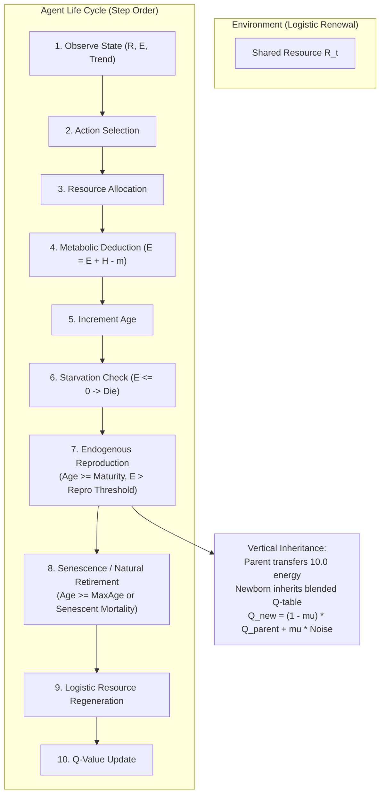

# Version D: Model Specification & Architectural Blueprint

**Document:** `calibration_logs/version_d/version_d_model_specification.md`  
**Date:** 2026-11-01  
**Simulator Target:** `simulator_v4/` (`sim-4.0.0`, `params-v4.0`)  
**Status:** Architectural Specification (Drafted for Review Prior to Implementation)  

---

## 1. Executive Summary & Foundational Motivation

### The Scientific Gap in Version C:
Version C successfully established an energy-conserved, parent-funded thermodynamic system where exogenous energy subsidies were completely eliminated. However, mechanism experiments in Stage 3 exposed two critical structural limitations in the Version C demographic framework:
1. **The Artificial Vacancy Constraint:** Reproduction could **only** occur when a death opened a vacancy below a rigid, static carrying capacity ceiling ($N_{\max} = 50$). When ecological conditions were viable (Stage 3B, Treatments B & C), zero agents died before step 100, which completely froze reproduction during the entire active lifespan of founders, despite 100% of agents possessing surplus reproductive energy ($E > 10.0$).
2. **Synchronized Founder Cliff:** All founders began at `age = 0` and reached `age = 100` at the exact same step. Because retiring agents were strictly prohibited from parenting, the population collapsed instantaneously to zero.
3. **Tabula Rasa Newborns:** Newborn Q-learning agents received an empty Q-table (`q_table = {}`), discarding all learned ecological experience and requiring every new generation to re-learn foraging policies via random exploration ($\varepsilon = 0.20 \to 0.02$).

### The Version D Architectural Breakthrough:
Version D replaces exogenous demographic engineering with an **endogenous life-history framework**:
- **Energy-Dependent, Age-Dependent Reproduction:** Reproduction is an internal physiological decision, triggered when an adult agent accumulates sufficient surplus energy, independent of artificial vacancy quotas.
- **Gradual Q-Table Inheritance:** Newborn Q-agents inherit a blended, noisy copy of their parent's learned policy, enabling multi-generational cultural transmission and policy evolution.
- **Dynamic Carrying Capacity:** Population size fluctuates organically around the ecological carrying capacity dictated by resource regrowth and metabolic maintenance.

---

## 2. Mathematical Model & Mechanics Specification

### A. Environment & Foraging Action Space
- **Resource Dynamics:** $G(R_t) = g R_t (1 - R_t / K)$ with $g = 0.10, K = 500, R_0 = 350$.
- **Harvesting Actions:** Adopts the ecologically verified **Treatment B / C scaled action space** (to ensure the commons is physically capable of supporting the community):
  - `rest`: $0.000$ units
  - `conservative`: $0.250$ units
  - `moderate`: $0.500$ units
  - `aggressive`: $1.000$ units
- **Maintenance Cost:** $m = 0.20$ units/step.
- **Maximum Energy Storage:** $E_{\max} = 25.0$ units (slightly expanded from 20.0 to allow physiological buffering above reproductive cost).

### B. Endogenous Reproduction (Energy-Dependent & Age-Dependent)
Reproduction no longer requires an external vacancy. Any living agent reproduces when both developmental and energetic criteria are satisfied:
1. **Maturity Threshold ($\text{Age} \ge A_{\text{mature}}$):**
   - Agents must reach sexual/reproductive maturity before reproducing ($A_{\text{mature}} = 20\text{ steps}$).
   - Prevents infant reproduction and enforces a biological juvenile phase.
2. **Surplus Energy Threshold ($E_t \ge E_{\text{repro}}$):**
   - The parent must have accumulated substantial energy reserves ($E_{\text{repro}} = 15.0\text{ units}$).
3. **Reproduction Cost & Transfer:**
   - Parent incurs a biological reproduction cost: $\Delta E_{\text{cost}} = 10.0$ units.
   - Newborn starts with exactly $E_{\text{newborn}} = 10.0$ units.
   - Parent retains: $E_{\text{parent}} \gets E_{\text{parent}} - 10.0 \ge 5.0$ units.
   - **Energy conservation:** $E_{\text{parent, before}} = E_{\text{parent, after}} + E_{\text{newborn}}$ ($\Delta E = 0.000$; strictly zero external subsidy).
4. **Refractory / Inter-Birth Period ($T_{\text{cooldown}}$):**
   - To prevent hyper-exponential blooms, an agent that reproduces must wait $T_{\text{cooldown}} = 10\text{ steps}$ before being eligible to reproduce again.
5. **Soft Density Dependence (Space / Resource Competition):**
   - While reproduction is endogenous, high local density or crowding can optionally modulate offspring survival if total population exceeds ecological capacity ($N > N_{\text{soft}}$).

### C. Gradual Q-Table Inheritance (Cultural Policy Transmission)
When a Q-learning agent reproduces, the offspring does not start tabula rasa. It inherits its parent's learned foraging experience with tunable transmission fidelity:

$$\mathbf{Q}_{\text{offspring}}(s, a) = (1 - \mu) \cdot \mathbf{Q}_{\text{parent}}(s, a) + \mu \cdot \xi(s, a)$$

Where:
- $\mathbf{Q}_{\text{parent}}(s, a)$: The parent's converged Q-value for state-action pair $(s, a)$.
- $\mu \in [0.0, 1.0]$: Policy mutation / noise rate (e.g., $\mu = 0.10$ for $90\%$ cultural fidelity).
- $\xi(s, a) \sim \mathcal{N}(0, \sigma^2)$: Exploration noise or freshly initialized baseline values.
- **Fixed Agents:** Offspring of Fixed agents inherit the identical fixed heuristic policy.
- **Mixed Offspring:** Offspring strictly inherit the parent's kind (`kind = parent.kind`), or with an optional small speciation/mutation probability.

### D. Age Structure & Senescence
To eliminate the artificial step-100 cohort extinction cliff:
1. **Initial Founder Age Dispersion:**
   - At step 0, founders are initialized with a distributed age structure:
     $$\text{Age}_i \sim \mathcal{U}(0, A_{\max} - 1) \quad \text{or staggered cohorts } \{0, 20, 40, 60, 80\}$$
2. **Gradual Senescence / Mortality:**
   - Maximum biological lifespan remains $A_{\max} = 100\text{ steps}$.
   - Because founder ages are staggered, retirements occur continuously (e.g., $10$ agents retire every $20$ steps), matching the rate of new juvenile recruitment.
   - Retiring agents leave the population; any residual unspent energy is logged to `cumulative_retirement_losses`.

---

## 3. Comparison Matrix: Version C vs. Version D

| Dimension | Version C (`sim-3.0.0`) | Version D (`sim-4.0.0`) |
| :--- | :--- | :--- |
| **Reproduction Trigger** | Vacancy-driven (only when $N < 50$ after deaths) | **Endogenous physiological state** ($E \ge 15.0$ and $\text{Age} \ge 20$) |
| **Population Capacity** | Hard static ceiling ($N = 50$) | **Dynamic ecological equilibrium** (emerges from harvest vs. metabolic burn) |
| **Q-Table Initialization** | Empty dictionary (`q_table = {}`, tabula rasa) | **Gradual inheritance** from parent ($\mathbf{Q}_{\text{child}} \approx \mathbf{Q}_{\text{parent}}$ with mutation) |
| **Founder Age Structure** | Synchronized cohort (all founders $\text{Age} = 0$) | **Distributed / staggered cohorts** ($\text{Age} \sim \mathcal{U}(0, 99)$) |
| **Retirement Dynamics** | Synchronized cliff (100% die at step 100) | **Continuous turnover** (steady generational recruitment and retirement) |
| **Energy Conservation** | Strictly closed ($\Delta E = 0.0$) | **Strictly closed** ($\Delta E = 0.0$; parent transfers exactly $10.0$) |
| **Harvest Action Space** | Baseline or experimental quotas | **Pre-calibrated sustainable quotas** (Treatment B/C scaling) |

---

## 4. Implementation & Validation Roadmap

### Step 1: Simulator Architecture (`simulator_v4/`)
- `simulator_v4/parameters.py`: Add parameters for $A_{\text{mature}}$, $E_{\text{repro}}$, $T_{\text{cooldown}}$, inheritance rate $(1-\mu)$, and initial age distribution mode.
- `simulator_v4/agents.py`: Implement `inherit_q_table()` with tunable mutation.
- `simulator_v4/reproduction.py`: Implement endogenous physiological reproduction checks.
- `simulator_v4/simulator.py`: Integrate continuous lifecycle and dynamic population tracking.

### Step 2: Unit Testing Suite (`simulator_v4/tests/`)
1. Energy conservation: verify $\Delta E < 10^{-10}$ across parent-child transfers.
2. Reproductive constraints: verify agents with $\text{Age} < 20$ or $E < 15.0$ cannot reproduce.
3. Cooldown enforcement: verify parents cannot reproduce on consecutive steps within $T_{\text{cooldown}}$.
4. Inheritance fidelity: verify $\mathbf{Q}_{\text{child}}$ correlates with $\mathbf{Q}_{\text{parent}}$ at fidelity $1-\mu$.
5. Continuous turnover: verify asynchronous retirements occur without population collapse.

### Step 3: Phase 1 Calibration & Benchmark Experiments
- Run matched seeds 1001–1010 for 2,000 steps.
- Evaluate multi-generational persistence beyond step 100, step 500, and step 1,000.

