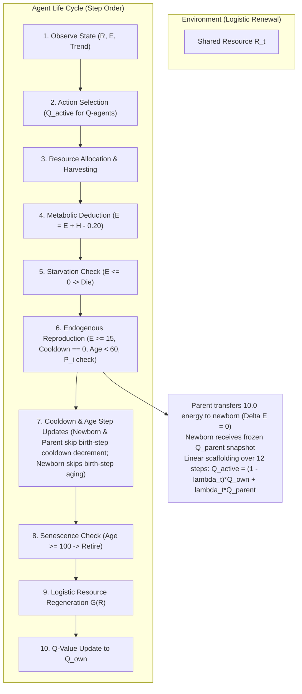

# Version D: Model Specification & Architectural Blueprint

**Document:** `calibration_logs/version_d/version_d_model_specification.md`  
**Date:** 2026-11-01  
**Simulator Target:** `simulator_v4/` (`sim-4.0.0`, `params-v4.0`)  
**Status:** Architectural Specification (Drafted for Review Prior to Implementation)  

---

## 1. Executive Summary & Foundational Motivation

### The Scientific Gap in Version C:
Version C successfully established an energy-conserved, parent-funded thermodynamic system where exogenous energy subsidies were completely eliminated. However, mechanism experiments in Stage 3 exposed two critical structural limitations in the Version C demographic framework:
1. **The Artificial Vacancy Constraint:** Reproduction could **only** occur when a death opened a vacancy below a rigid, static carrying capacity ceiling ($N_{\max} = 50$). When ecological conditions were viable (Stage 3B, Treatments B & C), zero agents died before step 100, which completely froze reproduction during the entire active lifespan of founders, despite 100% of agents possessing surplus reproductive energy ($E > 10.0$).
2. **Synchronized Founder Cliff:** All founders began at `age = 0` and reached `age = 100` at the exact same step. Because retiring agents were strictly prohibited from parenting, the population collapsed instantaneously to zero.
3. **Tabula Rasa Newborns:** Newborn Q-learning agents received an empty Q-table (`q_table = {}`), discarding all learned ecological experience and requiring every new generation to re-learn foraging policies via random exploration ($\varepsilon = 0.20 \to 0.02$).

### The Version D Architectural Breakthrough:
Version D replaces exogenous demographic engineering with an **endogenous life-history framework**:
- **Energy-Dependent, Age-Dependent Reproduction:** Reproduction is an internal physiological decision, triggered when an adult agent accumulates sufficient surplus energy, independent of artificial vacancy quotas.
- **Gradual Q-Table Inheritance:** Newborn Q-agents inherit a blended, noisy copy of their parent's learned policy, enabling multi-generational cultural transmission and policy evolution.
- **Dynamic Carrying Capacity:** Population size fluctuates organically around the ecological carrying capacity dictated by resource regrowth and metabolic maintenance.

---

## 2. Mathematical Model & Mechanics Specification

### A. Environment & Foraging Action Space
- **Resource Dynamics (Escapement Renewal):** In discrete time, biological regrowth depends on the residual spawning biomass remaining after harvest ($X_t = \max(0, R_t - H_t)$):
  $$R_{t+1} = \min\left(K, X_t + g X_t \left(1 - \frac{X_t}{K}\right)\right)$$
  with $g = 0.10, K = 500.0, R_0 = 350.0$. If standing stock is completely harvested ($X_t = 0$), natural regrowth is zero ($G(0) = 0$). Identical to Version B and Version C.
- **Harvesting Actions:** Adopts the **50% harvest-quota treatment** (calibrated in Stage 3B as Treatment B):
  - `rest`: $0.000$ units
  - `conservative`: $0.250$ units
  - `moderate`: $0.500$ units
  - `aggressive`: $1.000$ units
- **Maintenance Cost:** $m = 0.20$ units/step.
- **Maximum Energy Storage:** $E_{\max} = 25.0$ units (allowing physiological energy accumulation for reproduction).

### B. Endogenous Reproduction (Energy-Dependent & Age-Dependent)
Reproduction occurs without artificial vacancy requirements or population limits whenever an individual agent meets physiological criteria:
1. **Eligibility Criteria:**
   - Agent is living and active.
   - Energy $E_i \ge 15.0$ units.
   - Reproduction cooldown is satisfied (`reproduction_cooldown == 0`).
   - Agent is within reproductive lifespan ($a_i < 60$ steps).
   - Agent passes the stochastic reproduction check: $\text{Uniform}(0, 1) < P_i$.

2. **Energy-Dependent Probability Component:**
   Reproduction probability scales continuously between minimum energy ($15.0$) and target energy ($20.0$), with a maximum of $10\%$ per eligible step:
   $$P_i = 0.10 \cdot \operatorname{clip}\left(\frac{E_i - 15}{5}, 0, 1\right) \cdot A_i$$

3. **Age-Dependent Reproductive Ability ($A_i$):**
   $$A_i = \begin{cases}
   1.0 & a_i \le 45 \\
   \frac{60 - a_i}{15} & 45 < a_i < 60 \\
   0.0 & a_i \ge 60
   \end{cases}$$

4. **Reproduction Cooldown & Timing Rules:**
   - Minimum interval between births: $T_{\text{cooldown}} = 20$ steps.
   - Upon a successful birth, the parent's `reproduction_cooldown` is set to $20$.
   - **Cooldown Step Skipping:** A reproducing parent and a newborn skip the cooldown decrement on the birth step, ensuring a full 20-step refractory and juvenile period.
   - Failed reproduction attempts do not reset or alter the cooldown.
   - Newborns initialize with `reproduction_cooldown = 20` (acts as an innate juvenile phase of 20 steps before any reproduction can be considered).

5. **Age Timing at Birth:**
   - A newborn starts at $\text{Age} = 0$.
   - **Age Step Skipping:** A newborn does not age on the step it is born. Its first age increment occurs at the end of its first full simulation step.

6. **Parent-Funded Energy Transfer:**
   - Parent energy cost: $\Delta E_{\text{parent}} = -10.0$ units.
   - Parent retains: $E_{\text{parent}} \gets E_{\text{parent}} - 10.0 \ge 5.0$ units.
   - Newborn energy: $\Delta E_{\text{newborn}} = +10.0$ units.
   - **Thermodynamic conservation:** $\Delta E_{\text{birth}} = 0.000$ (strictly zero external subsidy).

7. **Population Dynamics (No Artificial Cap):**
   - Population capacity $N_{\max}$ is completely removed.
   - Initial population starts at $N_0 = 50$ (38 Fixed, 12 Q).
   - Population expands and contracts dynamically according to vital rates:
     $$N_{t+1} = N_t + B_t - D_t$$
   - The ecosystem is allowed to experience natural population growth, potential overshoot, self-regulation, or resource collapse based purely on ecological feedback.

### C. Gradual Q-Table Inheritance (Parental Policy Scaffolding)
When a Q-learning agent reproduces, the offspring inherits a frozen snapshot of the parent's converged Q-table at the moment of birth ($Q_{\text{parent}}$):
1. **Three Distinct Q-Tables:**
   - $Q_{\text{parent}}$: An immutable, frozen snapshot of the parent's active Q-table at the moment of birth. Never updated or modified after birth.
   - $Q_{\text{own}}$: The newborn's independently initialized and updated Q-table (starts empty/neutral).
   - $Q_{\text{active}}$: The dynamically blended table used for action selection.

2. **Active Q-Value Blending:**
   For an offspring of age $t$ steps ($t = 0, 1, 2, \dots$):
   $$Q_{\text{active}}(s, a) = (1 - \lambda_t) Q_{\text{own}}(s, a) + \lambda_t Q_{\text{parent}}(s, a)$$
   $$\lambda_t = 1 - \frac{\min(t, 12)}{12} = \frac{12 - \min(t, 12)}{12}$$

3. **Temporal Dynamics of Influence:**
   - Step $t=0$ (at birth): $\lambda_0 = 1.00$ ($100\%$ parental scaffolding).
   - Step $t=6$: $\lambda_6 = 0.50$ ($50\%$ parental, $50\%$ autonomous learning).
   - Step $t \ge 12$: $\lambda_t = 0.00$ ($100\%$ autonomous experience; parental influence decays to zero).

4. **Learning Update Mechanism:**
   - Action selection uses $\varepsilon$-greedy exploration over $Q_{\text{active}}$.
   - Experience updates accumulate in $Q_{\text{own}}$ using the blended baseline:
     $$Q_{\text{own}}(s, a) \gets Q_{\text{own}}(s, a) + \alpha \left[ r + \gamma \max_{a'} Q_{\text{active}}(s', a') - Q_{\text{active}}(s, a) \right]$$
     This guarantees that $Q_{\text{own}}$ actively absorbs and refines the parental policy, eliminating catastrophic forgetting or performance drops as $\lambda_t \to 0$.

5. **Fixed Agent Offspring:**
   - Offspring of Fixed agents inherit the identical fixed heuristic policy.

### D. Age Structure & Senescence
1. **Founder Age Initialization:**
   - In accordance with causal isolation principles, all 50 founders initialize at $\text{Age} = 0$. Staggered ages are deferred to separate controlled tests so demographic and inheritance effects can be isolated unambiguously.
2. **Senescence & Mortality:**
   - Maximum biological lifespan remains $A_{\max} = 100\text{ steps}$.
   - Agents reaching $\text{Age} = 100$ retire and are removed from the population.
   - Any residual unspent energy of retiring or starving agents is recorded in the energy ledger (`cumulative_mortality_losses`).

### E. Comprehensive Energy & Demographic Ledger
The simulator tracks the complete thermodynamic balance across the entire simulation run:
$$E_{\text{total}}(t) = E_{\text{initial}} + \sum_{\tau=0}^t E_{\text{harvest}}(\tau) - \sum_{\tau=0}^t E_{\text{maintenance}}(\tau) - E_{\text{mortality\_losses}}(t)$$
Discrepancy must satisfy $|E_{\text{ledger\_error}}| < 10^{-10}$ at every step.

Detailed metrics recorded per step:
- Births by agent type ($B_{\text{fixed}}, B_{\text{Q}}$).
- Parent age and energy at birth.
- Reproduction attempts vs. successful births.
- Deaths by starvation vs. old-age retirement ($D_{\text{starve}}, D_{\text{retire}}$).
- Dynamic population count ($N_t$) and type composition ($N_{\text{fixed}}, N_{\text{Q}}$).
- Resource regeneration $G(R_t)$, requested harvest, and allocated harvest by type.
- Q-table inheritance progress ($\lambda_t$) and Q-value convergence.

---

---

## 3. Comparison Matrix: Version C vs. Version D

| Dimension | Version C (`sim-3.0.0`) | Version D (`sim-4.0.0`) |
| :--- | :--- | :--- |
| **Population Capacity** | Hard static ceiling ($N = 50$) | **No population cap** ($N_{t+1} = N_t + B_t - D_t$; initial $N_0 = 50$) |
| **Reproduction Trigger** | Vacancy-driven (only when $N < 50$ after deaths) | **Endogenous physiological state** ($E_i \ge 15.0$, $a_i < 60$, Cooldown $= 0$, stochastic $P_i$) |
| **Reproduction Probability** | Deterministic (100% if eligible & vacancy exists) | **Continuous gradient:** $P_i = 0.10 \cdot \operatorname{clip}\left(\frac{E_i-15}{5}, 0, 1\right) \cdot A_i$ |
| **Age Influence ($A_i$)** | Binary ($a < 100 \implies$ eligible; $a = 100 \implies$ blocked) | **Gradual senescence:** $1.0$ ($a \le 45$), $\frac{60-a}{15}$ ($45 < a < 60$), $0.0$ ($a \ge 60$) |
| **Reproduction Cooldown** | None (could reproduce whenever vacancy opened) | **Enforced 20-step refractory interval;** skips decrement on birth step |
| **Birth Step Aging** | Immediate | **No aging on birth step;** first increment at end of first full step |
| **Q-Table Inheritance** | Empty dictionary (`q_table = {}`, tabula rasa) | **Gradual 12-step inheritance:** $Q_{\text{active}} = (1-\lambda_t)Q_{\text{own}} + \lambda_t Q_{\text{parent}}$ |
| **Founder Age Structure** | Synchronized cohort (all founders $\text{Age} = 0$) | **Synchronized cohort (all founders $\text{Age} = 0$)** to isolate vital rates |
| **Retirement Dynamics** | Synchronized cliff (100% die at step 100) | **Natural demographic turnover** via endogenous reproduction prior to retirement |
| **Energy Conservation** | Strictly closed ($\Delta E = 0.0$) | **Strictly closed** ($\Delta E_{\text{parent}} = -10.0, \Delta E_{\text{newborn}} = +10.0$) |
| **Harvest Action Space** | Baseline or experimental quotas | **50% harvest-quota treatment** (`rest`: 0.0, `conservative`: 0.25, `moderate`: 0.5, `aggressive`: 1.0) |

---

## 4. Implementation & Validation Roadmap

### Step 1: Simulator Architecture (`simulator_v4/`)
- `simulator_v4/parameters.py`: Add parameters for $E_{\text{min\_repro}} = 15.0$, $E_{\text{target}} = 20.0$, $P_{\max} = 0.10$, $T_{\text{cooldown}} = 20$, $\lambda_{\text{steps}} = 12$, $A_{\text{repro\_max}} = 60$, and the 50% harvest-quota action values. Remove $N_{\max}$.
- `simulator_v4/agents.py`: Implement distinct $Q_{\text{parent}}$, $Q_{\text{own}}$, and $Q_{\text{active}}$ management; age and cooldown tracking with birth-step decrement skipping.
- `simulator_v4/reproduction.py`: Implement endogenous physiological reproduction checks, energy transfer ($10.0$), and immutable Q-table snapshotting.
- `simulator_v4/energy_accounting.py`: Implement complete simulation-wide thermodynamic ledger tracking.
- `simulator_v4/simulator.py`: Integrate continuous lifecycle without population capacity limits.

### Step 2: Unit Testing Suite (`simulator_v4/tests/test_version_d.py`)
1. **Thermodynamic Conservation:** Verify $\Delta E = 0.000$ on every reproduction event and across the full simulation ledger.
2. **Probability Gradient & Clipping:** Test $P_i$ across energy range $[0, 30]$ and age range $[0, 100]$.
3. **Birth-Step Cooldown & Aging Immunity:** Verify that newborn and parent skip cooldown decrement and newborn does not age on the step of birth.
4. **Q-Table Scaffolding & 12-Step Decay:** Test linear progression of $\lambda_t$ from $1.0$ down to $0.0$, verifying that $Q_{\text{parent}}$ remains unchanged while $Q_{\text{own}}$ updates autonomously.
5. **No Artificial Population Cap:** Verify population can grow beyond 50 when energy permits.

### Step 3: Stage 0 Pre-Execution Audit Report
- Produce exhaustive audit report documenting architecture diffs, unit test outputs, lifecycle order, and energy balance.
- Submit for user review. No experiment runs will be executed without explicit authorization.

