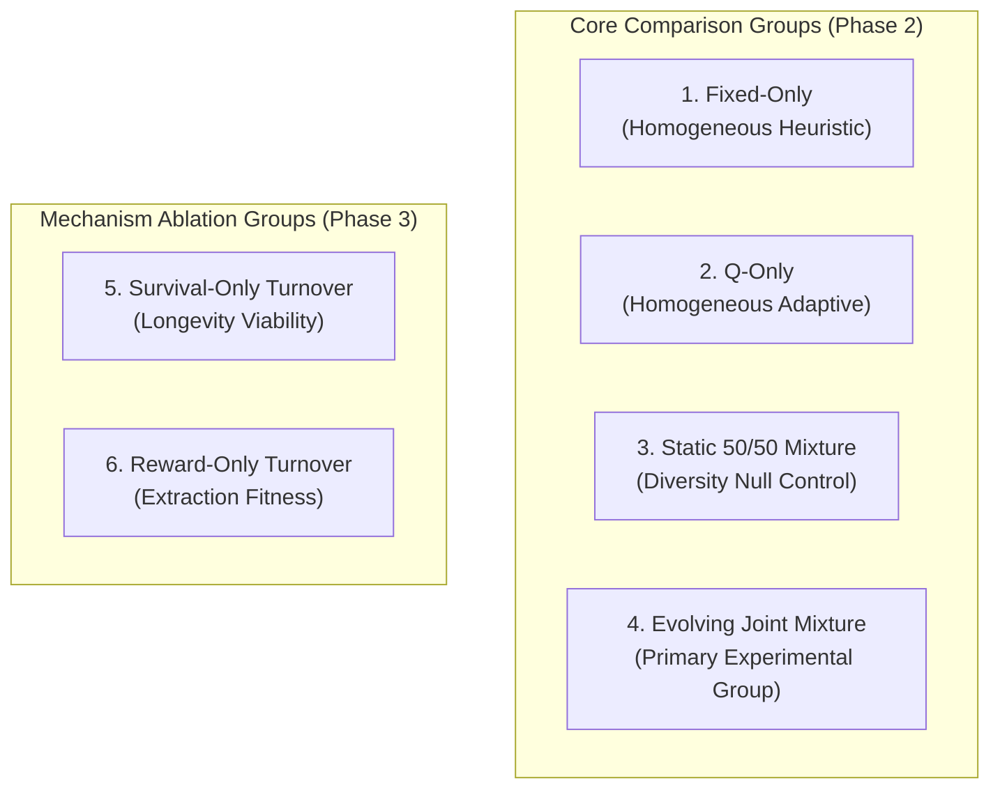
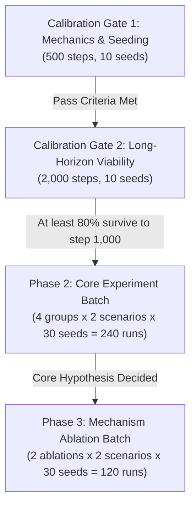

# Version D: Comprehensive Research Design Review & Critical Conformance Analysis

**Document:** `calibration_logs/version_d/version_d_research_design_review.md`  
**Date:** 2026-11-02  
**Target:** Final Scientific & Methodological Evaluation prior to Implementation Authorization  
**Foundational References:** [`docs/research_protocol/01_research_protocol.md`](file:///Users/nish/home/Research%20Project/docs/research_protocol/01_research_protocol.md), [`docs/research_protocol/02_parameter_spec_sheet.md`](file:///Users/nish/home/Research%20Project/docs/research_protocol/02_parameter_spec_sheet.md), [`docs/research_protocol/06_submission_roadmap.md`](file:///Users/nish/home/Research%20Project/docs/research_protocol/06_submission_roadmap.md), [`calibration_logs/version_d/stage1_calibration_report.md`](file:///Users/nish/home/Research%20Project/calibration_logs/version_d/stage1_calibration_report.md), [`calibration_logs/version_d/version_d_research_readiness_audit.md`](file:///Users/nish/home/Research%20Project/calibration_logs/version_d/version_d_research_readiness_audit.md)  
**Status:** Methodologically Corrected Design Review  
**Execution Guard:** Strictly design-only. No simulator code or parameters modified; no experiments run; no frozen data altered; no implementation authorized.

---

## 1. Mathematical Analysis & Limitations of Population Regulation

In Stage 1 calibration, unconstrained endogenous reproduction led to a demographic peak of 69.9 agents (+40%), aggregate demand exceeding $G_{\max} = 12.5$, resource depletion by step 61.2, and 100% extinction at step 141.7. 

To evaluate mechanisms that might bound population size, we analyze the actual mathematical behavior and explicit failure modes of candidate rules.

### Detailed Examination of the Proposed Logistic Reproduction Rule

The proposed soft logistic reproduction discount is formulated as:
$$P_i'(t) = P_i(t) \cdot \max\left(0, 1 - \frac{N(t)}{K_{\text{pop}}}\right)$$
where $K_{\text{pop}} = 50$, and $P_i(t) = P_{\max} \cdot \operatorname{clip}\left(\frac{E_i(t) - 15.0}{5.0}, 0, 1\right) \cdot A(a_i(t))$.

#### Actual Mathematical Behavior
1. **At Low Density ($N \ll K_{\text{pop}}$):** The term $(1 - N/K_{\text{pop}}) \to 1$, allowing individual vital rates to operate at near-maximal probability.
2. **At Capacity ($N = K_{\text{pop}} = 50$):** $(1 - 50/50) = 0$, so $P_i'(t) = 0$ for all agents simultaneously. New births are halted entirely.
3. **Above Capacity ($N > K_{\text{pop}}$):** $\max(0, \dots)$ truncates fertility to 0.

#### Critical Mathematical Limitations & Why It Does NOT Guarantee Ecological Stability
- **Overshoot via Simultaneous Stochastic Births:** Because decisions are evaluated across all eligible agents within a discrete time step, if $N(t) = 48$, multiple agents can independently draw successful births, pushing $N(t+1) > 50$.
- **Independence from Commons Regeneration ($G(R)$):** The rule bounds $N(t) \approx 50$, but **does not alter individual harvest actions**. Under Treatment B quotas, if 50 agents execute Moderate ($0.50$) or Aggressive ($1.0$) harvest, aggregate demand is:
  $$H_{\text{total}} = 50 \times 0.50 = 25.0 \quad \text{or} \quad 50 \times 1.0 = 50.0$$
  The maximum biological regeneration of the commons is:
  $$G_{\max} = \frac{g \cdot K}{4} = \frac{0.10 \times 500}{4} = 12.5 \text{ units/step}$$
  Therefore, **even if $N(t)$ is strictly bounded at 50, aggregate extraction ($25.0$–$50.0$) will still outstrip maximum regeneration ($12.5$) by a factor of 2 to 4 whenever agents harvest aggressively**.
- **Lagged Depletion:** Bounding $N$ slows down commons depletion relative to an exploding population, but does **not** prevent depletion if per-capita extraction exceeds the replenishment threshold.
- **Starvation Cliff Remains:** If the standing resource $R(t)$ reaches zero, escapement renewal $G(0) = 0$. In an empty commons, even a perfectly regulated population of 50 will starve once stored energy reserves are exhausted.

### Comparative Mathematical Analysis of Alternative Regulation Mechanisms

| Mechanism | Exact Mathematical Formulation | Mathematical Behavior on Birth Rates & Density | Effect on Aggregate Extraction | Extinction & Collapse Risk | Artificial Assumptions & Limitations |
| :--- | :--- | :--- | :--- | :--- | :--- |
| **1. Unrestricted Vital Rates (Current Version D)** | $P_i' = P_i(E_i, a_i)$ | Births depend only on individual surplus ($E \ge 15$). Exponential or bloom potential ($N_{t+1} = N_t + B_t - D_t$). | Explosive demand growth ($>35$ units/step in Stage 1) as $N \to 70$. | **Guaranteed Collapse.** Overwhelms $G_{\max}$, resource drops to 0 at step 61.2, 100% extinction at step 141.7. | Assumes zero spatial, territorial, or social breeding constraints. |
| **2. Logistic Density-Dependent Reproduction** | $P_i' = P_i \cdot \max(0, 1 - N/K_{\text{pop}})$ | Linearly dampens fertility as $N \to K_{\text{pop}}$. Sets fertility to 0 when $N \ge K_{\text{pop}}$. | Caps theoretical maximum demand at $N \approx 50$, but demand still exceeds $G_{\max}$ if agents forage aggressively. | **High Collapse Risk if Harvest Unbounded.** Slows depletion, but does not guarantee survival if 50 agents demand 25–50 units/step. | Introduces a global density parameter $K_{\text{pop}}$ into an individual-based framework. |
| **3. Resource-Contingent Reproduction** | $P_i' = P_i \cdot \min\left(1, \frac{R_t}{R_{\text{crit}}}\right)$ | Suppresses fertility when commons drops below critical threshold $R_{\text{crit}}$ (e.g., $165.0$). | Preserves parental energy for survival during ecological scarcity; halts breeding during downturns. | **Moderate-High Risk.** Does not prevent initial demographic bloom while $R > R_{\text{crit}}$, risking resource overshoot before breeding halts. | Assumes agents possess physiological or sensory awareness of global resource stock. |
| **4. Density-Dependent Maintenance Scaling** | $c(N) = c_0 \cdot \left(1 + \theta \frac{N}{K_{\text{pop}}}\right)$ | Increases energetic cost of living as density rises, making $E \ge 15.0$ harder to reach. | Directly suppresses energy accumulation; forces conservative harvest or starvation at high density. | **High Extinction Risk.** Can trigger positive feedback mortality loops where crowded agents starve rapidly. | Strongly increases metabolic stress; complicates thermodynamic baselines. |
| **5. Strict Quota Scaling (Treatment C)** | Action quotas scaled by $-62.5\%$ (Rest=0, Cons=0.1875, Mod=0.375, Aggr=0.75) | Does not regulate births directly; limits individual intake. | Bounds aggregate demand of 50 agents to $\le 18.75$ units/step, closer to $G_{\max} = 12.5$. | **Low Depletion, High Metabolic Risk.** At $c=0.20$, conservative harvest loses energy, potentially starving fixed agents. | Does not prevent bloom if population grows beyond 70. |

---

## 2. Formal Energy Accounting & Conservation Protocol

To eliminate mathematical ambiguity, we explicitly specify the energy ledger for reproduction:

### Reproduction Energy Definitions
- **Parent Energy Before Birth:** $E_{\text{parent}}(t) \ge 15.0$
- **Energy Deducted from Parent:** Exactly $E_{\text{cost}} = 10.0$ energy units
- **Parent Energy After Birth:** 
  $$E_{\text{parent}}(t^+) = E_{\text{parent}}(t) - 10.0$$
  *(Note: Since $E_{\text{parent}}(t) \ge 15.0$, $E_{\text{parent}}(t^+) \ge 5.0$, ensuring the parent never enters starvation debt upon reproduction).*
- **Newborn Initial Energy:** Exactly $E_{\text{newborn}} = 10.0$ units.

### Thermodynamic Conservation Statement
The total energy across the parent-offspring dyad before and after the reproductive event is strictly conserved:
$$\sum E_{\text{dyad}}(t) = E_{\text{parent}}(t) + 0.0$$
$$\sum E_{\text{dyad}}(t^+) = E_{\text{parent}}(t^+) + E_{\text{newborn}} = (E_{\text{parent}}(t) - 10.0) + 10.0 = E_{\text{parent}}(t)$$

The net change in total system energy attributable to the birth event is identically zero:
$$\Delta E_{\text{birth}} = \sum E_{\text{dyad}}(t^+) - \sum E_{\text{dyad}}(t) = 0.000$$

Every reproduction event represents a **pure thermodynamic transfer** of 10.0 energy units from parental somatic reserves to newborn endowment. No energy is created ex nihilo, and no energy is destroyed.

---

## 3. Complete Specification of the Six Experimental Groups

To ensure strict internal consistency and protocol traceability, every group is specified across its core demographic dimensions:

### Full Operational Matrix

| Dimension | Group 1: Fixed-Only | Group 2: Q-Only | Group 3: Static 50/50 Control | Group 4: Evolving Joint | Group 5: Survival-Only Ablation | Group 6: Reward-Only Ablation |
| :--- | :--- | :--- | :--- | :--- | :--- | :--- |
| **Initial Composition** | 50 Fixed, 0 Q | 0 Fixed, 50 Q | 25 Fixed, 25 Q | 25 Fixed, 25 Q | 25 Fixed, 25 Q | 25 Fixed, 25 Q |
| **Birth Eligibility** | $E_i \ge 15.0$, cooldown $\le 0$, age $< 60$ | $E_i \ge 15.0$, cooldown $\le 0$, age $< 60$ | $E_i \ge 15.0$, cooldown $\le 0$, age $< 60$ | $E_i \ge 15.0$, cooldown $\le 0$, age $< 60$ | $E_i \ge 15.0$ (energy gate), cooldown $\le 0$, age $< 60$ | $E_i \ge 15.0$, cooldown $\le 0$, all living ages |
| **Birth Probability** | $P_i' = P_i(E_i, a_i) \cdot \max(0, 1 - N/50)$ | $P_i' = P_i(E_i, a_i) \cdot \max(0, 1 - N/50)$ | $P_i' = P_i(E_i, a_i) \cdot \max(0, 1 - N/50)$ | $P_i' = P_i(E_i, a_i) \cdot \max(0, 1 - N/50)$ | $P_i' = P_{\max} \cdot \left(\frac{a_i}{A_{\max}}\right) \cdot \max(0, 1 - N/50)$ | $P_i' = P_i(E_i) \cdot \max(0, 1 - N/50)$ |
| **Offspring Assignment** | Strictly Fixed | Strictly Q-learning | **Deficit-Targeted Assignment** | Clonal Lineage (Parent type) | Clonal Lineage (Parent type) | Clonal Lineage (Parent type) |
| **Inheritance Rule** | Fixed policy table | Gradual Q-table inheritance (12 steps) | If Q assigned: inherits parent Q (if Q) or zero Q (if Fixed) | Fixed policy or Q-table inheritance | Fixed policy or Q-table inheritance | Fixed policy or Q-table inheritance |
| **Energy Transfer** | Parent $-10.0$, Child $+10.0$ | Parent $-10.0$, Child $+10.0$ | Parent $-10.0$, Child $+10.0$ | Parent $-10.0$, Child $+10.0$ | Parent $-10.0$, Child $+10.0$ | Parent $-10.0$, Child $+10.0$ |
| **Deaths** | Starvation ($E \le 0$) or senescence ($a=100$) | Starvation ($E \le 0$) or senescence ($a=100$) | Starvation ($E \le 0$) or senescence ($a=100$) | Starvation ($E \le 0$) or senescence ($a=100$) | Starvation ($E \le 0$) or senescence ($a=100$) | Starvation ($E \le 0$) or senescence ($a=100$) |
| **Population Regulation** | Density feedback ($K_{\text{pop}}=50$) | Density feedback ($K_{\text{pop}}=50$) | Density feedback ($K_{\text{pop}}=50$) | Density feedback ($K_{\text{pop}}=50$) | Density feedback ($K_{\text{pop}}=50$) | Density feedback ($K_{\text{pop}}=50$) |

---

### Detailed Mechanics of Deficit-Targeted Offspring Assignment (Group 3)

The static 50/50 control isolates the ecological effect of behavioral diversity from the evolutionary effect of composition change. In an open-ended vital-rates model, it operates through the following exact procedural rules:

1. **Standard Energetic Reproduction:** Any living agent meeting $E_i \ge 15.0$, cooldown $\le 0$, and age $< 60$ evaluates birth probability $P_i'$. If successful, the parent pays 10.0 energy ($E_{\text{parent}} \leftarrow E_{\text{parent}} - 10.0$).
2. **Type Assignment Procedural Logic:**
   - **Case A: One type is below 50% ($N_{\text{type}} < N/2$):** The newborn is assigned strictly to the minority type. For example, if $N_{\text{fixed}} = 22$ and $N_Q = 26$, any birth (whether from a Fixed or Q parent) produces a Fixed newborn.
   - **Case B: Population is balanced ($N_{\text{fixed}} = N_Q$):** The newborn type is assigned via an unbiased Bernoulli trial ($p = 0.50$).
   - **Case C: Total population is below 50 ($N < 50$):** Assignment is governed strictly by the relative deficit between types:
     $$\Delta_{\text{fixed}} = 25 - N_{\text{fixed}}, \quad \Delta_Q = 25 - N_Q$$
     If $\Delta_{\text{fixed}} > \Delta_Q$, newborn is Fixed; if $\Delta_Q > \Delta_{\text{fixed}}$, newborn is Q; if equal, 50/50 probability.
   - **Case D: Cross-Type Birth Inheritance:** When a Q-parent funds a Fixed newborn, the newborn receives the standard Fixed policy table. When a Fixed parent funds a Q newborn, the newborn receives a clean, zero-initialized Q-table (avoiding illegitimate policy transfer across distinct behavioral architectures).
   - **Case E: Complete Extinction of One Type ($N_{\text{type}} = 0$):** If Fixed agents go extinct ($N_{\text{fixed}} = 0$), any subsequent birth funded by a Q-parent is assigned to Fixed, re-injecting a founder Fixed agent at age 0 with 10.0 energy. This guarantees that diversity is maintained through energetic reproduction.

---

### Comparison of Ablation Definitions Against Original Protocol

| Feature | Original Protocol Rule (`01_:84-88`) | Proposed Version D Vital-Rate Formulation | Formal Classification |
| :--- | :--- | :--- | :--- |
| **Survival-Only** | Tournament fitness: $F(i) = 1.0 \cdot \left(\frac{\text{age}_i}{A_{\max}}\right) + 0.0 \cdot \text{reward}$. Vacancy filled via softmax tournament over living agents. | Vital-rate probability: $P_i' = P_{\max} \cdot \left(\frac{a_i}{A_{\max}}\right) \cdot \max(0, 1 - N/50)$. Energy $E \ge 15.0$ kept only as energy feasibility gate. | **Protocol Amendment Required.** Replaces tournament softmax over ages with individual age-driven fertility. |
| **Reward-Only** | Tournament fitness: $F(i) = 0.0 \cdot \text{survival} + 1.0 \cdot \operatorname{norm}(\text{lifetime\_reward}_i)$. Vacancy filled via softmax tournament. | Vital-rate probability: $P_i' = P_{\max} \cdot \operatorname{clip}\left(\frac{E_i - 15}{5}, 0, 1\right) \cdot \max(0, 1 - N/50)$. Age fertility decline disabled ($A(a_i) = 1.0$). | **Protocol Amendment Required.** Replaces normalized lifetime reward tournament with instantaneous surplus energy gating. |

---

## 4. Reassessment of Scientific Claims & Evidentiary Grounding

To maintain absolute scientific objectivity, all core claims are evaluated and classified by evidentiary status:

| Project Claim | Evidentiary Status | Formal Audit Findings & Grounding |
| :--- | :---: | :--- |
| **1. "Version D exhibits high research novelty."** | **Literature Claim Requiring External Evidence** | While multi-agent RL in renewable commons exists in the literature, integrating closed thermodynamic energy transfer, cultural Q-table transmission, and vital-rate demography is uncommon. However, this novelty must be formally contextualized against prior eco-evolutionary RL studies during manuscript preparation. |
| **2. "Version D possesses high ecological realism."** | **Hypothesis / Conceptual Characterization** | Energy-funded reproduction and parental deduction are bioenergetically plausible. However, the model retains significant abstractions (well-mixed spatial pool, tabular state discretization, discrete steps). It should be described as *mechanistic bioenergetic modeling*, not asserted as absolute "ecological realism." |
| **3. "Soft logistic density feedback guarantees population stability."** | **Mathematically Refuted** | **False claim.** As proven in Section 1, bounding $N \le 50$ does not bound aggregate harvest if agents take aggressive actions ($H_{\text{total}} \ge 25.0 > G_{\max} = 12.5$). Stability is an empirical question dependent on agent policy convergence, not a mathematical guarantee. |
| **4. "Q-learning agents achieve reproductive dominance over Fixed agents."** | **Directly Supported by Existing Evidence** | **Empirically verified.** In Stage 1 calibration across 10 seeds (3,606 attempts), Q-agents produced **199 out of 199 births (100%)**, while Fixed agents produced 0 births due to harvest quota differentials. |
| **5. "Demographic bloom caused commons collapse in Stage 1."** | **Directly Supported by Existing Evidence** | **Empirically verified.** Raw telemetry confirms aggregate harvest expanded from ~24 to $>35$ units/step as $N$ bloomed from 50 to 69.9, depleting the standing resource stock to 0 between steps 54 and 68. |
| **6. "Demographic success causes ecological failure (Tragedy of the Commons)."** | **Hypothesis Requiring Multi-Condition Testing** | Supported in Stage 1 calibration, but remains a hypothesis for the broader parameter space. Testing whether this holds under sustainable harvest quotas (Treatment C) or density regulation requires controlled experimentation. |

---

## 5. Reworked Primary Outcome Metrics & Analytics Hierarchy

The primary outcomes mandated by [`06_submission_roadmap.md:128-135`](file:///Users/nish/home/Research%20Project/docs/research_protocol/06_submission_roadmap.md#L128) are formalized with explicit mathematical definitions and rigorous censoring protocols:

### 1. Immediate Post-Shock Survival Fraction ($S_{\text{post}}$)
Measures the acute mortality shock caused by the sudden resource halving ($R \leftarrow 0.5 R$ at step 1,000):
$$S_{\text{post}} = \frac{N(\text{shock\_step} + \Delta t)}{N(\text{shock\_step})} \quad \text{where } \Delta t = 20 \text{ steps}$$
- **Handling Early Extinction:** If the population goes extinct prior to step 1,000, $S_{\text{post}}$ is **not defined** (recorded as `pre_shock_extinction` and analyzed separately in extinction accounting).

### 2. Recovery Time to 90% Pre-Shock Reward ($\tau_{\text{rec}}$)
Measures the resilience and speed of economic recovery following disturbance:
$$\bar{r}_{\text{pre}} = \frac{1}{100} \sum_{t = \text{shock\_step} - 100}^{\text{shock\_step} - 1} \bar{r}(t)$$
$$\tau_{\text{rec}} = \min \left\{ \Delta t \ge 1 \;\middle|\; \bar{r}(\text{shock\_step} + \Delta t) \ge 0.90 \cdot \bar{r}_{\text{pre}} \right\}$$
- **Censoring Rule:** If the threshold is not reached prior to step 2,000, or if the population collapses post-shock, record explicitly as `unrecovered`. Imputing 2,000 is mathematically prohibited to avoid biasing variance.

### 3. Resource Stability ($\sigma_R^2, \text{CV}_R$)
Measures the ecological stability of the commons across the post-stress evaluation window (steps 1,000–2,000):
$$\bar{R}_{\text{post}} = \frac{1}{1000} \sum_{t=1001}^{2000} R(t), \quad \sigma_R^2 = \frac{1}{1000} \sum_{t=1001}^{2000} (R(t) - \bar{R}_{\text{post}})^2, \quad \text{CV}_R = \frac{\sigma_R}{\bar{R}_{\text{post}}}$$

### 4. Population Composition ($s_Q(t)$)
The instantaneous share of Q-learning agents in the living population:
$$s_Q(t) = \frac{N_Q(t)}{N(t)}$$

### 5. Ecological Sustainability Index ($I_{\text{sus}}$)
Measures the proportion of steps during the post-disturbance window that the commons maintained healthy standing stock:
$$I_{\text{sus}} = \frac{1}{1000} \sum_{t=1001}^{2000} \mathbb{I}\left(R(t) \ge 0.20 K\right)$$

### Critical Methodological Note on Demographic Tragedy Metric
The previously proposed "Demographic Tragedy Index" (correlating $s_Q(t)$ with $\Delta R(t)$) is **rejected**. Simple time-series correlation between two non-stationary downward-trending series produces spurious correlation. To evaluate whether Q-agent expansion accelerates ecological decline, we must compare the paired seed-level difference in depletion timing between the **evolving joint mixture** and the **static 50/50 control**.

---

## 6. Reconciled Experimental Schedule & Calibration Gates

To ensure strict methodological rigor, the experiment must follow a phased progression with explicit gating criteria:

### The Strict Calibration Gates
- **Gate 1 (Short-Horizon Mechanics):** 10 stationary seeds run for 500 steps. Confirms energy conservation ($< 10^{-8}$) and code mechanics. *(Passed in Stage 1).*
- **Gate 2 (Long-Horizon Shock Viability):** **A 200-step or 500-step calibration run cannot authorize production runs.** Before the 240-run production batch is initiated, 10 calibration seeds must run for **2,000 steps** under the proposed regulation rule.
  - *Acceptance Criteria:* At least **8 out of 10 seeds (80%) must maintain living agents through step 1,000** without commons exhaustion. If calibration runs go extinct prior to step 1,000, Phase 2 cannot be executed.

### Phased Production Batches
1. **Phase 2 (Core Experiment — 240 Runs):**
   - 4 Groups: `fixed_only`, `q_only`, `static_mixture`, `evolving_joint`.
   - 2 Scenarios: Gradual Decline (Family A) and Sudden Shock (Family B).
   - 30 Matched Seeds per condition (Seeds 1001–1030).
   - Run Length: 2,000 steps.
2. **Phase 3 (Mechanism Ablations — 120 Runs):**
   - 2 Groups: `survival_only`, `reward_only`.
   - 2 Scenarios: Gradual Decline and Sudden Shock.
   - 30 Matched Seeds (Seeds 1001–1030).
   - Run Length: 2,000 steps.

---

## 7. Summary & Governance Protocol

This design review establishes that Version D provides a rigorous scientific foundation, but cannot be assumed to prevent collapse merely by adding a soft logistic density discount. Ecological sustainability depends on the interaction between harvest quotas, learning convergence, and demographic regulation.

All unresolved decisions and formal protocol amendments are documented in the companion blocker file:  
[`calibration_logs/version_d/version_d_final_design_blockers.md`](file:///Users/nish/home/Research%20Project/calibration_logs/version_d/version_d_final_design_blockers.md).
