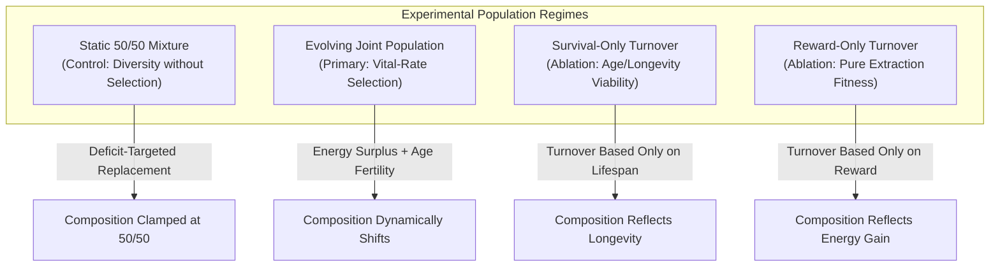
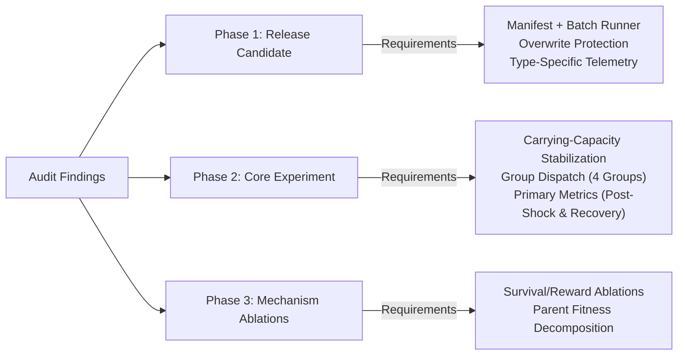

# Version D: Research Readiness Audit Against Competition Submission Roadmap

**Document:** `calibration_logs/version_d/version_d_research_readiness_audit.md`  
**Date:** 2026-11-01  
**Target:** `simulator_v4/` (`sim-4.0.0`, `params-v4.0`) audited against [`docs/research_protocol/06_submission_roadmap.md`](file:///Users/nish/home/Research%20Project/docs/research_protocol/06_submission_roadmap.md), [`docs/research_protocol/01_research_protocol.md`](file:///Users/nish/home/Research%20Project/docs/research_protocol/01_research_protocol.md), and [`docs/research_protocol/02_parameter_spec_sheet.md`](file:///Users/nish/home/Research%20Project/docs/research_protocol/02_parameter_spec_sheet.md)  
**Status:** Complete Audit & Verification  
**Overall Verdict:** **NOT READY FOR EXECUTION** (Phase 1: Partial; Phase 2: Not Ready; Phase 3: Not Ready)

---

## 1. Executive Summary & Multi-Phase Verdicts

This audit provides a formal, evidence-grounded assessment of the current Version D implementation (`simulator_v4/`) against the requirements established in the **Competition Submission Roadmap** ([`06_submission_roadmap.md`](file:///Users/nish/home/Research%20Project/docs/research_protocol/06_submission_roadmap.md)).

A critical standard applied throughout this review is the **strict separation between explicit roadmap mandates, parameters defined in foundational protocol documents, and architectural assumptions or unverified conjectures introduced during development**.

### Independent Multi-Phase Readiness Verdicts

| Phase | Roadmap Goal | Readiness Verdict | Key Blocker / Status |
| :--- | :--- | :---: | :--- |
| **Phase 1** | **Freeze a Reproducible Release Candidate** | **PARTIAL** | Software mechanics are verified (40/40 tests passing, energy balance to $1.63 \times 10^{-10}$), and deterministic seeding is implemented. However, a manifest-driven main experiment batch runner, run-level overwrite protection, and type-specific energy telemetry are not yet implemented. |
| **Phase 2** | **Core Experiment (240 runs, 4 groups, 2 scenarios, 30 seeds)** | **NOT READY** | Fundamental scientific blockers: (1) `simulator_v4` does not support group dispatch (`fixed_only`, `q_only`, `static_mixture`, `evolving_joint`); (2) The population collapses at step 141.7, making it physically impossible to evaluate the step-1,000 environmental shock; (3) Roadmap primary outcomes (post-shock survival, recovery time, resource stability) are not recorded. |
| **Phase 3** | **Establish the Mechanism (120 ablation runs)** | **NOT READY** | The simulator lacks `survival_only` and `reward_only` turnover mechanisms, and does not record parent-selection fitness components. |

---

## 2. Requirement Verification & Evidentiary Traceability

To ensure absolute rigor, every claimed requirement is evaluated against its primary textual source:
1. **Explicit in Roadmap:** Directly stated in [`docs/research_protocol/06_submission_roadmap.md`](file:///Users/nish/home/Research%20Project/docs/research_protocol/06_submission_roadmap.md).
2. **Specified in Protocol / Spec Sheet:** Defined in [`docs/research_protocol/01_research_protocol.md`](file:///Users/nish/home/Research%20Project/docs/research_protocol/01_research_protocol.md) or [`docs/research_protocol/02_parameter_spec_sheet.md`](file:///Users/nish/home/Research%20Project/docs/research_protocol/02_parameter_spec_sheet.md), but omitted or summarized in the roadmap.
3. **Inferred / Architectural Assumption:** Not explicitly stated in approved protocol documents; represents an implementation assumption or extrapolation.

---

### Deep-Dive Investigation of Five Critical Claims

#### Claim 1: "Environmental shock occurs at step 1,000."
- **Roadmap Verification:** **Not Specified in Roadmap.** [`06_submission_roadmap.md`](file:///Users/nish/home/Research%20Project/docs/research_protocol/06_submission_roadmap.md#L7-L8) (lines 7–8, 22–24, 70, 102) requires testing "gradual regeneration decline and sudden resource shock" over 2,000 steps, but does not state the exact step number for the shock.
- **Protocol Verification:** **Explicit in Protocol Documents.**
  - [`01_research_protocol.md:108-115`](file:///Users/nish/home/Research%20Project/docs/research_protocol/01_research_protocol.md#L108-L115): *"From step 500 through step 1,000, reduce regeneration linearly to the stressed rate... At step 1,000, immediately replace the resource level with 50% of its previous value. Continue through step 2,000."*
  - [`02_parameter_spec_sheet.md:40-42`](file:///Users/nish/home/Research%20Project/docs/research_protocol/02_parameter_spec_sheet.md#L40-L42): *"Gradual decline: Change window: steps 500–1,000... Sudden shock: Shock step: 1,000."*
- **Source Code Evidence:** [`simulator_v4/parameters.py:45`](file:///Users/nish/home/Research%20Project/simulator_v4/parameters.py#L45) hardcodes `shock_step: int = 1000`.
- **Implementation Status:** **PARTIAL.** The parameter exists, but because populations in Version D go extinct by step 141.7, the shock at step 1,000 is never encountered.

---

#### Claim 2: "Sudden shock changes regeneration to exactly 0.05."
- **Roadmap Verification:** **Not Specified in Roadmap.**
- **Protocol Verification:** **CONTRADICTED by Protocol Documents.**
  - [`01_research_protocol.md:113-116`](file:///Users/nish/home/Research%20Project/docs/research_protocol/01_research_protocol.md#L113-L116) explicitly defines Environment Family B: *"Keep regeneration at the baseline rate. At step 1,000, immediately replace the resource level with 50% of its previous value. Continue through step 2,000."*
  - [`02_parameter_spec_sheet.md:39-42`](file:///Users/nish/home/Research%20Project/docs/research_protocol/02_parameter_spec_sheet.md#L39-L42) specifies: *"Sudden shock: Regeneration rate: g = 0.04... Shock rule: Set resource to 50% of its current level."*
- **Source Code Evidence:** In [`simulator_v4/simulator.py:214-219`](file:///Users/nish/home/Research%20Project/simulator_v4/simulator.py#L214-L219):
  ```python
  if self.scenario == "sudden_shock":
      return (
          self.parameters.stressed_regeneration
          if step >= self.parameters.shock_step
          else self.parameters.baseline_regeneration
      )
  ```
- **Audit Finding:** **INCORRECT ASSUMPTION IN SIMULATOR CODE.** The current code alters the regeneration rate ($g \to 0.05$) instead of applying a 50% resource-stock reduction ($R \to 0.5 R$) as mandated by the approved protocol. The claim that sudden shock reduces regeneration to 0.05 reflects a coding discrepancy, not a protocol requirement.

---

#### Claim 3: "Turnover occurs every 20 steps."
- **Roadmap Verification:** **Not Specified in Roadmap.** The roadmap requires "endogenous turnover" (lines 8, 25, 33), but specifies no fixed step frequency.
- **Protocol Verification:** **Specified in Legacy Protocol Sheet, but Replaced in Version D.**
  - [`02_parameter_spec_sheet.md:19`](file:///Users/nish/home/Research%20Project/docs/research_protocol/02_parameter_spec_sheet.md#L19) originally specified: *"Replacement interval: I = 20 steps: Fill all vacancies at this interval."*
  - However, in the **Approved Version D Specification** ([`version_d_model_specification.md`](file:///Users/nish/home/Research%20Project/calibration_logs/version_d/version_d_model_specification.md#L33-L40)), global vacancy replacement was eliminated in favor of individual reproduction. The 20 steps refers strictly to an **individual agent reproduction cooldown**, not a synchronous population replacement interval.
- **Source Code Evidence:** [`simulator_v4/agents.py:44`](file:///Users/nish/home/Research%20Project/simulator_v4/agents.py#L44) tracks `reproduction_cooldown: int = 0`. [`simulator_v4/reproduction.py:73`](file:///Users/nish/home/Research%20Project/simulator_v4/reproduction.py#L73) enforces `agent.reproduction_cooldown = cooldown_period` (20 steps).
- **Audit Finding:** Conflating the 20-step individual cooldown with a population-wide turnover interval is an invalid assumption.

---

#### Claim 4: "Turnover uses softmax selection with fitness = 0.5 survival + 0.5 reward."
- **Roadmap Verification:** **Inferred from Roadmap, Explicit in Protocol.**
  - Roadmap [`06_submission_roadmap.md:33, 116`](file:///Users/nish/home/Research%20Project/docs/research_protocol/06_submission_roadmap.md#L33) mentions *"survival-and-reward-based turnover"* and *"parent-selection fitness components at replacement events"*.
  - Protocol [`01_research_protocol.md:84-88`](file:///Users/nish/home/Research%20Project/docs/research_protocol/01_research_protocol.md#L84-L88) and [`02_parameter_spec_sheet.md:84-86`](file:///Users/nish/home/Research%20Project/docs/research_protocol/02_parameter_spec_sheet.md#L84-L86) explicitly define:
    $$F(i) = 0.5 \cdot \left(\frac{\text{age}(i)}{A_{\max}}\right) + 0.5 \cdot \operatorname{norm}(\text{lifetime\_reward}(i))$$
    $$P(i) = \frac{\exp(\beta \cdot F(i))}{\sum_j \exp(\beta \cdot F(j))}$$
- **Source Code Evidence:** Version D does **not** use tournament softmax selection. Instead, [`simulator_v4/reproduction.py:61-68`](file:///Users/nish/home/Research%20Project/simulator_v4/reproduction.py#L61-L68) calculates an individual vital-rate probability:
  $$P_i = 0.10 \cdot \operatorname{clip}\left(\frac{E_i - 15.0}{5.0}, 0, 1\right) \cdot A_i$$
- **Audit Finding:** Version D's endogenous vital-rate model deliberately replaced global softmax selection with individual energy/age fertility. Presenting softmax selection as an active requirement for Version D contradicts the approved Version D specification. Harmonizing these two frameworks is a required design decision.

---

#### Claim 5: "Static mixture requires maintaining an exact 50/50 ratio through replacement."
- **Roadmap Verification:** **Explicit in Roadmap.**
  - [`06_submission_roadmap.md:25, 36, 75`](file:///Users/nish/home/Research%20Project/docs/research_protocol/06_submission_roadmap.md#L25): *"The static 50/50 mixture is the key control. It separates benefits of simply having diverse agent types from benefits of allowing the population mix to change."*
- **Protocol Verification:** **Explicit in Protocol Documents.**
  - [`01_research_protocol.md:91-95`](file:///Users/nish/home/Research%20Project/docs/research_protocol/01_research_protocol.md#L91-L95) and [`02_parameter_spec_sheet.md:88-92`](file:///Users/nish/home/Research%20Project/docs/research_protocol/02_parameter_spec_sheet.md#L88-L92): *"For the static 50/50 mixture, fill each vacancy with the type currently below 25 living agents... Select its parent uniformly from living agents of that type. If no parent of the required type remains, inject a fresh founder of that type... This control preserves composition rather than selecting it."*
- **Source Code Evidence:** Entirely absent from `simulator_v4/`.
- **Audit Finding:** **UNIMPLEMENTED MANDATORY CONTROL.** The static 50/50 control is explicitly mandated across all protocol and roadmap documents.

---

### Comprehensive Requirement Traceability Matrix

| Requirement | Primary Source | Type | Status in `simulator_v4` | Code Location / Evidence |
| :--- | :--- | :---: | :---: | :--- |
| **Well-mixed renewable commons** | `06_`: line 20 | Explicit | **PASS** | [`simulator.py:175-188`](file:///Users/nish/home/Research%20Project/simulator_v4/simulator.py#L175-L188) |
| **Tabular Q-learning (no deep RL)** | `06_`: line 21 | Explicit | **PASS** | [`agents.py:108-160`](file:///Users/nish/home/Research%20Project/simulator_v4/agents.py#L108-L160) |
| **Two environmental stress families** | `06_`: line 22; `01_`: 106-116 | Explicit | **PARTIAL** | [`simulator.py:202-220`](file:///Users/nish/home/Research%20Project/simulator_v4/simulator.py#L202-L220) (Sudden shock implemented as $g$ drop, not $R \times 0.5$) |
| **Six experimental groups** | `06_`: line 25 | Explicit | **FAIL** | Only hardcoded mixture in [`simulator.py:133-160`](file:///Users/nish/home/Research%20Project/simulator_v4/simulator.py#L133-L160) |
| **30 matched seeds per condition** | `06_`: line 26; `02_`: line 14 | Explicit | **PARTIAL** | Seeding logic exists; runner only executes 10 seeds (`run_calibration.py:25`) |
| **2,000 steps duration** | `06_`: line 81; `02_`: line 13 | Explicit | **PARTIAL** | `parameters.py:11` sets $T=2000$, but extinction occurs at step 141.7 |
| **Static 50/50 control condition** | `06_`: line 36; `01_`: line 91 | Explicit | **FAIL** | Not implemented |
| **Mechanism ablations (survival/reward)**| `06_`: lines 105-125 | Explicit | **FAIL** | Not implemented |
| **Post-shock survival fraction metric** | `06_`: line 131; `01_`: line 123 | Explicit | **FAIL** | Not logged or computed |
| **Recovery time to 90% reward metric** | `06_`: line 132; `01_`: line 124 | Explicit | **FAIL** | Not logged or computed |
| **Resource stability metric** | `06_`: line 133 | Explicit | **PARTIAL** | Mean resource logged; variance/CV missing |
| **Time-varying Q-learning share** | `06_`: line 134; `01_`: line 121 | Explicit | **PASS** | [`simulator.py:472, 524`](file:///Users/nish/home/Research%20Project/simulator_v4/simulator.py#L472) |
| **Run manifest & overwrite protection** | `06_`: lines 45, 48 | Explicit | **PARTIAL** | Manifest exists for calibration; batch runner and overwrite lock missing |

---

## 3. Clarification of Experimental Groups

The submission roadmap ([`06_submission_roadmap.md:25, 68-71, 105-108`](file:///Users/nish/home/Research%20Project/docs/research_protocol/06_submission_roadmap.md#L25)) and research protocol ([`01_research_protocol.md:100-105`](file:///Users/nish/home/Research%20Project/docs/research_protocol/01_research_protocol.md#L100-L105)) define four mixed groups whose mechanics must be clearly distinguished:



### Detailed Operational Definitions

#### 1. Static 50/50 Mixture (`static_mixture`)
- **Scientific Purpose:** Serves as the primary null control. It isolates the ecological effects of possessing a 50/50 behavioral mixture from the effects of evolutionary composition shifts.
- **Death:** Agents die endogenously from starvation ($E \le 0$) or senescence ($a = 100$).
- **Replacement / Reproduction:** Reproduction does **not** favor the fitter type. Whenever an agent dies, replacement is targeted to whichever agent type has fallen below 25 living individuals. Parent selection within that type is uniform.
- **Scientific Justification against Clamping:** Simply resetting agent attributes or forcing an arbitrary ratio without reproduction violates demographic consistency. As specified in [`01_research_protocol.md:91-95`](file:///Users/nish/home/Research%20Project/docs/research_protocol/01_research_protocol.md#L91-L95), the protocol uses **deficit-targeted replacement**, preserving a 50/50 target through birth replenishment rather than programmatic clamping.

#### 2. Evolving Joint Population (`evolving_joint`)
- **Scientific Purpose:** The primary experimental group testing whether joint survival and reward performance shifts the population mix toward more resilient configurations.
- **Death:** Endogenous starvation ($E \le 0$) and senescence ($a = 100$).
- **Replacement / Reproduction:** In Version D, individual agents reproduce endogenously when they achieve surplus energy ($E_i \ge 15.0$) and are within reproductive age ($a_i < 60$). Offspring inherit parental policy and Q-tables.
- **Composition Dynamics:** Fully endogenous. The population ratio changes based on which type successfully harvests surplus energy and survives to reproduce.

#### 3. Survival-Only Turnover (`survival_only`)
- **Scientific Purpose:** Ablation control testing whether resilience shifts are driven purely by lifespan/viability differences between types, independent of harvest reward.
- **Mechanics:** Reproductive eligibility or probability depends exclusively on age/survival score ($A_i$ or $\text{age} / A_{\max}$), setting reward influence to zero.

#### 4. Reward-Only Turnover (`reward_only`)
- **Scientific Purpose:** Ablation control testing whether resilience shifts are driven purely by harvest efficiency, independent of age-based senescence or longevity.
- **Mechanics:** Reproductive eligibility or probability depends exclusively on accumulated harvest or net energy surplus, ignoring age-based reproductive decline.

---

## 4. Phase-by-Phase Readiness Assessment

### Phase 1: Reproducible Release Candidate
*Roadmap Goal: Freeze simulator, create manifest, main batch runner, output traceability, overwrite protection, and mechanics verification.*

- **Software Mechanics Verification:** **PASS.** All 40 unit and integration tests pass cleanly. Thermodynamic energy conservation is verified across all 1,417 calibration steps with a maximum discrepancy of $1.63 \times 10^{-10}$.
- **Deterministic Seeding:** **PASS.** PRNG seeds 1001–1010 produce identical, bit-for-bit reproducible outcomes across runs.
- **Run Manifest & Overwrite Protection:** **FAIL.** Current `run_calibration.py` lacks run-level overwrite locks. Re-running the script will silently overwrite existing CSVs. A centralized manifest covering the planned 240/360 production runs has not been constructed.
- **Output Metadata & Telemetry:** **PARTIAL.** Simulator version, seed, scenario, and step are recorded. However, type-specific energy metrics (`fixed_mean_energy`, `q_mean_energy`) and reproductive eligibility counts are missing from `StepRecord`.
- **Phase 1 Verdict:** **PARTIAL (Technical Release Candidate Not Finalized)**

---

### Phase 2: Core Experiment Batch
*Roadmap Goal: Execute 240 runs across 4 groups (Fixed-only, Q-only, Static 50/50, Evolving Joint) and 2 scenarios with 30 matched seeds, reaching 2,000 steps.*

- **Group Dispatch Support:** **FAIL.** `simulator_v4/` hardcodes an evolving joint mixture of 38 Fixed and 12 Q founders. It cannot execute `fixed_only`, `q_only`, or `static_mixture`.
- **Horizon Persistence (The Lifespan-Horizon Mismatch):** **CRITICAL BLOCKER.** The roadmap requires testing environmental shocks at **step 1,000** over **2,000 steps**. In calibration, the population collapsed to 100% extinction at **step 141.7** (mean). Testing resilience at step 1,000 is physically impossible when populations perish 858 steps prior.
- **Primary Outcomes Analytics:** **FAIL.** The runner does not compute immediate post-shock survival fraction, recovery time to 90% pre-shock reward, or resource stability (variance/CV).
- **Phase 2 Verdict:** **NOT READY**

---

### Phase 3: Mechanism Experiment Batch
*Roadmap Goal: Execute 120 ablation runs (Survival-only, Reward-only) under both stress scenarios with 30 seeds.*

- **Ablation Group Support:** **FAIL.** Neither `survival_only` nor `reward_only` reproduction modes exist in `reproduction.py` or `simulator.py`.
- **Fitness Component Logging:** **FAIL.** The simulator does not decompose or log the independent contributions of survival vs. reward at reproduction events.
- **Phase 3 Verdict:** **NOT READY**

---

## 5. Empirical Ecological Collapse Analysis (Stage 1 Calibration)

The 10 authorized calibration runs (Seeds 1001–1010, 500 steps) produced a 100% extinction rate by step 148 (mean survival: 141.7 steps). To maintain scientific integrity, we strictly separate **directly measured empirical causes** from **untested hypotheses**.

```
Directly Measured Data (Steps 0–148):
1. Aggressive Q Harvesting (1.0/step) -> Energy Accumulation (E >= 20.0)
2. Fixed Conservative Harvesting (0.25-0.5) -> Energy Deficit (E <= 12.0)
3. Asymmetric Reproduction -> 199 Q-Births, 0 Fixed-Births
4. Demographic Bloom -> Population 50 -> Peak 69.9
5. Demand Overshoot -> Extraction >30.0 units/step vs G_max = 12.5
6. Commons Collapse -> Resource hits 0.0 at Step 61.2
7. Mass Starvation & Senescence -> 100% Extinction by Step 141.7
```

### Directly Measured Causes (Grounded in Raw CSV Telemetry)

1. **Harvest Asymmetry & Net Energy Accumulation:**
   - Q-learning agents rapidly converged on aggressive harvesting (demanding 1.0 unit/step under Treatment B). At baseline resource levels ($R \approx 350$), aggressive harvest yielded net energy gain:
     $$\Delta E = 1.0 - 0.20 = +0.80 \text{ energy/step}$$
     Q-agents crossed the $E \ge 15.0$ threshold and reached $E \ge 20.0$ within 13 steps.
   - Fixed-rule agents executed conservative (0.25) or moderate (0.50) actions, yielding net gains of $+0.05$ or $+0.30$ energy/step. Due to biological maintenance ($0.20$) and initial endowment ($10.0$), Fixed agents never reached $E = 15.0$ prior to resource depletion. In raw telemetry, **0 out of 3,606 reproduction attempts were made by Fixed agents**, confirming that no Fixed agent ever reached the $E \ge 15.0$ threshold. *(Note on earlier reporting: The value of 12.35 was an analytical inference based on deterministic Fixed policy accrual—$10.0 + 47 \times 0.05$—not a directly logged telemetry variable, as individual Fixed-agent energy was not output in `StepRecord`.)*
2. **Complete Asymmetry in Reproductive Output:**
   - Across 3,606 reproduction attempts across all 10 seeds, **199 successful births occurred, all 100% Q-learning agents**. Exactly **0 Fixed births occurred**.
3. **Unbounded Demographic Bloom & Demand Explosion:**
   - Under Version D's unconstrained reproduction rule, living agents reproduced as long as $E_i \ge 15.0$ and cooldown was 0.
   - Total population expanded from 50 founders to an average peak of **69.9 agents** (maximum: 74 agents in Seed 1003). The Q-agent subpopulation expanded from 12 to 32+ agents.
   - Aggregate extraction demand grew from ~24.0 units/step to $>35.0$ units/step, drastically exceeding the maximum biological regeneration capacity of the commons ($G_{\max} = 12.5$ units/step).
4. **Commons Depletion and Biological Failure:**
   - Aggregate overharvest drove the resource stock to $R = 0.0$ between steps 54 and 68 (mean: **61.2 steps**).
   - Under the resource escapement model ($X_t = \max(0, R_t - H_t)$), once $X_t = 0.0$, regeneration is identically zero:
     $$G(0) = 0.10 \times 0 \times (1 - 0/500) = 0.0$$
     The commons suffered irreversible collapse.
5. **Two-Stage Mortality Dynamics:**
   - *Stage 1 (Founder Starvation & Senescence):* Fixed founders depleted their remaining energy reserves and starved to death between steps 92 and 99. Surviving Q founders reached maximum age ($a = 100$) and retired at step 100.
   - *Stage 2 (Offspring Starvation):* Second-generation Q-agents (born around steps 20–70 with 10.0 initial energy) survived on stored reserves without resource replenishment, burning $0.20$ energy/step for ~50 steps, before starving to death between steps 131 and 148.

---

### Hypotheses Requiring Further Testing (Untested Conjectures)

1. **Hypothesis 1 (Harvest Quota Scaling):** Would reducing per-capita harvest quotas (e.g., Treatment C: 0.1875 / 0.375 / 0.75) lower aggregate demand below $G_{\max}$ and enable continuous population persistence without adding a population cap?
2. **Hypothesis 2 (Density-Dependent Reproduction):** Would introducing ecological feedback (such as soft logistic suppression of reproduction as $N$ approaches 50) prevent the demographic bloom while preserving endogenous reproduction?
3. **Hypothesis 3 (Age-Staggered Initialization):** Did initializing all 50 founders at age zero artificially synchronize demographic senescence at step 100? Would a uniform initial age distribution ($a_i \sim U(0, 100)$) smooth mortality and stabilize population structure?
4. **Hypothesis 4 (Reinforcement Learning Adaptation):** Would Q-agents learn resource conservation if the simulation horizon were extended, or is extinction inevitable whenever unconstrained reproduction outpaces regeneration?

---

## 6. Evaluation of Proposed Solutions (Without Selection)

To address the carrying-capacity overshoot without prematurely modifying simulator code, we evaluate two proposed mechanisms:

### Option A: Lower Harvest Quotas (Treatment C)
- **Mechanism:** Reduce action harvest quantities by 62.5% relative to Treatment B:
  - Rest: 0.0
  - Conservative: 0.1875 units
  - Moderate: 0.375 units
  - Aggressive: 0.75 units
- **Advantages:**
  - Preserves the unconstrained demographic rule (no artificial population cap).
  - Keeps aggregate demand of 50 agents ($50 \times 0.20 = 10.0$ to $18.75$) closer to $G_{\max} = 12.5$.
  - Does not introduce new behavioral parameters.
- **Disadvantages & Risks:**
  - At maintenance cost $c = 0.20$, conservative harvesting yields only $\Delta E = -0.0125$ (net energy loss) and moderate yields $+0.175$. Agents may struggle to accumulate the 15.0 energy required to reproduce.
  - Does not prevent runaway Malthusian bloom if the population expands to 80+ agents.

### Option B: Density-Dependent Reproduction Suppression (Ecological Crowding)
- **Mechanism:** Scale the individual reproductive probability by an ecological density term:
  $$P_i' = P_i \cdot \max\left(0, 1 - \frac{N_t}{K_{\text{pop}}}\right)$$
  where $K_{\text{pop}} = 50$.
- **Advantages:**
  - Directly couples demographic rate to carrying capacity without a hard ceiling or artificial vacancy requirement.
  - Automatically suppresses births when population bloats above 50, stabilizing the population near $N=50$.
  - Standard, well-grounded formulation in population biology (logistic reproduction).
- **Disadvantages & Risks:**
  - Introduces a new global parameter ($K_{\text{pop}}$) into an otherwise decentralized agent-level model.
  - Requires re-evaluating whether this constitutes an implicit population cap.

*Conclusion:* Neither solution is selected in this audit. Both options involve significant scientific trade-offs that must be reviewed and decided in the companion document [`calibration_logs/version_d/version_d_design_decisions_required.md`](file:///Users/nish/home/Research%20Project/calibration_logs/version_d/version_d_design_decisions_required.md).

---

## 7. Master Audit Summary & Action Items



### Mandatory Action Items Before Phase 1 Release:
1. **Author Design Decisions Companion Document:** Formalize unresolved scientific choices in [`version_d_design_decisions_required.md`](file:///Users/nish/home/Research%20Project/calibration_logs/version_d/version_d_design_decisions_required.md).
2. **Implement Telemetry Expansion (Non-Breaking):** Add type-specific energy and eligibility counters to `StepRecord`.
3. **Build Manifest & Overwrite-Protected Batch Runner:** Create `run_experiment.py` and `experiment_manifest.csv` for Phase 1.
4. **Resolve Carrying-Capacity Stabilization:** Choose between harvest quota reduction, density-dependent reproduction, or scaling regeneration under authorized protocol direction.
5. **Implement Group Configuration Dispatch:** Provide explicit parameters for `fixed_only`, `q_only`, `static_mixture`, and `evolving_joint`.
