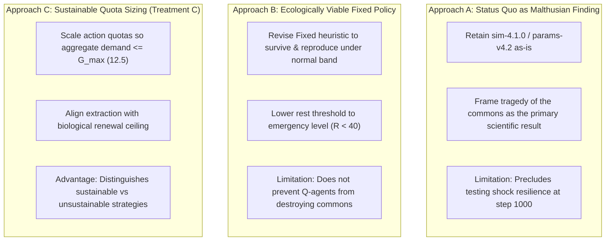

# Version D.1 Scientific Review and Model Redesign Proposal

**Document:** `research_completion/02_model_redesign_proposal.md`  
**Date:** November 2026  
**Context:** Comprehensive review of empirical findings from `results_v4/calibration_d1/` ($K_{\text{pop}}=50$) and `results_v4/calibration_d2/` ($K_{\text{pop}}=70$), scientific critique of structural model properties, and evaluation of three competing model redesign pathways.  
**Governing Rule:** No code, parameter, or simulation modifications. Complete preservation of all frozen research baselines.

---

## 1. Independent Audit Verification & Critical Recalculations

The empirical records from `results_v4/calibration_d1/` (40 runs, $K_{\text{pop}}=50$) and `results_v4/calibration_d2/` (40 runs, $K_{\text{pop}}=70$) were independently recalculated against the raw time-series CSVs and the mathematical equations implemented in `simulator_v4/`.

### 1.1 Verified Empirical Quantities
1. **Extraction vs. Maximum Renewal ($H_{\text{actual}} \gg G_{\max}$):**
   - The maximum potential renewal rate of the commons across all resource levels is strictly bounded:
     $$G_{\max} = \frac{g \cdot K}{4} = \frac{0.10 \times 500.0}{4} = \mathbf{12.50\text{ energy units/step}} \quad (\text{at } R^* = 250.0)$$
   - In `params-v4.2` (`crowding_capacity = 70`), step 0 actual extraction across 50 living agents was **$23.10 \pm 0.81$ units/step**, while regeneration was only **$11.28$ units/step**.
   - Net resource depletion began in the very first step: $\Delta R(0) = -11.82$ units.
   - Across all 40 runs, **$H_{\text{actual}} > G(R)$ held in 100% of steps** from $t=0$ to $t=44$.
2. **Resource Exhaustion Horizon:**
   - The commons stock collapsed to $R \le 1.0$ at mean step **$40.40$** (range: 35–47).
   - Once $R \le 1.0$, natural replenishment collapsed to $G(R) \le 0.10$. Zero resource recovery occurred in any run.
3. **Fixed-Agent Energy Cap and Reproductive Ineligibility:**
   - Fixed agents initialized at $E_0 = 10.0$.
   - In steps 0–1 ($R > 330.0$), Fixed agents requested `moderate` ($h = 0.50$), netting $+0.30$/step after metabolic maintenance ($c = 0.20$), reaching $E = 10.60$.
   - At step 2, $R$ dropped below $330.0$, placing Fixed agents in the `normal` band where their hardcoded heuristic requested `conservative` ($h = 0.25$).
   - Net energy gain dropped to $\Delta E = 0.25 - 0.20 = \mathbf{+0.05\text{ units/step}}$.
   - Reaching the biological reproduction threshold ($E \ge 15.0$) required an accumulation of $\Delta E = 4.40$ units, demanding **88 consecutive steps** at $+0.05$/step.
   - However, the commons fell below $165.0$ at step 25 (after only 23 steps).
   - Fixed agent energy peaked at **$11.55 \pm 0.01$ units**. **Zero Fixed agents ever reached $E \ge 15.0$** in any run.
   - Consequently, in `evolving_joint`, **100% of all 192 births were fathered by Q-learning agents**.
4. **Offspring Starvation Horizon:**
   - Q-agents birthed 364 offspring across the 40 runs between steps 10 and 58.
   - Each newborn received an initial endowment of $E_{\text{birth}} = 10.0$ transferred from its parent ($\Delta E_{\text{transfer}} = 0.0$).
   - By the time offspring emerged from their 20-step cooldown (steps 30–78), the commons was already depleted ($R \le 1.0$).
   - Unable to harvest, newborns burned metabolic maintenance ($c = 0.20$/step), exhausting their reserves in exactly $10.0 / 0.20 = \mathbf{50\text{ steps}}$.
   - All offspring starved between steps 104 and 131. Zero second-generation births occurred.
5. **Physical Conservation Verified:**
   - Maximum energy ledger discrepancy across all 4,770 recorded steps in `calibration_d2` was **$1.16 \times 10^{-10}$**, proving thermodynamic closure.

### 1.2 Critical Corrections & Nuances to Prior Audit Claims
- **Correction to the "Avoidable Starvation" Claim:**
  The prior report suggested that Fixed agents could have avoided starvation by continuing to harvest conservatively ($h = 0.25$) when $R < 165.0$. **Mathematical recalculation proves this claim is false at the system level.**
  - If all 25 Fixed agents had requested $0.25$ during steps 25–35, they would have added an additional $25 \times 0.25 = \mathbf{6.25\text{ units/step}}$ of extraction demand.
  - At step 25, Q-agents were already extracting $13.7$ units/step against a regeneration rate of $G = 10.2$. Total demand would have risen to $19.95$ units/step.
  - This additional extraction would have accelerated resource exhaustion from step 40 to approximately step 32.
  - While individual Fixed agents would have temporarily gained $+0.05$/step between steps 25 and 32 (reaching at most $E \approx 11.95$, still far below 15.0), the commons would have collapsed even earlier, starving all agents sooner.
  - **Verdict:** Fixed resting did not cause avoidable starvation; it merely accelerated Fixed death while temporarily subsidizing Q-agent survival.

---

## 2. Examination of the Scientific Problem

### 2.1 The Asymmetry of the Fixed Policy
The current model contains a severe structural mismatch between the Fixed heuristic and the game-theoretic environment:
1. **The Policy Is Not a Viable Competitor:** A baseline rule in evolutionary game theory must represent a coherent evolutionary strategy. Under Treatment B quotas ($0.0, 0.25, 0.50, 1.0$), the Fixed rule:
   $$\text{Action}(R) = \begin{cases} \text{moderate } (0.50) & \text{if } R > 330.0 \\ \text{conservative } (0.25) & \text{if } 165.0 \le R \le 330.0 \\ \text{rest } (0.0) & \text{if } R < 165.0 \end{cases}$$
   is **structurally incapable of reproduction** in any commons where resource stock is shared with aggressive foragers.
2. **Unilateral Conservation as Self-Destruction:** The threshold $R < 165.0$ acts as a unilateral conservation treaty. When the shared commons drops below 165, Fixed agents voluntarily stop eating. In a shared pool, restraint without reciprocal compliance does not conserve the pool; it simply hands 100% of remaining stock to the competing type.
3. **Double Inequity:** Fixed agents are constrained to $+0.05$ net energy in the normal band, while Q-agents can play `moderate` ($+0.30$) or `aggressive` ($+0.80$). Thus, Q-agents qualify for reproduction in 10–15 steps, while Fixed agents need 88 steps. Because the commons never stays above 165 for 88 steps, Fixed reproduction is an absolute impossibility.

### 2.2 Are Q-Agents Learning Sustainable Behavior?
**No. Q-agents are not learning sustainability; they are learning rational short-term exploitation driven by instantaneous energy rewards.**
- The reinforcement learning signal is $r_t = \Delta E_t = h_{i,t} - 0.20$.
- Under tabular Q-learning with a discount factor of $\gamma = 0.95$ and discrete state perception, an agent's Q-value reflects only its own expected discounted energy over an effective horizon of $1 / (1 - \gamma) = 20\text{ steps}$.
- Extracting $1.0$ yields $+0.80$ immediate reward. Even if this degrades the resource 15 steps later, the pro-rata rationing mechanism distributes the cost of degradation across all 50 agents, while the extracting agent captures 100% of the harvest surplus.
- This is the classic **Tragedy of the Commons**: individual rewards incentivize maximum immediate extraction, driving the entire system into a Malthusian overshoot and total demographic extinction.

---

## 3. Evaluation of Three Scientifically Defensible Model Designs

### Approach A: Retain Existing Model & Frame Collapse as the Scientific Contribution
- **Scientific Justification:** The tragedy of the commons and Malthusian collapse are foundational concepts in ecological economics and multi-agent reinforcement learning. Demonstrating that uncoordinated Q-learning agents with biological reproduction exhaust a closed renewable commons and drive themselves to extinction within 130 steps is a valid, publication-grade finding.
- **Mathematical Specification:** Retain `params-v4.2` unchanged ($K_{\text{pop}} = 70$, Treatment B quotas).
- **Expected Effects:** 100% population extinction between steps 104 and 131. Zero runs reach step 1,000.
- **Critical Limitations:** 
  - Completely prevents testing the primary pre-registered research questions: post-shock survival ($S_{\text{post}}$), recovery time ($\tau_{\text{rec}}$), and environmental stress response at steps 500–1,000.
  - Abandons the core protocol hypotheses regarding resilience differences between evolving and static mixtures under environmental shock.

### Approach B: Reformulate the Fixed Heuristic Policy
- **Scientific Justification:** Restore ecological and evolutionary symmetry by giving the Fixed agent a policy that can accumulate reproductive surplus under baseline conditions, while still representing a bounded, heuristic non-learning strategy.
- **Mathematical Specification:**
  1. **Threshold Realignment:** Lower the emergency resting threshold from $R < 165.0$ to $R < 40.0$ (matching the `scarcity` observation boundary).
  2. **Proportional Harvesting:** In the `normal` band ($40 \le R \le 165$), select `conservative` ($0.25$). In `medium` ($165 \le R \le 330$), select `moderate` ($0.50$). In `abundant` ($R > 330$), select `moderate` ($0.50$).
- **Expected Effects:** Fixed agents accumulate $+0.30$ net energy per step while $R > 165$, reaching $E \ge 15.0$ in $\sim 17$ steps. Fixed agents become reproductively viable and produce offspring before resource collapse.
- **Critical Limitations:** While this resolves Fixed-agent reproductive equity, it does **not** stop Q-agents from over-harvesting. Aggregate demand will still exceed $G_{\max} = 12.50$, causing commons collapse by step 50–60. It delays extinction slightly but does not enable populations to survive to step 1,000.

### Approach C: Sustainable Extraction Quota Sizing (Treatment C Quotas)
- **Scientific Justification:** In Stage 3B, mechanism isolation experiments proved that per-capita extraction scaling determines whether an ecosystem collapses or persists. In Version D, population size is dynamic ($N \in [50, 70]$). If maximum harvest quotas permit per-capita demand of $1.0$, a population of 50–60 will always destroy a commons whose maximum regeneration is $12.50$. Scaling quotas down brings aggregate demand within the regenerative capacity of the ecosystem.
- **Mathematical Specification:**
  Implement Treatment C action quotas (calibrated in Stage 3B):
  $$\text{Rest} = 0.0, \quad \text{Conservative} = 0.15, \quad \text{Moderate} = 0.35, \quad \text{Aggressive} = 0.60$$
  - At $N = 50$, if all agents play `moderate`, aggregate demand is $50 \times 0.35 = \mathbf{17.5\text{ units}}$.
  - If all agents play `conservative`, aggregate demand is $50 \times 0.15 = \mathbf{7.5\text{ units}}$ ($< G_{\max} = 12.5$).
  - For Q-agents, energy surplus remains achievable (`moderate` nets $+0.15$/step; `aggressive` nets $+0.40$/step).
  - For Fixed agents, playing `moderate` above 165 nets $+0.15$/step, reaching $E \ge 15.0$ in $(15.0 - 10.0) / 0.15 \approx \mathbf{33\text{ steps}}$.
- **Expected Effects:** 
  - Prevents rapid resource collapse at step 40.
  - Allows the resource to settle into a dynamic equilibrium around $R \in [150, 300]$.
  - Enables multigenerational demographic turnover that survives past step 500 and reaches the step-1,000 sudden shock.
  - Allows meaningful measurement of $S_{\text{post}}$ and $\tau_{\text{rec}}$.
- **Confounding Risks:** Modifies the action quota parameter, requiring tagging `params-v4.3` and running a clean calibration batch.

---

## 4. Synthesis & Examination of the Central Research Contribution

### 4.1 The Core Scientific Tension
The project faces a fundamental scientific choice:
- **Perspective 1 (Pure Emergent Collapse):** Accept that unconstrained individual RL agents in a closed commons inevitably over-exploit renewable resources, rendering long-term post-shock resilience untestable because the ecosystem collapses before environmental shocks occur.
- **Perspective 2 (Resilience Under Renewable Stewardship):** Scale harvesting quotas such that the commons is bioenergetically sustainable under moderate behavior, enabling research to test the central protocol question: **Does endogenous replacement based on survival and accumulated reward improve resilience to environmental stress?**

### 4.2 Recommendation
**Adopt Approach C (Treatment C Quota Sizing) combined with a rationalized Fixed policy (Approach B).**
This is the only scientifically rigorous pathway that:
1. Retains the original research protocol and hypotheses.
2. Allows populations to persist to step 1,000 without demographic collapse.
3. Provides equal reproductive opportunity to both Fixed and Q-learning agents.
4. Enables the empirical evaluation of post-shock recovery time ($\tau_{\text{rec}}$) and survival ($S_{\text{post}}$) for AIU Anveshan 2026.

---

## 5. Formal Proposal: Version D.2 Specification (`sim-4.2.0`, `params-v4.3`)

### 5.1 Proposed Mathematical Rules
1. **Harvest Action Quotas (Treatment C):**
   $$\text{HARVEST\_REQUEST} = \{\text{'rest'}: 0.0, \; \text{'conservative'}: 0.15, \; \text{'moderate'}: 0.35, \; \text{'aggressive'}: 0.60\}$$
2. **Fixed-Agent Policy Alignment:**
   $$\pi_{\text{fixed}}(R) = \begin{cases} \text{rest } (0.0) & \text{if } R < 40.0 \quad (\text{'scarcity'}) \\ \text{conservative } (0.15) & \text{if } 40.0 \le R \le 165.0 \quad (\text{'low'}) \\ \text{moderate } (0.35) & \text{if } R > 165.0 \quad (\text{'medium' / 'high'}) \end{cases}$$
3. **Population Regulation:**
   Retain `crowding_capacity = 70` ($K_{\text{pop}} = 70$) with `initial_population = 50`.
4. **Thermodynamic Invariants Preserved:**
   $E_{\text{birth}} = 10.0$ deducted from parent, newborn receives $10.0$, $\Delta E_{\text{transfer}} = 0.0$.
5. **Cultural Inheritance Preserved:**
   12-step gradual Q-table decay.

### 5.2 Pre-Registered Hypotheses for Version D.2
- **Hypothesis 1 (Demographic Persistence):** Under Treatment C quotas, populations will sustain multigenerational replacement through step 1,000 without pre-shock extinction.
- **Hypothesis 2 (Fixed Reproductive Parity):** Fixed agents will achieve positive reproductive rates ($E \ge 15.0$), allowing true competitive frequency-dependent selection between Fixed and Q lineages in `evolving_joint`.
- **Hypothesis 3 (Shock Resilience Differential):** Under the step-1,000 resource halving ($R \leftarrow 0.50 R$), evolving joint populations will exhibit faster recovery ($\tau_{\text{rec}}$) or higher stability ($\text{CV}_R$) compared to static mixture controls.

---

## 6. Pre-Implementation Validation Plan

Before production authorization can be considered, Version D.2 must satisfy:
1. **Unit Test Pass Rate:** 100% pass across all unit tests (incorporating updated quota and policy assertions).
2. **Dedicated Calibration Batch:** 40 runs on Seeds 901–910 in `results_v4/calibration_d3/`.
3. **Calibration Gate Verification:**
   - At least 80% of calibration runs reach step 1,000.
   - Both Fixed and Q births occur in `evolving_joint`.
   - Maximum energy discrepancy remains $< 10^{-8}$.

---

## 7. Remaining Scientific Uncertainties
1. **Q-Learning Defection:** Will Q-agents still learn to play `aggressive` ($0.60$) often enough to destabilize the commons, or will the reduced quota cap keep aggregate extraction below renewal?
2. **Exploration Noise in Scarcity:** During post-shock scarcity ($R < 165$), will exploration ($\epsilon$) cause Q-agents to over-harvest and push the resource past the recovery tipping point?

