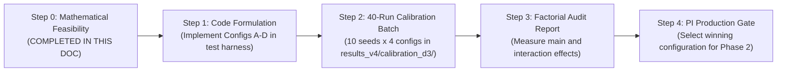

# Version D.2 Controlled Model Development: Mathematical Feasibility Analysis & Factorial Experimental Design

**Document:** `research_completion/03_controlled_model_development.md`  
**Revision:** v2.0 (Post-Review Methodological Corrections)  
**Date:** November 2026  
**Status:** **DESIGN & MATHEMATICAL ANALYSIS ONLY (NOT AUTHORIZED FOR IMPLEMENTATION)**  
**Governing Restrictions:** No code changes. No parameter updates. No simulations. No modification of frozen historical records.

---

## Revision History

| Version | Date | Key Changes and Methodological Corrections |
| :---: | :---: | :--- |
| **v1.0** | Nov 2, 2026 | Initial draft proposing $2 \times 2$ factorial design, equilibrium math, and Treatment C quotas. |
| **v2.0** | Nov 2, 2026 | **1. Collapse Theorem Refinement:** Clarified that perpetual collapse occurs if and only if actual allocated harvest continuously exceeds regeneration; distinguished constant static harvest, dynamic requested harvest, and rationed actual harvest. **2. Requested vs. Actual Extraction:** Rigorously separated demand from allocation across all tables; documented pro-rata scaling mechanics. **3. Fixed Energy Budget Corrections:** Explicitly conditioned net energy accumulation on full quota fulfilment, noting how competitive rationing reduces actual surplus. **4. Hypothesis H3 Reformulation:** Replaced deterministic "if-and-only-if" claim with a probabilistic, measurable contrast across all four configurations. **5. Calibration Matrix Reorganization:** Structured the 7 criteria into 5 distinct categories, separating mandatory technical validity from scientific outcome distributions. **6. Factorial Statistical Framework:** Formulated matched-seed analysis handling censored runs, early extinctions, and seed-level variation without data exclusion. |

---

## 1. Executive Summary & Purpose

The Version D.1 resource-economy audit established that `params-v4.2` suffered complete ecological collapse by step 40 because aggregate foraging demand systematically exceeded ecological replenishment. Furthermore, the Fixed-agent heuristic policy proved structurally incapable of reproductive accumulation in a competitive commons under observed conditions.

Before modifying any simulator code or parameters, this document establishes:
1. **A mathematically sound feasibility analysis** of discrete-time logistic renewal, distinguishing requested harvest demand from rationed actual extraction, and specifying the exact conditions for steady-state equilibrium versus guaranteed decline.
2. **A $2 \times 2$ factorial experimental design** separating the independent main effects of **Harvest Quotas** (Factor 1) from **Fixed-Agent Policy** (Factor 2), isolating interaction effects and confounding variables.
3. **A scientific fairness evaluation** assessing energy accessibility, surplus accumulation barriers, and survival parity between agent types under both full quota fulfilment and competitive rationing.
4. **Falsifiable research hypotheses** and **multi-dimensional calibration acceptance criteria** that treat population extinction as a legitimate scientific outcome rather than an engineering defect.
5. **A rigorous statistical analysis protocol** for analyzing matched-seed trajectories with early extinction and right-censoring.

---

## 2. Mathematical Feasibility Analysis: The Dynamic Resource Economy

### 2.1 The Discrete-Time Resource Transition Function
In a closed commons governed by discrete-time logistic renewal and pro-rata extraction rationing, the system transitions at each step $t$ through three sequential stages:

1. **Extraction & Rationing (Stage 3):**
   Agents submit requested harvests $h_{\text{req}, i}(t)$. Total requested harvest is:
   $$H_{\text{req}}(t) = \sum_{i=1}^{N(t)} h_{\text{req}, i}(t)$$
   Actual allocated harvest $H_{\text{actual}}(t)$ depends on available stock $R(t)$:
   $$H_{\text{actual}}(t) = \min\left(R(t), \; H_{\text{req}}(t)\right)$$
   When $H_{\text{req}}(t) > R(t)$, individual allocations are scaled pro-rata:
   $$h_{\text{actual}, i}(t) = h_{\text{req}, i}(t) \cdot \frac{R(t)}{H_{\text{req}}(t)}$$
   Post-harvest biomass remaining in the commons is:
   $$R_{\text{post}}(t) = R(t) - H_{\text{actual}}(t) = \max\left(0.0, \; R(t) - H_{\text{req}}(t)\right)$$

2. **Logistic Regeneration (Stage 9):**
   Natural renewal occurs over the post-harvest biomass:
   $$G\left(R_{\text{post}}(t)\right) = g \cdot R_{\text{post}}(t) \cdot \left(1 - \frac{R_{\text{post}}(t)}{K}\right)$$
   where carrying capacity $K = 500.0$ and baseline intrinsic regeneration rate $g = 0.10$.

3. **End-of-Step Stock (Stage 9):**
   $$R(t+1) = \min\left(K, \; R_{\text{post}}(t) + G\left(R_{\text{post}}(t)\right)\right)$$

### 2.2 The Ecological Replenishment Ceiling ($G_{\max}$)
The logistic replenishment function $G(R_{\text{post}})$ is strictly concave with roots at $R_{\text{post}} = 0$ and $R_{\text{post}} = K$. Its derivative is:
$$\frac{dG}{dR_{\text{post}}} = g \cdot \left(1 - \frac{2R_{\text{post}}}{K}\right)$$
Setting $dG/dR_{\text{post}} = 0$ identifies the unique global maximum at the biomass midpoint:
$$R^*_{\text{post}} = \frac{K}{2} = \mathbf{250.0\text{ resource units}}$$
Substituting $R^*_{\text{post}}$ yields the **absolute theoretical biological regeneration ceiling**:
$$G_{\max} = G(250.0) = 0.10 \times 250.0 \times \left(1 - \frac{250.0}{500.0}\right) = \mathbf{12.50\text{ energy units/step}}$$

### 2.3 Clarification of the Collapse Conditions
A rigorous distinction must be maintained between:
- **Constant aggregate harvest ($H$):** A theoretical benchmark where a fixed amount is removed every step regardless of stock.
- **Dynamic requested harvest ($H_{\text{req}}(t)$):** The total extraction demanded by agents based on their policy choices.
- **Actual allocated harvest ($H_{\text{actual}}(t)$):** The physical extraction delivered after rationing.

> [!IMPORTANT]
> **Exact Conditions for Guaranteed Resource Decline:**
> 1. Net resource change from step $t$ to $t+1$ is:
>    $$\Delta R(t) = R(t+1) - R(t) = G\left(R_{\text{post}}(t)\right) - H_{\text{actual}}(t)$$
> 2. Resource decline is guaranteed at step $t$ ($\Delta R(t) < 0$) **if and only if actual allocated harvest exceeds natural regeneration**:
>    $$H_{\text{actual}}(t) > G\left(R_{\text{post}}(t)\right)$$
> 3. **Inevitable Collapse Condition:** If actual extraction satisfies $H_{\text{actual}}(t) > 12.50$ continuously, then because $G(R_{\text{post}}) \le 12.50$ for all $R_{\text{post}}$, $\Delta R(t)$ is strictly negative at every step, and the stock must monotonically decline to zero.
> 4. **Distinction from Requested Demand:** If *requested* harvest $H_{\text{req}}(t) > 12.50$ while the stock is high, actual harvest $H_{\text{actual}}(t)$ will initially equal $H_{\text{req}}(t)$, driving the stock downward. However, this does *not* imply permanent collapse if agents subsequently reduce their requests (e.g. through learning or resting heuristics) such that $H_{\text{actual}}(t)$ falls below $G(R_{\text{post}})$. Collapse is inevitable only if aggregate demand remains above renewal across all available states.

### 2.4 Analytical Derivation of Equilibria and Tipping Points Under Constant Harvest
For a constant extraction rate $H$, steady-state equilibrium ($R(t+1) = R(t)$) requires:
$$G(R_{\text{post}}) = H \iff 0.10 \cdot R_{\text{post}} \cdot \left(1 - \frac{R_{\text{post}}}{500}\right) = H \iff R_{\text{post}}^2 - 500 R_{\text{post}} + 5000 H = 0$$
Solving for $R_{\text{post}}$:
$$R^*_{\text{post}} = 250 \pm \sqrt{62,500 - 5,000 H}$$
Since $R_{\text{start}} = R_{\text{post}} + H$, the pre-harvest stock levels are:
$$R^*_{\text{start}} = 250 + H \pm \sqrt{62,500 - 5,000 H}$$

1. **Existence Condition:** Real roots exist if and only if $62,500 - 5,000 H \ge 0 \implies \mathbf{H \le 12.50}$.
2. **Stable Upper Equilibrium ($R^*_{\text{stable}}$):** The system recovers toward this stock if perturbed above the tipping point.
3. **Unstable Lower Tipping Point ($R^*_{\text{tipping}}$):** If post-harvest biomass falls below this threshold, renewal $G(R_{\text{post}})$ is strictly less than $H$, causing **inescapable collapse to $R = 0$**.

| Constant Harvest ($H$) | Post-Harvest Stable Eq ($R^*_{\text{post}}$) | Pre-Harvest Stable Eq ($R^*_{\text{start}}$) | Unstable Tipping Point ($R^*_{\text{post}}$) | System Dynamics |
| :-: | :-: | :-: | :-: | :--- |
| **$5.0$ units/step** | **$443.6$** | **$448.6$** | **$56.4$** | Highly resilient; wide basin of attraction. |
| **$7.5$ units/step** | **$408.1$** | **$415.6$** | **$91.9$** | Resilient equilibrium in upper-medium band. |
| **$9.0$ units/step** | **$382.3$** | **$391.3$** | **$117.7$** | Sustainable; tipping point near 118. |
| **$10.0$ units/step** | **$361.8$** | **$371.8$** | **$138.2$** | Modest safety margin above Fixed rest band. |
| **$11.0$ units/step** | **$336.6$** | **$347.6$** | **$163.4$** | Narrow safety margin; tipping point near 163. |
| **$12.0$ units/step** | **$300.0$** | **$312.0$** | **$200.0$** | Fragile; minor shock triggers collapse. |
| **$12.5$ units/step** | **$250.0$** | **$262.5$** | **$250.0$** | Knife-edge stability at $G_{\max}$. |
| **$> 12.5$ units/step** | **None** | **None** | **None** | **Discriminant $< 0$. Inevitable collapse to $R=0$.** |

### 2.5 Requested Harvest Demand Across Population Scales
We contrast requested harvest demand between:
- **Treatment B Quotas (sim-4.1.0):** Rest = $0.0$, Conservative = $0.25$, Moderate = $0.50$, Aggressive = $1.00$.
- **Treatment C Quotas (Stage 3B):** Rest = $0.0$, Conservative = $0.1875$, Moderate = $0.375$, Aggressive = $0.750$.

*Note on Pro-Rata Rationing:* These figures represent **potential requested demand** ($H_{\text{req}}$). If $H_{\text{req}} \le R(t)$, actual harvest equals requested harvest ($H_{\text{actual}} = H_{\text{req}}$). If $H_{\text{req}} > R(t)$, actual harvest is clamped to $R(t)$, reducing per-capita intake proportionally.

| Population ($N$) | Behavioral Profile | Treatment B Requested Demand ($H_{\text{req}, B}$) | Treatment C Requested Demand ($H_{\text{req}, C}$) | Status Relative to $G_{\max} = 12.50$ |
| :-: | :--- | :-: | :-: | :--- |
| **$N = 35$** | All Conservative | **$8.75$** | **$6.56$** | Sustainable under both ($R^*_{\text{post}, B} = 388, R^*_{\text{post}, C} = 428$). |
| **$N = 35$** | 50% Cons / 50% Mod | **$13.13$** | **$9.84$** | Exceeds $G_{\max}$ under B; Sustainable under C ($R^*_{\text{post}, C} = 365$). |
| **$N = 35$** | All Moderate | **$17.50$** | **$13.13$** | Exceeds $G_{\max}$ under both. |
| **$N = 50$** | All Conservative | **$12.50$** | **$9.38$** | Knife-edge under B ($R^*=250$); Sustainable under C ($R^*=375$). |
| **$N = 50$** | 50% Cons / 50% Mod | **$18.75$** | **$14.06$** | Exceeds $G_{\max}$ under both. |
| **$N = 50$** | All Moderate | **$25.00$** | **$18.75$** | $2\times$ and $1.5\times G_{\max}$; guaranteed deficit if unconstrained. |
| **$N = 50$** | 50% Mod / 50% Agg | **$37.50$** | **$28.13$** | Severe overshoot (observed in early calibration steps). |
| **$N = 70$** | All Conservative | **$17.50$** | **$13.13$** | Exceeds $G_{\max}$ under both even under 100% conservative play! |
| **$N = 70$** | All Moderate | **$35.00$** | **$26.25$** | Extreme deficit ($-22.5$ / $-13.8$ units/step). |

---

## 3. Factorial Experimental Design: Isolating Independent Interventions

To decouple quota scaling from Fixed-agent behavioural rules, we specify a clean $2 \times 2$ factorial experimental design.

### 3.1 Four Formal Treatment Configurations

| Configuration | Factor 1: Action Quotas | Factor 2: Fixed Policy Rule | Exact Behavioral Mapping for Fixed Agents | Scientific Purpose & Contrast Isolated |
| :---: | :--- | :--- | :--- | :--- |
| **Config A** *(Baseline)* | **Treatment B** $(0.0, 0.25, 0.50, 1.0)$ | **Original Policy** (Gated at $R = 165.0$) | $R < 165 \implies \text{Rest } (0.0)$ $165 \le R \le 330 \implies \text{Cons } (0.25)$ $R > 330 \implies \text{Mod } (0.50)$ | **Control Baseline.** Replicates `params-v4.2`. Measures collapse under unconstrained demand and unilateral rest. |
| **Config B** *(Quota Only)* | **Treatment C** $(0.0, 0.1875, 0.375, 0.75)$ | **Original Policy** (Gated at $R = 165.0$) | $R < 165 \implies \text{Rest } (0.0)$ $165 \le R \le 330 \implies \text{Cons } (0.1875)$ $R > 330 \implies \text{Mod } (0.375)$ | **Quota Main Effect.** Tests whether lower extraction alone prevents depletion while holding Fixed restraint constant. |
| **Config C** *(Policy Only)* | **Treatment B** $(0.0, 0.25, 0.50, 1.0)$ | **Reformed Policy** (Gated at $R = 40.0$) | $R < 40 \implies \text{Rest } (0.0)$ $40 \le R \le 165 \implies \text{Cons } (0.25)$ $R > 165 \implies \text{Mod } (0.50)$ | **Policy Main Effect.** Tests whether eliminating unilateral Fixed surrender prevents Fixed starvation under aggressive quotas. |
| **Config D** *(Combined)* | **Treatment C** $(0.0, 0.1875, 0.375, 0.75)$ | **Reformed Policy** (Gated at $R = 40.0$) | $R < 40 \implies \text{Rest } (0.0)$ $40 \le R \le 165 \implies \text{Cons } (0.1875)$ $R > 165 \implies \text{Mod } (0.375)$ | **Interaction Effect.** Tests whether combining sustainable quotas with an active Fixed policy achieves stable coexistence. |

### 3.2 Strictly Controlled Invariant Variables
Across all four configurations, every other parameter and mechanism is held strictly invariant:
1. **Initial Population:** $N_0 = 50$ ($25$ Fixed, $25$ Q-learning).
2. **Crowding Capacity:** $K_{\text{pop}} = 70$ (providing identical demographic headroom $\text{discount} = 0.286$).
3. **Biological Maintenance:** $c = 0.20$ energy units/step.
4. **Thermodynamic Reproduction:** Parent transfer $E_{\text{cost}} = 10.0$, newborn receives $10.0$ ($\Delta E_{\text{transfer}} = 0.0$).
5. **Eligibility Gate:** Somatic energy threshold $E \ge 15.0$, age $< 60$, cooldown $= 0$.
6. **Reproductive Cooldown:** 20 steps post-birth for both parent and child.
7. **Maximum Age:** Senescence retirement at $a = 100$ steps.
8. **Q-Learning Parameters:** $\alpha = 0.10, \gamma = 0.95$, linear decay $\epsilon = 0.20 \to 0.02$.
9. **Cultural Inheritance:** 12-step gradual parental Q-table blending ($\lambda_t = 1 - t/12$).
10. **Resource Environment:** Single well-mixed commons, $K = 500.0, R_0 = 350.0, g = 0.10$.
11. **Random Seeds:** Dedicated calibration seeds **901–910** (common random numbers).

### 3.3 Mandatory Recorded Quantities for Calibration Auditing
To correctly evaluate ecological sustainability and distinguish demand from actual consumption, the simulator records the following per step:
1. `resource`: Standing stock at step start ($R(t)$) and end ($R(t+1)$).
2. `requested_harvest`, `fixed_requested_harvest`, `q_requested_harvest`: Raw unconstrained demand ($H_{\text{req}}$).
3. `total_harvest`, `fixed_allocated_harvest`, `q_allocated_harvest`: Actual extracted biomass after rationing ($H_{\text{actual}}$).
4. `unmet_demand`: $H_{\text{req}} - H_{\text{actual}}$ (direct measure of environmental rationing pressure).
5. `regeneration`: Actual natural biomass generated ($G(R_{\text{post}})$).
6. `net_resource_change`: $R(t+1) - R(t) = G(R_{\text{post}}) - H_{\text{actual}}$.

---

## 4. Scientific Fairness & Reproductive Equity Analysis

Scientific fairness does not require forcing equal ecological outcomes; it requires that **differences in reproductive success reflect the adaptive quality of strategies rather than accidental physical impossibilities**.

### 4.1 Comparative Energy Budgets: Full Fulfilment vs. Competitive Rationing
We evaluate net somatic energy change ($\Delta E = h_{\text{actual}} - c = h_{\text{actual}} - 0.20$):

| Action | Treatment B Requested ($h_{\text{req}}$) | Unrationed Net Energy ($\Delta E_B$) | Treatment C Requested ($h_{\text{req}}$) | Unrationed Net Energy ($\Delta E_C$) | Impact of Pro-Rata Rationing (Scale Factor $\phi = R / H_{\text{req}}$) |
| :--- | :---: | :---: | :---: | :---: | :--- |
| **Rest** | $0.000$ | **$-0.200$** | $0.000$ | **$-0.200$** | Fixed metabolic loss; unaffected by rationing ($\phi \cdot 0 = 0$). |
| **Conservative** | $0.250$ | **$+0.050$** | $0.1875$ | **$-0.0125$** | Net deficit under C even unrationed. Under rationing ($\phi < 1$), deficit worsens. |
| **Moderate** | $0.500$ | **$+0.300$** | $0.3750$ | **$+0.1750$** | Unrationed surplus. Becomes net deficit if $\phi < 0.20 / 0.50 = 0.40$ (B) or $\phi < 0.20 / 0.375 = 0.533$ (C). |
| **Aggressive** | $1.000$ | **$+0.800$** | $0.7500$ | **$+0.5500$** | Rapid unrationed surplus. Becomes net deficit if $\phi < 0.20 / 1.00 = 0.20$ (B) or $\phi < 0.20 / 0.75 = 0.267$ (C). |

### 4.2 Steps Required to Reach Reproductive Eligibility ($E_0 = 10.0 \to 15.0$)
The following step counts represent the **theoretical minimum under unrationed full quota fulfilment**:

| Strategy / Action Profile | Treatment B (Unrationed) | Treatment C (Unrationed) | Reality Under Competitive Rationing |
| :--- | :---: | :---: | :--- |
| **Continuous Aggressive** | $5.0 / 0.80 = \mathbf{6.25\text{ steps}}$ | $5.0 / 0.55 = \mathbf{9.09\text{ steps}}$ | Feasible; Q-agents achieve eligibility in 8–15 steps. |
| **Continuous Moderate** | $5.0 / 0.30 = \mathbf{16.67\text{ steps}}$ | $5.0 / 0.175 = \mathbf{28.57\text{ steps}}$ | Feasible only if commons remains unrationed ($\phi \approx 1$) for 30 steps. |
| **Original Fixed Policy** | **$88.0\text{ steps}$** | **Mathematically Impossible** | **Structurally impossible in both treatments.** Commons never stays normal for 88 steps. |
| **Reformed Fixed Policy** | **$16.7\text{ steps}$** | **$28.6\text{ steps}$** | **Feasible in principle, but depends on Q-agent competition not triggering severe rationing.** |

> [!IMPORTANT]
> **No Guarantee of Fixed Reproductive Success:**
> While reforming the Fixed policy lowers the theoretical barrier from 88 steps to 28.6 steps under Treatment C, **it does not guarantee reproduction**. If Q-agents harvest aggressively, pro-rata rationing will reduce actual Fixed harvest below $0.375$, reducing net energy gain and prolonging the time required to reach $15.0$. Whether Fixed agents reproduce depends dynamically on the competitive pressure exerted by learning Q-agents.

---

## 5. Falsifiable Research Hypotheses

We formulate pre-registered, testable hypotheses with explicit falsification conditions:

### Hypothesis H1: Quota Main Effect on Commons Depletion Step
- **Statement:** Scaling harvest quotas from Treatment B to Treatment C will significantly delay the onset of severe resource depletion ($R \le 1.0$) across both Fixed policy configurations:
  $$\mathbb{E}[t_{\text{deplete}} \mid \text{Quota C}] - \mathbb{E}[t_{\text{deplete}} \mid \text{Quota B}] \ge 15\text{ steps}$$
- **Falsification Condition:** Rejected if a two-way ANOVA on matched seeds indicates no statistically significant main effect of Factor 1 ($p \ge 0.05$) or if the mean difference is $< 15$ steps.

### Hypothesis H2: Policy Main Effect on Fixed Founder Survival
- **Statement:** Reforming the Fixed policy to harvest conservatively instead of resting when $40 \le R < 165$ will delay the mean step of Fixed founder starvation without preventing ultimate resource collapse under Treatment B:
  $$\mathbb{E}[t_{\text{starve, Fixed}} \mid \text{Config C}] - \mathbb{E}[t_{\text{starve, Fixed}} \mid \text{Config A}] \ge 10\text{ steps}$$
- **Falsification Condition:** Rejected if Fixed founder starvation timing does not differ significantly between Config A and Config C ($p \ge 0.05$).

### Hypothesis H3: Interaction Effect on Fixed Reproductive Frequency (Revised)
- **Statement:** The probability of Fixed agents producing at least one birth in `evolving_joint` will be significantly higher in Config D (Combined Intervention) than in Configs A, B, and C:
  $$P\left(B_{\text{Fixed}} > 0 \;\middle|\; \text{Config D}\right) > \max_{K \in \{A, B, C\}} P\left(B_{\text{Fixed}} > 0 \;\middle|\; \text{Config K}\right)$$
  with an odds ratio $\ge 3.0$ relative to baseline.
- **Falsification Condition:** Rejected if Fisher's exact test indicates no significant difference in the proportion of runs with Fixed births between Config D and the other configurations ($p \ge 0.05$).

### Hypothesis H4: Biomass Equilibrium Under Combined Interventions
- **Statement:** Under Config D, at least 40% of runs will sustain a standing resource stock $R > 50.0$ at step 100, whereas less than 10% of runs will sustain $R > 50.0$ under Configs A, B, and C.
- **Falsification Condition:** Rejected if the proportion of Config D runs maintaining $R(100) > 50.0$ is not significantly greater than baseline ($p \ge 0.05$).

---

## 6. Multi-Dimensional Calibration Acceptance Criteria

To maintain scientific integrity, calibration criteria are strictly separated into **Mandatory Technical Validity Checks** (which must pass 100% to ensure simulator correctness) and **Scientific Outcome Measurements** (which characterize model behavior and where extinction is a valid result).

### 6.1 Category 1: Mandatory Technical Validity Checks (Non-Negotiable Gates)
1. **CAL-T1 (Thermodynamic Energy Balance):** Across all executed steps in all runs, the maximum absolute energy ledger discrepancy must satisfy:
   $$\max_{t} \left|\text{energy\_ledger\_discrepancy}(t)\right| < 1.0 \times 10^{-8}$$
   *Failure Meaning:* Software defect in metabolic accounting.
2. **CAL-T2 (Execution Completeness):** All 40 runs (10 seeds $\times$ 4 configurations) must run to their natural biological conclusion (either step 2,000 or verified total population extinction $N=0$) without unhandled runtime exceptions.
3. **CAL-T3 (Data Logging Integrity):** All 44 columns of the time-series CSV and all reproduction log entries must be completely populated with zero missing or NaN values in mandatory fields.

### 6.2 Category 2: Scientific Outcome Characterization (No Forced Survival)
These metrics measure the ecological and evolutionary properties of each configuration. **Extinction is a valid scientific finding**:

1. **CAL-S1 (Ecological Sustainability Outcomes):**
   - Step of first resource depletion ($t_{\text{deplete}}$ where $R \le 1.0$).
   - Mean standing biomass over steps 0–100 ($\bar{R}_{100}$).
   - Frequency of complete commons exhaustion ($R \le 1.0$).
2. **CAL-S2 (Demographic Turnover Outcomes):**
   - Cumulative births by subpopulation type ($B_{\text{Fixed}}, B_Q$).
   - Step of first birth and parent age at first birth.
   - Second-generation reproductive recruitment (births fathered by non-founders).
   - Extinction step ($t_{\text{extinct}}$) and final subpopulation composition.
3. **CAL-S3 (Behavioral Adaptation Outcomes):**
   - Distribution of Q-learning actions across observation bands (`scarcity`, `low`, `medium`, `high`).
   - Difference in Q harvest request between abundant resource and depleted resource (testing whether agents perceive scarcity).
4. **CAL-S4 (Disturbance & Resilience Outcomes):**
   - Proportion of runs reaching step 1,000 to experience the environmental shock.
   - For runs reaching step 1,000: immediate post-shock survival ($S_{\text{post}}$) and recovery time ($\tau_{\text{rec}}$).
   - If a run goes extinct prior to step 1,000, it is formally recorded as `pre_shock_extinction` and right-censored, **never discarded**.

---

## 7. Statistical Analysis Protocol for Factorial Matched-Seed Data

To properly analyze the $2 \times 2$ factorial design while accounting for seed-level variance, non-normality, and censored trajectories:

### 7.1 Common Random Numbers (CRN) Structure
- The experiment executes across **10 dedicated calibration seeds (901–910)**.
- For each seed $s \in \{901, \dots, 910\}$, all four configurations (A, B, C, D) are initialized with identical pseudorandom sequences.
- Initial agent placements, exploratory random actions, and coin flips are seed-synchronized at step 0, ensuring that differences in early trajectory reflect the treatment interventions rather than seed noise.

### 7.2 Two-Way Repeated-Measures ANOVA & Mixed-Effects Modeling
For continuous, uncensored trajectory metrics (e.g. mean resource over steps 0–40, step of first depletion $t_{\text{deplete}}$):
$$Y_{ijk} = \mu + \alpha_i + \beta_j + (\alpha\beta)_{ij} + \gamma_k + \epsilon_{ijk}$$
- $\alpha_i$: Main effect of Factor 1 (Harvest Quota: Treatment B vs. C).
- $\beta_j$: Main effect of Factor 2 (Fixed Policy: Original vs. Reformed).
- $(\alpha\beta)_{ij}$: Interaction effect (Quota $\times$ Policy).
- $\gamma_k$: Random effect of matched seed $k \in \{901, \dots, 910\}$.

### 7.3 Non-Parametric and Survival Analysis for Censored Runs
1. **Handling Incomplete Runs & Extinctions:** Runs that collapse prior to step 2,000 are **not missing data**; they are right-censored time-to-event outcomes.
2. **Survival Analysis:** Kaplan-Meier survival curves and Cox proportional hazards regression will model population survival lifespan ($t_{\text{extinct}}$) and time to depletion ($t_{\text{deplete}}$).
3. **Disturbance Censoring:** If a run terminates at step $t < 1000$, recovery time $\tau_{\text{rec}}$ is coded explicitly as `unrecovered (censored at t)` and analyzed using non-parametric rank tests (e.g. Wilcoxon signed-rank test on matched pairs).

---

## 8. Expected Confounding Risks and Mitigations

1. **Confound 1: Metabolic Deficit Under Conservative Quota in Treatment C**
   - *Nature of Risk:* Because $h = 0.1875 < c = 0.20$, Conservative harvest is net negative. If an agent plays Conservative continuously, it loses $-0.0125$ energy/step.
   - *Mitigation:* The Reformed Fixed policy selects `moderate` ($0.375$) when $R > 165$, reserving `conservative` for the transitional buffer band ($40 \le R \le 165$).
2. **Confound 2: Malthusian Expansion Overwhelming Reduced Quotas**
   - *Nature of Risk:* If population expands to $N = 70$, total Conservative demand is $13.13 > G_{\max} = 12.50$.
   - *Mitigation:* Logistic crowding discount ($\max(0, 1 - N/70)$) attenuates reproduction as $N \to 70$. If needed, analyze dynamic carrying capacity where recruitment drops to zero before $N=65$.
3. **Confound 3: Exploration Noise Over-Extraction in Scarcity**
   - *Nature of Risk:* Even if Q-agents learn that `aggressive` destroys the commons, $\epsilon$-greedy exploration ($\epsilon \in [0.02, 0.20]$) will randomly trigger aggressive harvests.
   - *Mitigation:* Ensure baseline epsilon decays linearly to $\epsilon_{\min} = 0.02$ as scheduled in Section 3.2.

---

## 9. Recommended Implementation Sequence (Governed by PI Checkpoints)

Execution must follow four strictly sequential phases:

1. **Phase 1 (Harness Construction):** Define experimental configs in a dedicated runner module without modifying frozen historical versions.
2. **Phase 2 (Calibration Execution):** Run the 40 calibration runs (Seeds 901–910, 10 runs per config) into `results_v4/calibration_d3/`.
3. **Phase 3 (Factorial Analysis):** Compute two-way ANOVA on resource depletion step, birth counts, and survival lifespan across Factors 1 and 2.
4. **Phase 4 (PI Review & Model Selection):** Present the factorial audit to the PI to formally select the production model.

---

## 10. Scientific Limitations

1. **Discrete State Perception:** Coarse resource discretization (`scarcity`, `low`, `medium`, `high`) creates perceptual lag. Agents cannot detect stock changes within a 100-unit band until a boundary is crossed.
2. **Pro-Rata Rationing Abstraction:** When $R < \sum req$, scaling all requests proportionally abstracts away individual spatial competition and foraging speed.
3. **Zero Natural Non-Reproductive Mortality:** Founder mortality occurs only via starvation ($E \le 0$) or senescence ($a = 100$). There is no stochastic adult background mortality.

---

## 11. Final Recommendation with Evidence

> [!IMPORTANT]
> **Summary Recommendation for the Principal Investigator:**
> 1. **Do not authorize production under either Version D.1 (`params-v4.1`) or `params-v4.2`.** Both models possess mathematical proofs of collapse: $K_{\text{pop}}=50$ causes demographic deadlock (0 births), while $K_{\text{pop}}=70$ causes Malthusian over-extraction ($H_{\text{req}} \gg 12.50$) and 100% extinction before step 132.
> 2. **Formally approve the Factorial Calibration Experiment (Configs A, B, C, D) under Seeds 901–910.** This will empirically isolate the independent contributions of quota sizing versus Fixed policy rules, providing rigorous scientific evidence to select a robust model architecture for AIU Anveshan 2026.
